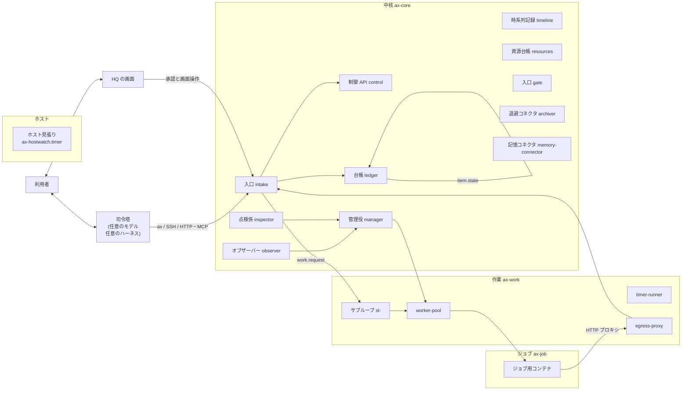
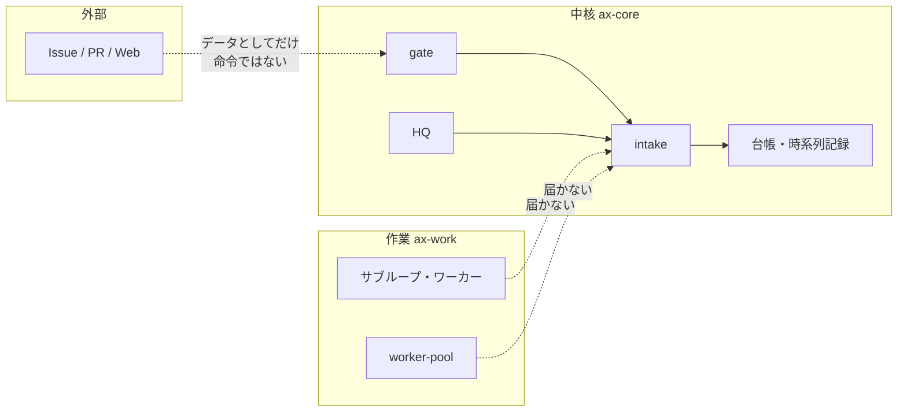
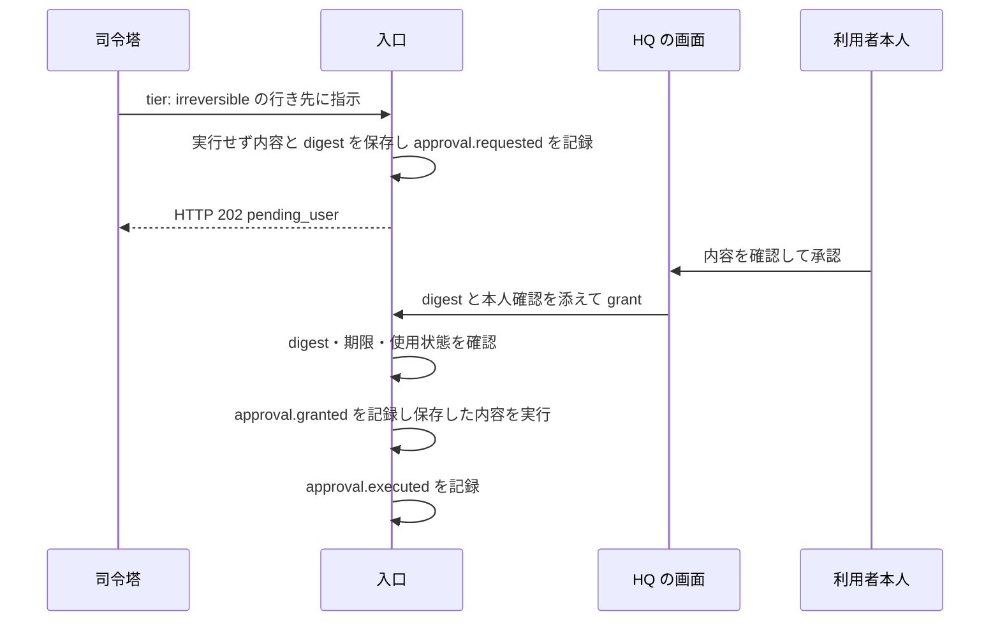

# 構成：部品と網と流れ

この文書は AX の部品、ネットワーク、依頼の流れを説明します。

> 概要（3行）
> AX は中核の部品と、制御を受けるプラグイン（サブループ、資源、タイマー）でできています。部品は網で分けられ、作業側の部品は入口と中核の書き込み系に届きません。依頼は入口を通って行き先へ届き、結果は台帳にカードとして残ります。

## 目次

- [1. 全体像](#1-全体像)
- [2. 部品と役割](#2-部品と役割)
- [3. 四つの網](#3-四つの網)
- [4. 信頼ゾーン](#4-信頼ゾーン)
- [5. 依頼から結果までの流れ](#5-依頼から結果までの流れ)
- [6. 記録と状態の置き場](#6-記録と状態の置き場)
- [7. 外へ見える口](#7-外へ見える口)
- [8. 止まるときの動き](#8-止まるときの動き)
- [9. 構成の目安](#9-構成の目安)

## 1. 全体像

利用者は司令塔と会話します。司令塔は `ax` コマンドか SSH か tailnet 経由で入口に依頼を送ります。入口は検証して行き先へ渡します。行き先は中核の部品かサブループです。長い作業はサブループのジョブか worker-pool のジョブになります。終わると結果は時系列記録と台帳に残ります。点検と警報は常駐の部品が回します。

絵では中核と作業側とジョブの網を分けてあります。詳しくは [3. 四つの網](#3-四つの網) を見てください。

## 2. 部品と役割

部品は三つの層に分かれます。入力を受ける入口が一つあります。判断と記録を行う中核の部品があります。制御を受けるプラグインがあります。役割の分け方の根拠は S-1.1 です。

### 2.1 入口

| 部品 | 役割 | 責任の範囲 |
|---|---|---|
| 入口 `intake` | 司令塔と HQ からの指示を受け、検証して行き先へ渡す | 受けた指示を全部時系列記録に残す。拒否した指示と失敗した認証も残す。指示の中身は判断しない。管理役も通さない |

入口は新しいジョブを作りません。台帳に項目を作る行き先は、別の部品へ中継します。行き先の一覧は `config/intake-destinations.yaml` と `config/intake-destinations.d/` です。行き先の追加はファイルの変更だけで済みます（S-6.3）。

入口には四つの受け口があります。詳しくは [4. 信頼ゾーン](#4-信頼ゾーン) を見てください。

| 受け口 | 来る人 | 確かめる物 |
|---|---|---|
| `local` | 同じホストの司令塔 | 司令塔のユーザーだけが開ける Unix ソケット。接続元の uid が司令塔のユーザーであること |
| `ssh` | 別の端末の司令塔 | sshd が確かめた席の公開鍵と席のソケットの接続元の uid が `ax-seat` であること |
| `tailnet` | 別の端末の司令塔 | 接続元の tailnet 端末と、その端末に結び付いた Bearer トークン。入口 `gate` が中継する |
| `hq` | HQ の画面 | HQ の専用ソケットの接続元の uid が `ax-hq` であること。利用者の tailnet 身元も添えてあること |

コード：`core/intake/`（`app.py`、`registry.py`、`idempotency.py`、`audit.py`）。

### 2.2 中核の部品

| 部品 | 役割 |
|---|---|
| 制御 API `control` | プラグインの登録簿と、制御命令の検証と適用と期限管理を行う。読み取り専用の検証 `POST /v1/validate` も持つ |
| 時系列記録 `timeline` | 追記だけの事象の記録。書き換えと削除の API を持たない |
| 台帳 `ledger` | 利用者を待つカード（ToDo）の台帳。遷移の表にない遷移を拒否する |
| 資源台帳 `resources` | モデルの登録簿と実行環境の台帳を持ち、状態を保つ。選び方も持つ。S-25 の環境の選び方もここに置く |
| 管理役 `manager` | 事象を受けて1周回で判断する。許された操作だけを API で実行する |
| オブザーバー `observer` | 健康を見るだけの部品。LLM を使わない。検査で警報を出す。警報は重複除去して出す |
| 点検係 `inspector` | 定期点検を回す部品。間隔と段を保つ |
| 予備役 | 管理役が不調なときに、オブザーバーが呼ぶ側のモデル。管理役と同じ入力と操作で1回起動する。根本原因の ToDo を必ず作る |
| 入口 `gate` | tailnet 側の HTTP と MCP を受ける入口。中継するだけで、席の台帳は持たない |
| HQ | 利用者の画面。照会だけを行う。書き込みはすべて入口に出す |
| 記憶コネクタ `memory-connector` | 共有記憶への書き込みの窓口。送る前に記録の必須項目と秘密検査を通す |
| 退避コネクタ `archiver` | 各ボリュームの `archive/` を退避先へ転送する。内容を照合するまで元を消さない |

コード：`core/control/`、`core/timeline/`、`core/ledger/`、`core/resources/`、`core/manager/`、`core/observer/`（`standby/` に予備役の周回があります）、`core/inspector/`、`core/gate/`、`core/hq/`、`core/archiver/`、`core/memory-connector/`。

### 2.3 プラグイン

| 種類 | 動かし方 | 例 |
|---|---|---|
| サブループ `subloop` | グラフを走らせ、1周回で項目を処理する | 標準の `work-tdd`、GitHub の変更受付の `change`、公開の `release` |
| 資源 `resource` | ジョブを受けてモデルを選んで実行する | `worker-pool`、資源台帳の宣言 `resources` |
| タイマー `timer` | 決まった時刻か間隔で1つの作業を起こす。1つの専用コンテナを持たない | `timer-runner` が動かす各処理。集中状態の取り込み処理 `hibi-state` もこれです |

サブループには種類があります。入口から項目を受け取れる物があります。`work-tdd` がその例です。部品庫はサブループの1ノードの実装です。単独では動きません。サブループの中でだけ動きます。

プラグインには宣言があります。宣言は `plugins/<種類>/<id>/manifest.yaml` です。登録簿は `plugins/registry.yaml` です。読み方と作り方は README の「拡張点」を見てください。

コード：`plugins/subloop/`、`plugins/resource/`、`runtime/subloop/`、`runtime/timer_runner/`、`templates/subloop/`。

### 2.4 ホスト側

| 部品 | 役割 |
|---|---|
| ホスト見張り | systemd の timer が動かすスクリプト。止まっている部品を起動し直す。コンテナの外で動く |
| ホストのスクリプト | `host/ax-up.sh` が部品を起動する。`host/ax-env.sh` が設定ファイルを作る。`host/ax-fw.sh` が firewall の規則を作る |

ホスト側のスクリプトだけが特権操作（docker、systemd）を行います。コンテナに Docker のソケットも sudo も渡しません。特権操作は利用者のパスワードなし sudo（`sudo -n`）で直接行います。

コード：`host/`（`ax-up.sh`、`ax-env.sh`、`ax-fw.sh`、`ax-hostwatch.sh`、`ax-hostwatch.timer`）。

### 2.5 部品の約束

部品同士の約束は次の五つです。

| 約束 | 内容 |
|---|---|
| 通信の形 | HTTP と JSON。文字コードは UTF-8。ID は ULID。時刻は UTC の RFC 3339（ミリ秒まで） |
| 境界 | 部品が別の部品のデータベースやファイルを直接読み書きしない。共有するのは API だけ |
| 待ち | 待ちに期限のない処理を作らない。待つ処理は必ず期限を持つ |
| 未到達 | 送り先の中核に届かないとき、送る側は自分のボリュームに溜める。届くようになったら順に送る。届かないことを理由に自分の処理を止めない |
| 形式 | すべての API は `GET /healthz` を持ち、`{"ok":true,"component":"<名前>","version":"<版>"}` を返す |

すべての部品は起動時と心拍の間隔ごとに `health.beat` を時系列記録へ書きます。コネクタは送れないときにボリュームの `outbox/` に溜め、戻ったら送ります。

共通の部品庫は `axcommon` です。`/healthz` と心拍の骨組み、事象の組み立て、スキーマの検証、資格の読み込み、秘密検査を含みます。

コード：`axcommon/`（`http.py`、`events.py`、`schemas.py`、`creds.py`、`redact.py`、`policy.py`）。

## 3. 四つの網

compose は四つの網を持ちます。網と秘密の宣言だけを `compose.yaml` に置きます。サービスの定義は `compose.d/` に置きます。

| 網 | サブネット | ゲートウェイ | `internal` | 役割 |
|---|---|---|---|---|
| `ax-core` | `192.0.2.0/25` | `192.0.2.1` | false | 中核の網。入口と中核の書き込み系がいる |
| `ax-work` | `198.51.100.0/25` | `198.51.100.1` | false | 作業側の網。サブループとワーカーがいる |
| `ax-publish-review` | `192.0.2.128/26` | `192.0.2.129` | true | 公開前レビュー用の内部網 |
| `ax-job` | `203.0.113.0/25` | `203.0.113.1` | true | ジョブ用コンテナの網。外へ直接届かない |

`ax-job` と `ax-publish-review` は `internal: true` です。ジョブ用コンテナは外へ直接出られません。外へ出る通信は許可先を通す `egress-proxy` の中継だけを通ります。

サービスの網の所属は `docker/base.yaml` の土台で選びます。

| 土台 | 入る網 | 例 |
|---|---|---|
| `ax-core-base` | `ax-core` だけ | 入口 `intake`、管理役 `manager`、オブザーバー `observer`、点検係 `inspector`、HQ `hq`、退避コネクタ `archiver`、入口 `gate` |
| `ax-both-base` | `ax-core` と `ax-work` の両方 | 時系列記録 `timeline`、台帳 `ledger`、制御 API `control`、資源台帳 `resources`、記憶コネクタ `memory-connector`、worker-pool `worker-pool` |
| `ax-work-base` | `ax-work` だけ | サブループ `sl-<id>`、タイマーランナー `timer-runner` |

`gate` は `ax-core` の網にだけ入ります。`ax-work` と `ax-job` には入りません。

`egress-proxy` は作業とジョブの網に入ります。`ax-work` と `ax-job` の両方に入る唯一のコンテナです。`ax-core` には入らない。

### 3.1 作業側の口

両方の網に足を持つ部品は、1つのプロセスで2つの口を開きます。

| 口 | 結び付け先 | 通す物 |
|---|---|---|
| 中核の口 | `ax-core` のアドレスの 8080 | 全 API |
| 作業側の口 | `ax-work` のアドレスの 8081 | 許可した API だけ |

作業側の口が通す API は狭くなっています。時系列記録は追記と読み取りです。台帳は ToDo の作成と読み取りです。集中状態と日次状態の書き込みは、登録済みの取り込み処理 `hibi-state` の資格があるときだけです。制御 API は登録と有効な値の読み取りだけです。遷移、回答、命令の発行は通らない。

結び付け先は網のアドレスに絞ります。時系列記録は `core/timeline/netbind.py` が 8080 を `ax-core` のアドレスと 127.0.0.1 だけに、8081 を `ax-work` のアドレスだけに結び付けます。台帳と制御 API と資源台帳も同じやり方を使います。

コード：`compose.yaml`、`docker/base.yaml`、`core/timeline/netbind.py`。

### 3.2 firewall の規則

ufw の設定は `host/ax-fw.sh` を参照してください。

| 許可 | 内容 |
|---|---|
| モデルの入口 | 中核の網と作業側の網から、ホストの橋のゲートウェイへポート 3425 を開ける |
| launcher | worker-pool の固定アドレス `198.51.100.10` から、ホストの SSH ポート 22 だけを開ける |
| 環境への SSH | 資源台帳の固定アドレス `198.51.100.11` から、登録済みの環境のポートだけを開ける |
| 記憶と通知 | 中核の網から、ホスト自身の tailnet アドレスの 8377（共有記憶）と 8908（ntfy）だけを開ける |

登録済みの環境以外への SSH は、3つの橋から `tailscale0` へ送らず捨てます。退避コネクタ `archiver` の例外は1本だけです。退避先の特定のホストと特定のポートへだけ開けます。

アドレスはこの文書には書きません。`host/ax-fw.sh` が `profile` から実行のときに解決します。

## 4. 信頼ゾーン

信頼ゾーンはどこまで信用するかの線です。点は五つあります。詳しくは `docs/manual/security.md` を見てください。

| ゾーン | 誰がいるか | その線で守ること |
|---|---|---|
| 上位層 | 利用者、司令塔 | 制御を受けない。この仕組みの外で動く |
| 中核 | 入口、制御 API、時系列記録、台帳、資源台帳、管理役、オブザーバー、予備役、点検係、HQ、記憶コネクタ、退避コネクタ、ホスト見張り | 制御を受けない |
| プラグイン | 資源プラグイン（worker-pool）、サブループ、タイマー | 制御を受ける。モードと調整項目は制御 API が決める |
| 部品庫 | ノード部品（グラフの1ノードの実装） | 単独では動かない。サブループの中で動く |
| 実行環境 | SSH ホスト、Windows のデスクトップ、クラウドの使い捨て箱など | 制御を受けない。資源台帳に載る |

### 4.1 守る線

サブループとワーカーのコンテナは、入口と制御 API の書き込み系に届きません。届く先は manifest に宣言した限られた API だけです。入口と中核は受け口ごとに資格を確かめます。

### 4.2 承認の安全の境界

席の仕組み（専用ユーザー `ax-seat`、強制コマンド、段、承認）は、遠隔の席、コンテナ、利用者以外の OS ユーザー、エージェントの文章が戻しにくい操作を実行できないようにします。

守らない相手は利用者の uid で動き sudo を使える物です。ホスト上の司令塔と、対話セッションの中のワーカーと、利用者のシェルを取った者です。この者らに対しては、AX は承認を出させない保証をしません。

戻しにくい操作は段では止めません。利用者本人の承認だけが通します。段は「依頼できるか」を決める物で、実行の資格ではありません。

## 5. 依頼から結果までの流れ

### 5.1 受付と検証

司令塔の依頼は入口に届きます。入口は資格から身元を決め、検証して行き先へ渡します。検証は S-6.5 の順で行います。

| 順 | 検証 |
|---|---|
| 1 | 行き先が登録簿に載っていること |
| 2 | 許可元にその `from` があること |
| 3 | 入力の形が行き先の Schema に合うこと |
| 4 | 戻しにくい行き先なら、承認の記録か対象 repo・公開先・操作に一致する継続許可があること。許可照合が不明なら拒否する |
| 5 | 期限が過去でないこと |
| 6 | 受け口の資格が有効で、席が失効や停止や期限切れでないこと |
| 7 | 行き先の `via` にその受け口があり、`tier` が席の段以下であること |
| 8 | 運用の段以上の指示は `idempotency_key` を持ち、重複と衝突の検出を通ること |

検証に外れた指示は行き先へ渡されません。理由付きで拒否します。

### 5.2 作業の依頼

`work.request` は実装用の作業依頼です。実装の役割（`impl`、`impl_hard`）なら、標準のサブループ `work-tdd` の項目として渡します。読み取りと報告だけの役割（`summary`、`research`、`second_opinion`、`screen`、`assist`）なら、worker-pool にジョブを直接出します。

項目の渡し方は制御 API の中継を通ります。入口は `ax-core` の網にあり、`ax-work` の網のサブループへ直接つながりません。入口が制御 API の `POST /v1/plugins/work-tdd/items` を呼び、制御 API が `sl-work-tdd` の `POST /items` へ中継します（S-5.7、S-7.10）。

台帳の ToDo は入口が先に作ります。項目の `todo_id` に入ります。

### 5.3 サブループの周回

サブループはスケジュールで永久に起動します。回数の上限は持ちません。予定の時刻に起動できなかったら `missed` と書き、追いかけません。

| 状態 | 意味 |
|---|---|
| `planned` | 予定した |
| `launching` | 外へ影響する操作の直前に必ず書く |
| `submitted` | 渡した |
| `running` | 実行中 |
| `completed` | 完了 |
| `failed` | 失敗（`reason` を持つ） |
| `timed_out` | 時間切れ |
| `cancelled` | 取消（`by` を持つ） |
| `lost` | 主体の消失 |
| `skipped` | 起動しなかった |
| `ejected` | 外へ出した |
| `missed` | 予定の時刻に起動できなかった |

項目が上限に当たったら `ejected` にします。外へ出した項目の修正は、次の実行で新しい項目として拾います。

### 5.4 ワーカーのジョブ

worker-pool はジョブを受けると、登録済みの候補からモデルを選びます。LLM を使わない CI などは受けません。サブループのノードが直接行います。

ジョブは新しいコンテナで実行します。書き込めるのは作業場所だけです。秘密は manifest に書いた物だけ渡します。通信は許可先だけです。隔離を確認できなければ起動しません。ジョブを外へ出します。

selector は最低段階、利用可能系統、情報区分などで候補を絞ります。Jev の判定が有効で利用できる場合は適合した候補を使います。定額の候補を優先し、なければ単価が登録された従量課金の候補を使います。候補順は tier と役割の設定などで決まります。詳しくは [モデルの設定](configuration.md) を参照してください。モデルごとの枠は最後に原子的に確保します。

終わると worker-pool が検証を実行します。本人の合格主張は採用しません。`ok` になる条件は検証の終了コードが 0 かつ報告の `status` が `ready` であることです。manager の固定 schema 検証は worker-pool 内で実行します。二者による別系統の審査は実装中です。launcher の attest と collect は別の機能で、未接続です。

### 5.5 実行環境

実行環境は AX の外にある作業場所です。資源台帳が持ちます。サブループはノード `env.run` を出します。資源台帳が能力で環境を選んで検証します。

環境には種類があります。

| 種類 | 形 |
|---|---|
| `local` | 実行ホスト自身。ループバックの SSH で入る |
| `ssh-host` | 別のホストへの SSH |
| `container` | 別の位置のコンテナ |
| `cloud-sandbox` | クラウドの使い捨て箱 |

依頼は環境の名前ではなく能力で書きます。能力の形式と選択条件は [環境の設定](environments.md) を参照してください。

### 5.6 承認の流れ

戻しにくい操作には利用者本人の承認が必要です。

通常の承認経路は次のとおりです。実環境では各接続の状態を確認してください。

GitHub change サブループの `change.approval.record` は別の経路で、本人の判定を記録するだけです。source では HQ と intake を通じた本人承認への接続を限定試験で確認しています。記録だけで実操作が完了したとは扱わず、実操作の直前に対象の状態をオンラインで再照会します。本番での一連の動作、本人の正規ログインと通知の端末受領は未検証です。

通知 provider の受付と端末への到達は別です。端末の受領を確認できない場合、通知状態は `unknown` のままです。

承認は1件に1回だけ使えます。期限切れ、却下、取り下げ、依頼した席の失効、lockdown の間は実行しません。

## 6. 記録と状態の置き場

### 6.1 時系列記録

時系列記録は追記だけです。書き換えと削除の API を持ちません。各事象に単調に増える整数 `seq` を振ります。購読は `seq` のカーソルで行います。状態の表示用データは事象を先頭から読み直すと再現できます。

事象は `id`（ULID）、`seq`、`ts`（UTC、ミリ秒まで）、`source`（`component`、`host`、`run_id`、`node`）、`project`、`subloop`、`kind`、`subject`、`data` を持ちます。司令塔の受け口から来た事象は `source.principal`、`source.session`、`source.via` を持ちます。入力が確かめた値だけ入ります。本文の申告からは入れません。`data` に秘密を入れません。書き込み時に秘密検査を通し、当たった値は `[REDACTED]` へ置き換えます。

API は次のとおりです。

| メソッド | パス | 内容 |
|---|---|---|
| POST | `/v1/events` | 1件か配列で追記する。`id` が既にあれば無視して成功を返す |
| GET | `/v1/events?after=SEQ&kind=&subloop=&project=&subject=&limit=&wait=` | `after` より後を返す。`wait`（最大 `longpoll_s`）を付けると新事象まで待つ |
| GET | `/v1/events/{id}` | 1件 |
| GET | `/v1/projections/{name}` | 再現済みの表示用データ。`plugins`、`runs`、`jobs`、`controls`、`health` の5つ |
| POST | `/v1/export` | 範囲を指定して JSON Lines に書き出し、退避コネクタへ渡す |

投影は事象の `ts` と `data` だけを使います。現在時刻や乱数や外部の状態を使いません。そのため、同じ事象の列からは必ず同じ表になります。作り直しは `ax-admin rebuild-projections` です。詳しくは `core/timeline/admin.py` を見てください。

### 6.2 部品ごとの置き場

各部品は自分のボリュームだけを書き込みで開きます。部品が別の部品の置き場に書くことはしません。

| 部品 | ボリューム | 主な表 |
|---|---|---|
| `timeline` | `timeline-data` | 事象と投影 |
| `control` | `control-data` | 登録、命令、タイマー |
| `ledger` | `ledger-data` | ToDo と依存 |
| `resources` | `resources-data` | モデルと環境の状態 |
| `worker-pool` | `pool-data` と `work` | ジョブ。枠は起動時にジョブから作り直す |
| `sl-<id>` | `sl-<id>-data` と `work` | 実行、項目、ノード実行 |
| `manager` | `manager-data` | 購読のカーソルと判断の記録 |
| `observer` | `observer-data` | 警報の重複除去の表 |
| `inspector` | `inspector-data` | 点検の予定と結果 |
| `hq` | 名前付きボリュームなし | 照会だけ（秘密の受け口を除く） |
| `memory-connector` | `memory-data` | 送った記録の ID |
| `archiver` | 各部品の `archive/` | 移した記録 |
| `egress-proxy` | なし | なし |

退避は削除の代わりに行います。退避コネクタ `archiver` だけが各ボリュームの `archive/` を書き込みで開きます。

### 6.3 共有記憶と退避

時系列記録は、すべての事象の生の記録です。共有記憶（agent-memory）は、確定した再利用できる知識だけです。秘密と個人情報を除いて送ります。

記憶コネクタはすべての部品が通す窓口です。部品が共有記憶へ直接書きません。送る記録の必須項目は `project`、`subloop`（無ければ `core`）、`host`、`source`（事象 ID）、`kind` です。必須項目が無い記録は拒否します。送る前に秘密検査を通します。

退避は各部品のボリュームの `archive/` から、設定の `archive_target` の環境へ転送します。内容ハッシュで照合します。大きさと件数が同じでも内容が違えば不一致とします。内容が一致したときだけ元を消します。記録と成果物は消さず、移します。

## 7. 外へ見える口

外へ開ける口は2つだけです。他はすべて内部の網か Unix ソケットです。

| 口 | 場所 | 誰が叩くか |
|---|---|---|
| 入口 `gate` | tailnet のアドレスのポート 8909（既定） | tailnet の席 |
| HQ の画面 | tailnet serve が指す Unix ソケット（`hq.sock`）。公開入口は別の tailnet アドレスの 8907 を経由する | 利用者本人 |

`ports` は `${AX_BIND_ADDR}:<port>` の形だけにします。`0.0.0.0` とアドレスなしは `tools/compose_check.py` が拒否します。SSH の席は sshd の 22 番だけを使います。新しい待ち受けを作りません。

入口 `gate` には状態がありません。メモリ上の頻度の数え上げだけを持ちます。トークン、端末の結び付け、登録コードは入口が持ちます。`gate` は小さな HTTP サーバーです。`/v1/*` と MCP の `/mcp` を1つの待ち受けで受けます。

HQ は compose のコンテナです。HQ 専用のホストユーザー `ax-hq` の uid:gid で動きます。ホストから bind するのは、ソケットのディレクトリ、秘密の受け口の書き込み先、入口の `hq` 口のディレクトリの3つだけです。

コード：`core/gate/`（`app.py`、`config.py`、`service.py`、`identity.py`、`limits.py`）、`core/hq/`（`runtime.py`、`settings.py`、`app.py`）。

## 8. 止まるときの動き

AX は「小さく止める」を原則にしています。1つが壊れても、他は動きます。

### 8.1 外へ出す（`eject`）

項目か実行を止めて台帳へ移します。所属するサブループは回り続けます。外へ出した項目は `parked` になります。理由と次に見る時刻（`check_at`）を持ちます。

実行中が0になるか、待つ上限（`drain_wait_h`。既定 2 時間）に達するまで待つ、という点検の流れがその例です。長い作業は止めません。点検の命令は期限付きの命令です。点検係が落ちても点検中のまま残りません。点検の命令だけが期限で自動解除されます。

### 8.2 fail-soft

問題が起きたら、その機能だけを止めます。AX 全体は止めません。

| 起きたこと | 動き |
|---|---|
| 時系列記録に送れない | 自分のボリュームの `outbox/` に溜める。届かないことを理由に自分の処理を止めない |
| 照会の中継先が1つ落ちている | 落ちた部品を `unavailable` と出す。他の部品の結果と入口自身の応答は返す |
| 登録簿の Schema が壊れている | 前の登録簿を使い続け、`health.alert` を書く。入口全体を止めない |
| 台帳か保持の保存先が壊れている | 運用の段の指示だけ `unavailable` で拒否する。読む操作、止める向きの操作、緊急ボタンは通す |
| 席のソケットの待ち受けに失敗する | その接続だけを失敗させる。`commander.sock` と HQ の口は続ける |
| `sudo -n` が使えない | 特権操作の周期だけ行わない。観測と通知と入口と台帳とサブループは止めない。次の周期で成功すれば自動で再開する |
| 退避の照合が不一致や失敗や検証不能 | 元を保持する。失敗を記録する。退避の元の除去は初期設定で無効 |
| 秘密検査の索引が読めない | 他の基準だけで動く。`health.alert` を書く |

fail-soft の試験は T-17 です。

### 8.3 fail-closed

分からない物は送らない。閉じる側に倒します。

| 起きたこと | 動き |
|---|---|
| 許可の照合が不明 | 拒否する。別の必須検査の免除にはならない |
| 許可の登録だけでは許可範囲の外 | 個別承認を要する。許可の範囲外の宛先と操作へは広げない |
| 席の台帳が一度も読めていない | 席をすべて拒否する。`local` と `hq` は影響を受けない |
| 席の台帳が壊れて読めない | 最後に読めた版を使う |
| 登録コードの表が無い、読めない | 全部拒否する。AX の他の機能には影響しない |
| 隔離を確認できない | 制限を外して起動しない。そのジョブを外へ出す |
| 資格の未登録の機能 | その機能だけを無効にして理由を記録する。切り替えと他の機能は止めない |
| モデルの試験の結果が読めない、壊れている | その行を `read` として扱う。`health.alert` を書く |
| 席の台帳が改ざんされて intake が書いた版と違う | 採用せず、最後に intake が書いた版を使う。`health.alert` を書く。摩擦は対話ではなく検知で入れる |

fail-closed の規則は `docs/manual/security.md` の 11 節にあります。

## 9. 構成の目安

画像は1つだけです。全中核が共用するイメージ `ax/core:${AX_TAG}` を持ちます。サービスごとに実行の命令（`command`）を替えます。

| 項目 | 決め |
|---|---|
| 言語 | Python 3.12 |
| HTTP | Starlette と uvicorn |
| 検証 | `jsonschema`（Draft 2020-12）と PyYAML |
| 保存 | SQLite（WAL）を部品ごとに1つ |
| ID | ULID（`python-ulid`） |
| 実行 | Docker Compose（1部品1コンテナ） |
| ホスト見張り | systemd の timer と bash |
| HQ の画面 | サーバー側で HTML を返し、少しの JS で更新する。ビルドの工程を持たない |
| 試験 | pytest。compose で立てた物に対して走らせる |

使わない物は3つです。メッセージキューは時系列記録の購読で足りるため使いません。共有データベースは境界に反するため使いません。Kubernetes は1台で足りるため使いません。

画像を覚えるための番号があります。

| 場所 | 内容 |
|---|---|
| `compose.yaml` | 網（`ax-core`、`ax-work`、`ax-job`）と秘密の宣言だけ。サービスの定義は `compose.d/<束の ID>.yaml` |
| `docker/` | 全中核が共用する1イメージの定義と、サービスの共通設定（`extends` で使う） |
| `axcommon/` | 共通の部品庫 |
| `schemas/` | JSON Schema（Draft 2020-12） |
| `config/` | 公開してよい既定値 |
| `plugins/` | `registry.yaml`（`registry.d/` の断片から `tools/build_registry.py` が作る） |
| `host/` | ホストのスクリプト |
| `profile/` | 環境ごとの値。git には `example.yaml` だけを置く |
| `templates/` | サブループの雛形 |
| `docs/` | 設計文書の写し、変更履歴 |
| `tests/` | 受け入れ試験 |

使う順は [README のはじめ方](../../README.md#はじめ方) を参照してください。

## 参照

- [用語集・概念](concepts.md)
- [セキュリティ](security.md)
- [はじめ方](getting-started.md)
- [実行環境](environments.md)

## 状態

- 中核サービスとプラグインの一部は実装済みですが、全体の受入は未完了です。
- 未完成の接続があります。通常の承認後の処理と GitHub change の本人承認への接続は source に実装され、限定試験で確認しています。本番での一連の動作は未確認です。
- 退避先の書き出しからの照会は決まっていません（`core/timeline/archive.py`）。古い区間の照会まで含める設計は、後で足します。
