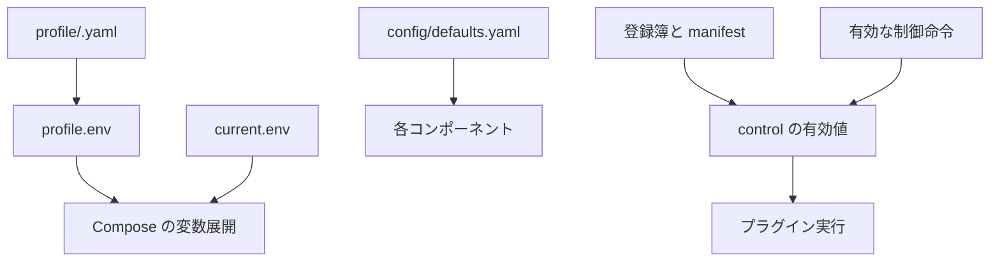

# 設定リファレンス

AX の設定は環境ごとの profile、リポジトリに置く既定値、登録簿、Compose とホスト側の環境変数に分かれます。
この文書は各項目の型、初期値、効く場所、優先順を、現在の実装に照らして説明します。
秘密の値は profile や登録簿に書かず、秘密用のファイルだけに置いてください。

## 目次

- [設定の全体像と優先順](#設定の全体像と優先順)
- [profile](#profile)
- [既定値](#既定値)
- [エラー分類](#エラー分類)
- [常設規則と規則の層](#常設規則と規則の層)
- [入口の行き先](#入口の行き先)
- [制御モード、knob、上限](#制御モードknob上限)
- [モデル、役割、実行環境の登録簿](#モデル役割実行環境の登録簿)
- [Compose とホスト側の環境変数](#compose-とホスト側の環境変数)
- [ファイルとディレクトリの権限](#ファイルとディレクトリの権限)
- [その他の設定ファイル](#その他の設定ファイル)
- [確認方法](#確認方法)

導入と初回起動は [導入ガイド](getting-started.md) を参照してください。この文書で `<…>` と書く値は、利用者が環境に合わせて置き換えるプレースホルダーです。

## 設定の全体像と優先順

設定値は同じ種類のものを複数箇所に重ねる仕組みではありません。まず、どの値がどの経路で効くかを確認してください。



| 対象 | 優先順または規則 | 初期値 | 意味 | コード上の読込元 |
|---|---|---|---|---|
| profile の出力先 | `--out`、指定がなければ `ax_state_dir/deploy/profile.env` | profile 内の `ax_state_dir` | Compose 用の環境変数ファイルを作る | `host/ax-env.sh` → `hostwatch.envfinish.main()` |
| AX のホーム | 呼出元の `AX_HOME`、なければスクリプト既定 | `$HOME/.local/share/ax/prod` | Compose の project directory と設定の基準 | `axcommon.profile.build_env()`、`host/ax-up.sh` |
| 共通設定ディレクトリ | `AX_CONFIG_DIR`、コンテナ内の `/ax/config`、リポジトリの `config/` の順 | リポジトリの `config/` | `defaults.yaml` と `error-rules.yaml` の検索先 | `axcommon.defaults.config_dir()`、`axcommon.errors.ErrorRules.load()` |
| モデル登録簿 | `AX_MODELS_FILE`、未指定時は `config/models.yaml` | `config/models.example.yaml` | 初回に資源台帳へ入れるモデル | `core/resources/catalog.models_path()` |
| 実行環境登録簿 | `AX_ENVIRONMENTS_FILE`、存在すれば `config/environments.yaml`、なければ見本 | `config/environments.example.yaml` | 実行環境の候補と安全属性 | `core/resources/envs/registry/loader.default_environment_path()` |
| intake の行き先 | 基点ファイル、`.d/*.yaml` の辞書順 | `config/intake-destinations.yaml` | 同名なら後に読む `.d` の行が前の行を置き換える | `core/intake/registry.discover_files()`、`build_registry()` |
| エラー分類 | 上から下へ最初に一致した規則 | `error-rules.yaml` の記載順 | 1 規則内は AND、複数規則は OR | `axcommon.errors.ErrorRules.classify()` |
| plugin の mode と knob | manifest の `default`、発行者優先順位、同順位では新しい命令 | mode は出力を持つ plugin では `collect_only`、それ以外は `run` | 有効な実行状態 | `core/control/service.ControlService.effective()` |

`host/ax-up.sh` は `profile.env` の後に `current.env` を `docker compose` へ渡します。後者に同名の変数を書いたときの最終値は Compose の `--env-file` の解釈に従います。AX のコード自身はこの二つのファイルをマージしません。

### 制御命令の優先順

同一 plugin に有効な命令が重なるときは、次の順で強い命令が選ばれます。同じ発行者なら発行時刻が新しい命令、さらに同時刻なら保存順が新しい命令が勝ちます。採用対象は、mode が 1 件、knob が名前ごとに 1 件です。

| 発行者 | 優先順位 | 初期値 | 意味 | コード上の読込元 |
|---|---:|---|---|---|
| `emergency` | 0 | — | 緊急時の最優先命令 | `core/control/__init__.py:PRIORITY` |
| `user` | 1 | — | 利用者が出した命令 | 同上 |
| `inspection` | 2 | — | 点検係の命令 | 同上 |
| `commander` | 3 | — | 司令塔の命令 | 同上 |
| `manager` | 4 | — | 管理役の命令 | 同上 |
| `backup` | 4 | — | 予備役の命令 | 同上 |

## profile

実際の profile は `profile/<name>.yaml` としてリポジトリ外に置きます。`profile/example.yaml` は値の形を示す見本です。秘密そのものは入れず、秘密を置くディレクトリやスロット名だけを記録します。

`host/ax-env.sh --check` は `axcommon.profile.build_env()` と `hostwatch.envfinish` を通ります。JSON Schema が必須とするのは 6 項目ですが、`build_env()` は次表の「必須」項目をすべて要求します。そのため、この表を実際の必須条件として使ってください。

| キー | 型 | 初期値 | 意味 | コード上の読込元 |
|---|---|---|---|---|
| `host` | string、必須 | なし | AX のホスト識別子。`AX_HOST` へ出力する | `axcommon/profile.py:build_env()` |
| `bind_addr` | string、必須 | なし | 公開する gate の bind address。`AX_BIND_ADDR` へ出力する。`host/ax-env.sh` は loopback または tailnet のアドレスを検査する | `build_env()`、`hostwatch.envfinish.check_bind_addr()` |
| `secrets_dir` | 絶対 path、必須 | なし | Compose secrets のホスト側ディレクトリ。`AX_SECRETS_DIR` へ出力する | `build_env()` |
| `tmp_dir` | 絶対 path、必須 | なし | AX の一時領域。`AX_TMP_DIR` へ出力する | `build_env()` |
| `ax_state_dir` | 絶対 path、必須 | なし | 状態、ロック、生成済み env の親。`AX_STATE_DIR` へ出力する | `build_env()` |
| `commander_socket` | `ax_state_dir` を使える絶対 path、必須 | なし | 司令塔ソケットの置き場。親ディレクトリを `AX_COMMANDER_DIR` へ出力する | `build_env()` |
| `archive_target` | string、必須 | なし | 退避先の識別子。`AX_ARCHIVE_TARGET` へ出力する | `build_env()` |
| `environments_file` | `AX_HOME` からの相対 path、必須 | なし | 実行環境登録簿。`AX_ENVIRONMENTS_FILE` へ出力する | `build_env()`、環境登録簿 loader |
| `memory_endpoint` | string、必須 | なし | memory connector が使う接続先。`AX_MEMORY_ENDPOINT` へ出力する | `build_env()`、`compose.d/b1.yaml` |
| `model_gateway` | string、必須 | なし | モデル gateway。`AX_MODEL_GATEWAY` へ出力する | `build_env()`、`compose.d/b6a.yaml` |
| `models_file` | `AX_HOME` からの相対 path、必須 | なし | モデル登録簿。`AX_MODELS_FILE` へ出力する | `build_env()`、`core/resources/catalog.py` |
| `ntfy_endpoint` | string、必須 | なし | 通知サービスの endpoint。`AX_NTFY_ENDPOINT` へ出力する | `build_env()`、`compose.d/b10a.yaml` |
| `ntfy_topic` | string、必須 | なし | 通知 topic。`AX_NTFY_TOPIC` へ出力する | `build_env()`、`compose.d/b10a.yaml` |
| `public_proxy_ip` | string | 空 | HQ が信頼する公開 proxy の IP。`AX_PUBLIC_PROXY_IP` へ出力する | `build_env()`、`core/hq/settings.py` |
| `gate_port` | integer、1–65535 | `8909` | gate のホスト公開ポート。`AX_GATE_PORT` へ出力する | `build_env()`、`compose.d/b12b1.yaml` |
| `commander_unit` | string または string[] | なし | hostwatch が操作対象から外す commander の unit 名 | `host/lib/hostwatch/config.load()` |
| `seat_user` | string | なし | SSH seat 専用アカウント。現在の host gate 実装は `ax-seat` だけを受け付ける | `host/lib/ax_gate.py:HostOps` |
| `seat_socket` | 絶対 path | なし | seat の Unix socket | `host/lib/ax_gate.py:HostOps.install()` |
| `seats_file` | 絶対 path | なし | seat 一覧ファイルの候補 | `hostwatch.envfinish.check_types()` |
| `seat_gate_path` | 絶対 path | なし | SSH 強制コマンドの配置先 | `host/lib/ax_gate.py:HostOps` |
| `gate_peers_file` | 絶対 path | なし | tailnet peer 一覧の候補 | `hostwatch.envfinish.check_types()` |
| `archive_sources` | string | なし | archive source 定義の候補 | `hostwatch.envfinish.check_types()` |
| `env_ssh_targets` | `{id,host,port}` の配列 | なし | firewall が許す SSH 宛先 | `host/ax-fw.sh` |
| `instabox_api_base` | string | なし | 外部 sandbox API の base URL の候補 | `hostwatch.envfinish.check_types()` |
| `instabox_machine_id` | string | なし | 外部 sandbox machine ID の候補 | 同上 |
| `box_machine_name` | string | なし | sandbox machine 名の候補 | 同上 |
| `box_machine_id` | string | なし | sandbox machine ID の候補 | 同上 |
| `sandbox_gate_port` | integer、1–65535 | なし | sandbox egress gate のポート候補 | `hostwatch.envfinish.check_types()` |
| `archive_dest` | `{host,port,user}` | なし | firewall の archive connector 宛先 | `host/ax-fw.sh` |
| `hq_access` | object | なし | HQ access 設定の参照情報 | `hostwatch.envfinish.check_types()` |

`hq_access` を書く場合は、次の 5 キーをすべて空でない文字列にします。値は profile に埋め込む秘密ではなく、識別子または URL にしてください。

| キー | 型 | 初期値 | 意味 | コード上の読込元 |
|---|---|---|---|---|
| `hq_access.iss` | string | なし | token issuer | `hostwatch.envfinish.check_types()` |
| `hq_access.jwks_url` | string | なし | JWKS の取得先 | 同上 |
| `hq_access.aud_secret` | string | なし | audience を置く secret 名 | 同上 |
| `hq_access.allowed_users_file` | string | なし | 許可利用者の secret 名 | 同上 |
| `hq_access.email_slot` | string | なし | メールアドレスを渡す secret slot 名 | 同上 |

### profile の展開規則

- `${ax_state_dir}` は `ax_state_dir` を先に展開してから、ほかの path 項目で使えます。
- `secrets_dir`、`tmp_dir`、`ax_state_dir` は絶対 path でなければなりません。
- `environments_file` と `models_file` は `AX_HOME` からの相対 path にします。
- `commander_socket` は出力時に親ディレクトリへ変換されます。ソケットファイルの path 自体は `AX_COMMANDER_DIR` に出ません。
- profile の値に改行は使えません。

## 既定値

`config/defaults.yaml` は公開できる数値と時間の既定値です。`Defaults.load()` は `schema_version: 1` と `defaults` を確認します。`min` と `max` を持つ値は `Defaults.get(name, override)` の override に対してだけ数値範囲を検査します。型を持たない値や、実行側の個別検査まではこの loader が保証しません。

以下の表の読込元はすべて `axcommon.defaults.Defaults.load()` です。`範囲` が「登録簿で検証」の項目は、既定値ファイル自身には数値上限がなく、呼出側の登録簿または manifest が制約を持ちます。

### 中核、失敗、監視

| キー | 型 | 初期値 | 範囲 | 意味 | コード上の読込元 |
|---|---|---:|---|---|---|
| `heartbeat_s` | number | 60 | 15–300 | health beat の間隔 | `Defaults.load()` |
| `longpoll_s` | number | 30 | 5–60 | long polling の待ち時間 | 同上 |
| `control_poll_s` | number | 30 | 10–120 | control の polling 間隔 | 同上 |
| `control_max_lease_min` | number | 60 | 10–240 | 非利用者命令の最大 lease | 同上 |
| `control_max_renewals` | integer | 3 | 0–10 | control 命令の最大更新回数 | 同上 |
| `expired_grace_min` | number | 15 | 5–60 | 期限切れ後の猶予 | 同上 |
| `system_retries` | integer | 3 | 0–6 | system error の再試行回数 | 同上 |
| `exclude_rate_limit_min` | number | 60 | 10–240 | rate limit 後の資源除外時間 | 同上 |
| `repeat_threshold` | integer | 5 | 2–20 | 1 時間あたりの繰返し検知しきい値 | 同上 |
| `stall_min` | number | 15 | 5–60 | 停滞とみなす時間 | 同上 |
| `observe_s` | number | 60 | 15–300 | observer の観測間隔 | 同上 |
| `stale_beats` | integer | 3 | 2–10 | stale 判定に必要な欠落 beat 数 | 同上 |
| `lag_alert_s` | number | 300 | 60–1800 | lag alert のしきい値 | 同上 |
| `starve_min` | number | 60 | 15–240 | starvation alert のしきい値 | 同上 |
| `manager_silent_min` | number | 30 | 6–180 | manager 無応答のしきい値 | 同上 |
| `manager_bad_streak` | integer | 3 | 2–10 | manager 不調の連続回数 | 同上 |
| `unknown_unhandled_min` | number | 30 | 10–120 | 未分類エラーを未処理とみなす時間 | 同上 |
| `drain_silent_min` | number | 10 | 5–60 | drain 中の無応答しきい値 | 同上 |
| `alert_dedup_min` | number | 30 | 5–240 | 同種 alert の重複抑制時間 | 同上 |
| `backup_window_days` | number | 7 | 1–30 | backup の対象期間 | 同上 |
| `backup_limit` | integer | 2 | 1–10 | backup の保持数 | 同上 |
| `host_watch_s` | number | 60 | 30–300 | hostwatch の周期 | 同上 |
| `observer_stale_s` | number | 180 | 60–900 | observer stale の時間 | 同上 |
| `inspection_interval_h` | number | 24 | 24–168 | 点検の初期間隔 | 同上 |
| `inspection_quiet_count` | integer | 3 | 1–10 | 点検間隔を伸ばすまでの静穏回数 | 同上 |
| `inspection_stretch` | number | 1.5 | 1.1–3.0 | 点検間隔の伸長倍率 | 同上 |
| `inspection_notice_min` | number | 30 | 5–120 | 点検前通知の時間 | 同上 |
| `drain_wait_h` | number | 2 | 0.5–12 | drain を待つ時間 | 同上 |
| `drain_max_h` | number | 6 | 1–24 | drain の最大時間 | 同上 |
| `archive_after_days` | number | 14 | 1–90 | hot data を archive 対象にするまでの日数 | 同上 |
| `timeline_hot_days` | number | 30 | 7–365 | timeline hot data の保持日数 | 同上 |
| `full_read_max_bytes` | integer | 8192 | 点検で見直す | 全文読み取りの大きさ上限 | 同上 |
| `retry_backoff` | object | `base_s=30, factor=2, max_s=1800` | — | 再試行待ち。30 秒から指数的に増え、最大 30 分 | 同上 |

### 変更、公開、ワーカー

| キー | 型 | 初期値 | 範囲 | 意味 | コード上の読込元 |
|---|---|---:|---|---|---|
| `max_hops` | integer | 8 | 2–20 | 項目の再入場回数上限 | `Defaults.load()` |
| `dependency_wait_h` | number | 24 | 1–72 | 依存待ちの時間 | 同上 |
| `tdd_impl_loops` | integer | 3 | 1–5 | TDD 実装ループ数 | 同上 |
| `test_cases_max` | integer | 12 | 3–30 | 変更 1 件あたりのテスト件数上限 | 同上 |
| `gate_changed_coverage` | number | 0.8 | 0.5–1.0 | 変更部分 coverage のしきい値 | 同上 |
| `timer_max_days` | number | 7 | 1–30 | タイマーの最大日数 | 同上 |
| `timer_max_count` | integer | 20 | 1–100 | タイマーの最大数 | 同上 |
| `loopify_min_days` | number | 5 | 3–14 | 繰返しへ昇格する最小日数 | 同上 |
| `role_queue_max` | integer | 5 | 1–50 | role ごとの待機列上限 | 同上 |
| `promote_after` | integer | 3 | 2–10 | 昇格に必要な連続合格数 | 同上 |
| `demote_after` | integer | 2 | 1–5 | 降格に必要な連続失敗数 | 同上 |
| `free_min_success` | number | 0.7 | 0.3–0.9 | 無料モデルの最小成功率 | 同上 |
| `free_min_runs` | integer | 3 | 2–20 | 無料モデルを判定する最小試行数 | 同上 |
| `promotion_share` | number | 0.3 | 0–0.5 | 昇格済み無料モデルへ振る比率 | 同上 |
| `change_starts_per_cycle` | integer | 4 | 登録簿で検証 | 1 巡に始める変更項目の上限 | 同上 |
| `change_model_calls_per_cycle` | integer | 30 | 登録簿で検証 | 1 巡のモデル呼出数上限 | 同上 |
| `change_cycle_seconds` | integer | 300 | 登録簿で検証 | 1 巡の収集・起動時間予算 | 同上 |
| `change_input_max_bytes` | integer | 65536 | 登録簿で検証 | 未信頼本文、差分、コメントそれぞれの上限 | 同上 |
| `change_author_items_per_day` | integer | 3 | 登録簿で検証 | 投稿者ごとの Issue・PR の 24 時間上限 | 同上 |
| `change_author_comments_per_day` | integer | 10 | 登録簿で検証 | 投稿者ごとのコメントの 24 時間上限 | 同上 |
| `change_items_per_day` | integer | 10 | 登録簿で検証 | 全体の新規変更処理の 24 時間上限 | 同上 |
| `change_fix_rounds` | integer | 3 | 登録簿で検証 | 重要問題の修正 round 上限 | 同上 |
| `release_quiet_min` | integer | 20 | 登録簿で検証 | 最終 merge 後の静穏時間の既定 | 同上 |
| `release_max_wait_min` | integer | 90 | 登録簿で検証 | 公開 batch を確定するまでの最大待ち時間 | 同上 |
| `release_lock_wait_min` | integer | 40 | 登録簿で検証 | 同一 repo・公開 mode の排他待ち上限 | 同上 |
| `build_wait_min` | integer | 40 | 登録簿で検証 | 公開 build の待ち上限 | 同上 |
| `publish_review_attempts` | integer | 3 | 登録簿で検証 | 公開検査の最大試行数 | 同上 |
| `contribution_max_files` | integer | 3 | 登録簿で検証 | 外部貢献 1 件のファイル数上限 | 同上 |
| `contribution_max_bytes` | integer | 2000000 | 登録簿で検証 | 外部貢献のファイル 1 件あたりのバイト上限 | 同上 |
| `worker_lower_wait_s` | integer | 300 | 登録簿で検証 | 下位候補へ切り替える前の待ち時間 | 同上 |
| `worker_recent_failure_min` | integer | 60 | 登録簿で検証 | 無料モデルを直近の能力失敗で外す時間 | 同上 |
| `question_renotify_h` | integer | 48 | 登録簿で検証 | 未回答質問を再通知するまでの時間 | 同上 |
| `manager_tick_min` | number | 10 | 2–60 | manager の巡回間隔 | `core/manager/config.ManagerConfig.load()` |
| `manager_decision_s` | number | 300 | 60–900 | manager の判断時間 | 同上 |

### 定期処理、通知、実行環境

| キー | 型 | 初期値 | 範囲 | 意味 | コード上の読込元 |
|---|---|---|---|---|---|
| `morning_digest_time_jst` | string | `07:00 JST` | 登録簿で検証 | 朝の要約の日本時間 | `Defaults.load()` |
| `u_index_time` | string | `04:41 Asia/Tokyo` | 登録簿で検証 | 会話索引の実行時刻 | 同上 |
| `u_digest_time` | string | `23:50 Asia/Tokyo` | 登録簿で検証 | 記憶要約の実行時刻 | 同上 |
| `u_entry_start_delay_s` | integer | `300` | 登録簿で検証 | 入口一覧の起動後の初回待ち | 同上 |
| `u_entry_interval_s` | integer | `3600` | 登録簿で検証 | 入口一覧の更新間隔 | 同上 |
| `u_hibi_interval_s` | integer | `60` | 登録簿で検証 | Hibi 状態更新の間隔 | 同上 |
| `hibi_segments_max` | integer | `288` | 96–1440 | 日次状態の `segments` 数上限 | 同上 |
| `hibi_body_max_kib` | integer | `64` | 16–256 | 状態本文の大きさ上限（KiB） | 同上 |
| `hibi_future_skew_min` | integer | `5` | 1–30 | `as_of` を未来として許す幅 | 同上 |
| `hibi_fail_streak` | integer | `5` | 2–20 | ToDo を 1 件出すまでの連続取込失敗回数 | 同上 |
| `u_eigen_interval_s` | integer | `3600` | 登録簿で検証 | scheduled-publisher の巡回間隔 | 同上 |
| `u_x_draft_time` | string | `07:00 Asia/Tokyo` | 登録簿で検証 | X の統計と投稿案の実行時刻 | 同上 |
| `u_x_queue_interval_s` | integer | `600` | 登録簿で検証 | 投稿キューの確認間隔 | 同上 |
| `u_forward_start_delay_s` | integer | `120` | 登録簿で検証 | 転送の初回待ち | 同上 |
| `u_forward_interval_s` | integer | `300` | 登録簿で検証 | 転送元の巡回間隔 | 同上 |
| `u_tumu_interval_s` | integer | `900` | 登録簿で検証 | Tumu 監視間隔 | 同上 |
| `u_security_time` | string | `06:20 Asia/Tokyo` | 登録簿で検証 | security 監視の実行時刻 | 同上 |
| `ntfy_rate_per_min` | integer | `60` | 登録簿で検証 | 通知配送の 1 分あたり上限 | 同上 |
| `env_probe_s` | integer | `300` | 登録簿で検証 | 実行環境の到達性と空きの確認間隔 | 同上 |
| `gate_probe_max_age_s` | integer | `900` | 300–3600 | gate 確認結果を token 発行に使える時間 | 同上 |
| `env_exclude_min` | integer | `30` | 登録簿で検証 | 失敗した実行環境の除外時間 | 同上 |
| `env_job_budget_min` | integer | `60` | 登録簿で検証 | `budget_min` が無い環境 job の時間上限 | 同上 |
| `env_artifact_max_bytes` | integer | `1073741824` | 登録簿で検証 | 環境 job の成果物 1 件の大きさ上限 | 同上 |

### sandbox、再開、司令塔、seat

| キー | 型 | 初期値 | 範囲 | 意味 | コード上の読込元 |
|---|---|---:|---|---|---|
| `box_wake_wait_s` | integer | 120 | 30–600 | box を起こした後の最大待ち時間 | `Defaults.load()` |
| `box_call_timeout_s` | integer | 120 | 10–600 | box MCP の 1 呼出し上限 | 同上 |
| `box_run_max_min` | integer | 30 | 1–480 | box 1 実行の仮の上限 | 同上 |
| `sandbox_gate_idle_s` | integer | 600 | 60–3600 | sandbox gate token の idle 失効時間 | 同上 |
| `sandbox_gate_calls_max` | integer | 200 | 10–2000 | 1 job が gate を通して呼べる回数 | 同上 |
| `sandbox_gate_token_max_min` | integer | 180 | 10–720 | sandbox gate token の最大有効時間 | 同上 |
| `sandbox_response_max_bytes` | integer | 4194304 | 65536–33554432 | gate が通す 1 応答の上限 | 同上 |
| `sandbox_steps_max` | integer | 50 | 1–200 | `entry.kind: steps` の最大件数 | 同上 |
| `sbx_poll_s` | integer | 30 | 5–300 | sandbox job 状態の読取間隔 | 同上 |
| `sbx_exec_timeout_s` | integer | 600 | 30–600 | Instabox `exec` の 1 回の上限 | 同上 |
| `sbx_ready_wait_s` | integer | 180 | 30–600 | Instabox の準備待ち上限 | 同上 |
| `sbx_queue_wait_min` | integer | 120 | 1–1440 | 期限なし依頼の枠待ち上限 | 同上 |
| `sbx_run_margin_min` | integer | 15 | 5–60 | hard 実行上限から引く余裕 | 同上 |
| `sbx_idle_suspend_min` | integer | 0 | 0–30 | 空き後に自動保留するまでの分。0 は呼ばない | 同上 |
| `sbx_chunk_bytes` | integer | 12288 | 1024–65536 | 成果物回収の 1 chunk の長さ | 同上 |
| `sbx_artifact_max_bytes` | integer | 8388608 | `env_artifact_max_bytes` 以下 | sandbox 成果物 1 件の上限 | 同上 |
| `sbx_usage_event_min` | integer | 60 | 5–1440 | 変化がなくても usage event を出す間隔 | 同上 |
| `env_use_day_tz` | string | `Asia/Tokyo` | IANA time zone | 日単位の利用量を区切る time zone | 同上 |
| `sbx_job_dir_keep_days` | integer | 7 | 1–90 | sandbox `jobs/` を archive に移すまでの日数 | 同上 |
| `sbx_archive_warn_gib` | integer | 15 | 1–19 | sandbox archive の警告しきい値 | 同上 |
| `sbx_disk_min_gib` | number | 1 | 0.1–50 | 新 job を止める残りディスクしきい値 | 同上 |
| `box_probe_shell_timeout_s` | integer | 30 | 5–120 | box 内 probe shell の timeout | 同上 |
| `box_machine_name` | string | `main` | 文字列 | 照合する box machine 名 | 同上 |
| `box_machine_id` | string | 空 | 文字列 | 任意の box machine ID | 同上 |
| `sbx_shot_max_height_px` | integer | 16384 | 1024–32768 | full-page screenshot の高さ上限 | 同上 |
| `sbx_gui_check_h` | integer | 24 | 1–168 | GUI snapshot の確認間隔 | 同上 |
| `sbx_shot_timeout_s` | integer | 60 | 10–300 | screenshot 全体の timeout | 同上 |
| `u_eigen_collect_budget_min` | integer | 15 | 5–40 | scheduled-publisher 収集 job の時間上限 | 同上 |
| `u_eigen_decide_budget_min` | integer | 40 | 10–50 | scheduled-publisher 判断 worker の時間上限 | 同上 |
| `u_eigen_send_budget_min` | integer | 10 | 2–30 | scheduled-publisher 送信 job の時間上限 | 同上 |
| `u_eigen_run_send_max` | integer | 12 | 1–100 | scheduled-publisher 1 巡の送信上限 | 同上 |
| `u_eigen_reply_cap_day` | integer | 5 | 0–50 | scheduled-publisher reply の日次上限 | 同上 |
| `prefix_ttl_min` | integer | 60 | 5–60 | prompt prefix cache の見込み TTL | 同上 |
| `resume_max_context_tokens` | integer | 60000 | 10000–200000 | 再開できる文脈長の上限 | 同上 |
| `resume_max_age_min` | integer | 55 | 5–60 | 再開できる job 終了後の時間 | 同上 |
| `resume_max_chain` | integer | 3 | 1–5 | 再開を連続させる回数 | 同上 |
| `prefix_hit_floor` | number | 0.5 | 0.1–0.9 | prefix 適用判定用の hit ratio しきい値 | 同上 |
| `prefix_probe_gap_s` | integer | 120 | 30–300 | prefix 計測を分ける最大間隔 | 同上 |
| `commander_exam_runs` | integer | 3 | 1–5 | 司令塔試験で各 case を走らせる回数 | 同上 |
| `commander_exam_max_turns` | integer | 12 | 6–30 | 司令塔試験 1 回の tool turn 上限 | 同上 |
| `commander_exam_run_timeout_s` | integer | 300 | 60–900 | 司令塔試験 1 回の timeout | 同上 |
| `commander_exam_total_min` | integer | 90 | 30–240 | 司令塔試験全体の timeout | 同上 |
| `commander_exam_normal_pass_cases` | integer | 9 | 8–10 | 通常 10 case 中で合格が必要な case 数 | 同上 |
| `commander_exam_valid_days` | integer | 90 | 7–365 | 司令塔試験結果の有効日数 | 同上 |
| `read_relay_timeout_s` | integer | 5 | 1–30 | `ax` の read relay timeout | 同上 |
| `seat_default_ttl_days` | integer | 90 | 1–365 | seat の既定有効日数 | 同上 |
| `subloop_create_max_per_day` | integer | 3 | 1–10 | 非 HQ の `subloop.create` 日次上限 | 同上 |
| `subloop_max_count` | integer | 16 | 4–64 | 登録済み subloop 総数の上限 | 同上 |
| `seat_max_sessions` | integer | 4 | 1–8 | 1 seat の同時 SSH session 上限 | 同上 |
| `seat_idle_timeout_s` | integer | 900 | 60–3600 | SSH 対話の idle timeout | 同上 |
| `seat_control_lease_min` | integer | 30 | 1–240 | `ax control` の既定 lease | 同上 |
| `seat_stdin_max_kib` | integer | 1024 | 16–8192 | SSH gate の標準入力上限 | 同上 |
| `seat_revoke_sync_s` | integer | 60 | 10–600 | seat revoke を反映する目標時間 | 同上 |
| `seat_cache_s` | integer | 5 | 1–60 | seat 状態 cache の最大時間 | 同上 |
| `ax_output_max_kib` | integer | 256 | 16–4096 | `ax` と gate の 1 応答上限 | 同上 |
| `gate_body_max_kb` | integer | 64 | 8–512 | gate request body の上限 | 同上 |
| `gate_read_per_s` | integer | 10 | 1–50 | seat ごとの read rate | 同上 |
| `gate_write_per_min` | integer | 30 | 5–120 | seat ごとの write rate | 同上 |
| `gate_inflight_max` | integer | 8 | 1–32 | seat ごとの同時 request 上限 | 同上 |
| `gate_call_timeout_s` | integer | 30 | 5–60 | gate 1 呼出しの timeout | 同上 |
| `gate_enroll_code_min` | integer | 10 | 2–30 | enrollment code の有効時間 | 同上 |
| `gate_enroll_fail_max` | integer | 5 | 3–10 | enrollment の連続失敗上限 | 同上 |
| `gate_enroll_lock_min` | integer | 15 | 5–120 | enrollment を受けない時間 | 同上 |
| `approval_ttl_min` | integer | 60 | 10–1440 | 承認待ちの期限 | 同上 |
| `go_md_max_bytes` | integer | 8192 | 1024–32768 | `GO.md` 全文の大きさ上限 | 同上 |
| `approval_wait_max_s` | integer | 20 | 1–25 | approval wait 1 回の最大待ち | 同上 |
| `approval_code_fail_max` | integer | 5 | 3–10 | 第二要素 code の失敗上限 | 同上 |
| `approval_lock_min` | integer | 15 | 5–120 | approval を拒否する時間 | 同上 |
| `commander_rate_max` | integer | 60 | 10–600 | 1 seat が window 内に出せる指示数 | 同上 |
| `commander_rate_window_min` | integer | 10 | 1–60 | commander rate の集計窓 | 同上 |
| `commander_reject_suspend` | integer | 5 | 3–20 | suspension 前の連続拒否数 | 同上 |
| `read_audit_interval_min` | integer | 10 | 1–60 | `commander.read.summary` を書く間隔 | 同上 |
| `audit_window_s` | integer | 300 | 60–900 | 同じ失敗をまとめる audit window | 同上 |
| `idempotency_retain_h` | integer | 168 | 24–720 | request ID の保持時間 | 同上 |
| `claim_lease_min` | integer | 30 | 5–240 | claim の lease | 同上 |
| `claim_max_hold_h` | integer | 4 | 1–24 | claim を連続更新できる最大時間 | 同上 |
| `brief_since_h` | integer | 24 | 1–168 | `ax brief` の既定の遡及時間 | 同上 |
| `brief_max_items` | integer | 5 | 3–10 | `ax brief` の各部の最大項目数 | 同上 |

## エラー分類

`config/error-rules.yaml` は `schema_version: 1` と 1 個以上の `rules` を持つ object です。規則の順序が動作を変えるため、似た規則を追加するときは既存行より前後のどちらへ置くかを確認してください。

| キー | 型 | 初期値 | 意味 | コード上の読込元 |
|---|---|---|---|---|
| `schema_version` | literal integer | `1` | ファイル形式の版 | `ErrorRules.load()` |
| `rules` | rule[] | 既存 13 規則 | 上から順に評価する分類規則 | 同上 |
| `rules[].class` | enum | なし | `system.expected`、`artifact.bug`、`unknown` のいずれか | `schemas/error-rules.schema.json` |
| `rules[].code` | string | なし | 分類後の code | 同上 |
| `rules[].match.http_status` | integer[] | 任意 | 一致させる HTTP status のいずれか | `axcommon.errors.Rule.matches()` |
| `rules[].match.http_status_range` | `[integer,integer]` | 任意 | HTTP status の両端を含む範囲 | 同上 |
| `rules[].match.body_regex` | string | 任意 | 大文字小文字を区別しない本文 regex | 同上 |
| `rules[].match.exception` | string[] | 任意 | 例外クラス名のいずれか | 同上 |
| `rules[].match.exit_code` | integer[] | 任意 | 終了 code のいずれか | 同上 |
| `rules[].match.hint` | string[] | 任意 | 呼出側が付けた hint のいずれか | 同上 |
| `rules[].action` | string | 空 | 人が読む対処の説明。分類ロジックはこの文字列を解釈しない | `ErrorRules.load()` |
| `rules[].counts_as_failure` | enum | なし | `yes`、`no`、`hold` | `schemas/error-rules.schema.json` |

| 現在の code | 型 | 初期値 | 意味 | コード上の読込元 |
|---|---|---|---|---|
| `test_fail`、`verify_fail`、`gate_fail` | `artifact.bug` | `counts_as_failure: yes` | hint が一致した検証失敗 | `config/error-rules.yaml` |
| `bad_output` | `artifact.bug` | `counts_as_failure: yes` | hint が一致した出力不適合 | 同上 |
| `quota` | `system.expected` | `counts_as_failure: no` | quota や usage limit を示す本文 | 同上 |
| `rate_limit` | `system.expected` | `counts_as_failure: no` | HTTP 429 または rate-limit 本文 | 同上 |
| `timeout` | `system.expected` | `counts_as_failure: no` | HTTP 408 または timeout 系例外 | 同上 |
| `provider_down` | `system.expected` | `counts_as_failure: no` | HTTP 5xx または connection refused | 同上 |
| `network` | `system.expected` | `counts_as_failure: no` | network 系例外または名前解決・経路エラー本文 | 同上 |

どの規則にも一致しないエラーは、規則を追加しなくても `unknown / unclassified` になります。

## 常設規則と規則の層

`config/standing-rules.md` はワーカーの固定部分です。記載内容は前景実行、変更部分だけの検証、不要な hash 検証と push の禁止、戻しにくい操作と削除の禁止、`TMPDIR` の使用、秘密と個人情報の非出力、fail-soft、日本語の報告、末尾の `STATUS:` 行です。`impl` には「テストを書かず、既存テストを変えない」という追加規則があります。

| 層 | 型 | 初期値 | 意味 | コード上の読込元 |
|---|---|---|---|---|
| 常設規則 | Markdown | `config/standing-rules.md` | 全 job に共通する規則本文 | `plugins/resource/worker-pool/prompt.PromptParts.standing` |
| プロジェクト規則 | string | 空 | 対象 project 固有の規則本文 | `PromptParts.project` |
| 昇格済み教訓 | `(id, body)[]` | 空 | ID 順に足す教訓 | `PromptParts.lessons` |
| job 本文 | string | 空 | 個別の依頼 | `PromptParts.job` |
| prefix の並び | enum | cache が `on` なら `A`、それ以外は `B` | `A` は規則群を先頭、`B` は job 本文を先頭に置く | `prompt.arrangement_for()`、`prompt.build()` |

層の連結順は常設規則、プロジェクト規則、教訓、job 本文です。`config/standing-rules.md` というファイルを直接開く呼出しは、現時点の worker-pool 実装にはありません。呼出側がその内容を `PromptParts.standing` として渡す構成です。

## 入口の行き先

`config/intake-destinations.yaml` を基点に、`config/intake-destinations.d/*.yaml` をファイル名順で追加します。読み直し時に壊れた schema があれば前の有効な登録簿を使い続け、入口全体は止めません。

| キー | 型 | 初期値 | 意味 | コード上の読込元 |
|---|---|---|---|---|
| `name` | dot-separated string | なし | 行き先の一意名 | `core/intake/registry.build_registry()` |
| `title` | string | なし | 人が読む名称 | `schemas/intake-destinations.schema.json` |
| `schema` | string | なし | payload schema の相対 path | `build_registry()` |
| `handler` | string | なし | 内部 handler URL | schema と intake app |
| `allowed_from` | `commander` / `hq` の配列 | なし | 呼出元の許可一覧 | schema と intake validation |
| `via` | `local` / `ssh` / `tailnet` / `hq` の配列 | 必須 | 受け口の許可一覧 | `build_registry()` |
| `tier` | `read` / `operate` / `irreversible` | 必須 | 必要な権限段 | `build_registry()`、intake validation |
| `irreversible` | boolean | `tier == irreversible` | 戻しにくい操作かどうか。tier と必ず一致させる | `build_registry()` |
| `ack` | `sync` / `async` | `sync` | 同期応答か受付 ID を返すか | `build_registry()` |
| `default_expiry_min` | positive integer | 任意 | 命令の既定期限 | schema |
| `conflict_key` | string | 任意 | 同時操作の競合を識別する template | `build_registry()` |
| `mcp_tool` | string | 任意 | MCP tool 名 | schema |

| 現在の `name` | 型 | 初期値 | 意味 | コード上の読込元 |
|---|---|---|---|---|
| `control.command` | destination | `operate`、`sync`、期限 60 分 | plugin control 命令。`b16b.yaml` が payload schema を拡張する | `config/intake-destinations.d/b16b.yaml` |
| `ledger.answer` | destination | `operate`、`sync`、期限 60 分 | ToDo カードへの回答 | `config/intake-destinations.yaml` |
| `emergency` | destination | `irreversible`、`async`、期限 10 分 | HQ の緊急操作。競合 key は持たない | `intake-destinations.d/b10a.yaml` |
| `approval.deny`、`approval.grant` | destination | `irreversible`、`sync`、期限 60 分 | HQ だけが使える approval 操作 | `intake-destinations.d/b12b2.yaml` |
| `approval.withdraw` | destination | `operate`、`sync`、期限 60 分 | commander または HQ が approval を取り下げる | 同上 |
| `change.cancel_merge`、`change.request` | destination | `operate`、`sync`、期限 60 分 | change の取消しまたは依頼。現在の handler は `not-implemented:*` | 同上 |
| `claim.op`、`commitment.update`、`decision.record`、`goal.update`、`life_state.update`、`schedule.update` | destination | `operate`、`sync`、期限 60 分 | commander または HQ の状態更新操作。現在の handler は `not-implemented:*` | 同上 |
| `core.change`、`go.confirm` | destination | `irreversible`、`sync`、期限 60 分 | 中核変更または go 確認。`core.change` の現在の handler は `not-implemented:*` | 同上 |
| `ledger.complete`、`ledger.park` | destination | `operate`、`sync`、期限 60 分 | ledger 状態更新。現在の handler は `not-implemented:*` | 同上 |
| `seat.add`、`seat.enroll_start`、`seat.lock`、`seat.tier`、`seat.unlock`、`secret.push` | destination | `irreversible`、`sync`、期限 60 分 | HQ だけが使える seat または secret 操作。現在の handler は `not-implemented:*` | 同上 |
| `seat.revoke` | destination | `operate`、`sync`、期限 60 分 | commander または HQ が seat を revoke する。現在の handler は `not-implemented:*` | 同上 |
| `subloop.create` | destination | `operate`、`sync`、期限 60 分 | subloop 作成。現在の handler は `not-implemented:*` | 同上 |
| `work.cancel`、`work.request`、`work.resume`、`work.stop` | destination | `operate`、`sync`、期限 60 分 | work 制御。現在の handler は `not-implemented:*` | 同上 |
| `permission.change` | destination | `irreversible`、`sync`、期限 60 分 | 継続許可の登録 | `intake-destinations.d/b16b.yaml` |

## 制御モード、knob、上限

`set_mode`、`set_knob`、`exclude_resource` だけが、現在は対象 plugin への適用経路を持ちます。ほかの操作は schema 上にあっても `operation_not_implemented` で拒否されます。送信先を持つ plugin の `run` 要求は、送信先一覧を照合する API が未定義のため `destination_contract_unavailable` を返します。

| キー | 型 | 初期値 | 意味 | コード上の読込元 |
|---|---|---|---|---|
| `run` | mode | outputs が送信出力に一致しなければ既定 | plugin を通常実行する | `core/control/__init__.py:MODES` |
| `collect_only` | mode | outputs が送信出力に一致すれば既定 | 収集のみで外部作用を止める | 同上 |
| `poll_paused` | mode | manifest が許す場合だけ | polling を止める | 同上 |
| `draining` | mode | 条件により capability の先頭を使用 | 新規作業を受けず、終了へ向ける | 同上 |
| knob `type` | `integer` / `number` / `boolean` / `enum` / `string` / `duration` / `list` | manifest ごと | `set_knob` の値検査に使う | `core/control/service.knob_check()` |
| knob `who` | issuer[] | 未指定なら制限なし | 変更できる発行者 | `ControlService._validate()` |
| knob `effective` | string | manifest ごと | `immediate` または `next_run` として UI・実装が扱う効果時点の宣言 | plugin manifest |

`default_mode` が `collect_only`、`poll_paused`、`draining` のいずれかで、capabilities に含まれる場合は、その値を初期モードに使います。`run` が capabilities に含まれず、選ばれたモードも含まれない場合は、capabilities の先頭を使います。

### 現在の plugin knob

| plugin / key | 型 | 初期値 | 意味 | コード上の読込元 |
|---|---|---|---|---|
| `worker-pool.role_candidates` | list | `{}` | role ごとの同額候補順 | `plugins/resource/worker-pool/manifest.yaml` |
| `worker-pool.family_cap` | string | 空 | family ごとの同時実行上限 | 同上 |
| `worker-pool.model_cap` | string | 空 | model ごとの同時実行上限 | 同上 |
| `worker-pool.jev_enabled` | boolean | `true` | Jev に適合判定をさせるか | 同上 |
| `worker-pool.lower_fallback_enabled` | boolean | `true` | 下位候補への切替可否 | 同上 |
| `worker-pool.lower_fallback_wait_s` | integer | `300`、0–3600 | 下位候補へ切替前の待ち秒数 | 同上 |
| `worker-pool.model_descriptions` | string | 空 | model の用途・能力説明 | 同上 |
| `worker-pool.promotion_passes` | integer | `3`、1–20 | 昇格に必要な連続合格数 | 同上 |
| `worker-pool.demotion_failures` | integer | `2`、1–20 | 降格に必要な連続不合格数 | 同上 |
| `worker-pool.free_success_threshold` | number | `0.7`、0–1 | 無料 model の成功率下限 | 同上 |
| `worker-pool.free_minimum_runs` | integer | `3`、2–100 | 成功率を判定する最小実行数 | 同上 |
| `worker-pool.free_recent_failure_min` | integer | `60`、0–1440 | 能力失敗後の除外分数 | 同上 |
| `change.dry_run` | boolean | `true` | 外部操作を予定だけにする | `plugins/subloop/change/manifest.yaml` |
| `change.max_parallel_items` | integer | `1`、1–4 | 同時に進める項目数の上限 | 同上 |
| `change.every_s` | integer | `300`、60–3600 | 巡回間隔 | 同上 |
| `change.max_hops` | integer | `20`、2–20 | 項目の再入場上限 | 同上 |
| `change.change_starts_per_cycle` | integer | `4`、1–8 | 1 巡に始める項目の上限 | 同上 |
| `change.change_model_calls_per_cycle` | integer | `30`、1–60 | 1 巡の model 呼出し上限 | 同上 |
| `change.change_cycle_seconds` | integer | `300`、30–600 | 1 巡の時間上限 | 同上 |
| `change.change_fix_rounds` | integer | `3`、1–3 | 修正 round の上限 | 同上 |
| `change.test_cases_max` | integer | `12`、3–30 | テスト件数の上限 | 同上 |
| `release.inbox_max` | integer | `50`、1–200 | 受取待ち項目の上限 | `plugins/subloop/release/manifest.yaml` |
| `release.dry_run` | boolean | `true` | 外部操作を予定だけにする | 同上 |
| `release.every_s` | integer | `300`、60–3600 | 巡回間隔 | 同上 |
| `release.release_retry_limit` | integer | `3`、1–10 | 同じ理由での再試行上限 | 同上 |
| `work-tdd.max_parallel_items` | integer | `1`、1–2 | 同時に進める項目数 | `plugins/subloop/work-tdd/manifest.yaml` |
| `work-tdd.inbox_max` | integer | `50`、1–200 | 受取待ち項目の上限 | 同上 |
| `work-tdd.every_s` | integer | `300`、60–3600 | 受取待ちを拾う間隔 | 同上 |
| `work-tdd.max_hops` | integer | `20`、2–20 | 項目の再入場上限 | 同上 |
| `work-tdd.test_cases_max` | integer | `12`、3–30 | テスト件数の上限 | 同上 |
| `conversation-index.u_index_time` | string | `04:41` | 会話索引の時刻 | `plugins/timer/conversation-index/manifest.yaml` |
| `conversation-index.enabled` | boolean | `false` | 自動実行の可否 | 同上 |
| `scheduled-publisher.u_eigen_interval_s` | integer | `3600`、最小 1 | 巡回間隔 | `plugins/timer/scheduled_publisher/manifest.yaml` |
| `scheduled-publisher.u_eigen_collect_budget_min` | integer | `15`、5–40 | 収集時間の上限 | 同上 |
| `scheduled-publisher.u_eigen_decide_budget_min` | integer | `40`、10–50 | 判断時間の上限 | 同上 |
| `scheduled-publisher.u_eigen_send_budget_min` | integer | `10`、2–30 | 送信時間の上限 | 同上 |
| `scheduled-publisher.u_eigen_run_send_max` | integer | `12`、1–100 | 1 巡の送信上限 | 同上 |
| `scheduled-publisher.u_eigen_reply_cap_day` | integer | `5`、0–50 | reply の日次上限 | 同上 |
| `x-posts.every_s` | integer | `600`、最小 1 | 投稿キュー確認の間隔 | `plugins/timer/x-posts/manifest.yaml` |
| `x-posts.enabled` | boolean | `true` | 自動実行の可否 | 同上 |

`resources` は `run` と `draining`、`timer-runner` は 4 mode を宣言しますが、独自 knob はありません。`worker-pool` の `role_candidates`、`family_cap`、`model_cap`、`model_descriptions` は複合値の詳細 schema が未定義のため、現在の control API では変更を 501 で拒否します。

## モデル、役割、実行環境の登録簿

### モデル資源

`config/models.example.yaml` は空の見本です。現在の gateway に登録されたモデルを確認し、実際の登録ファイルを用意します。resources は `AX_MODELS_FILE`、未指定時は `config/models.yaml` を読みます。見本への自動切替はありません。空の資源台帳に限り起動時に取り込み、資源が既にある場合はファイルを変更しても再取込しません。登録後の状態は資源 database が正です。秘密は設定ファイルに書かず、配置と読み取り権限は環境ごとに管理します。

| キー | 型 | 初期値 | 意味 | コード上の読込元 |
|---|---|---|---|---|
| `id` | string、必須 | なし | 資源の一意 ID | `core/resources/catalog.load_models_file()` |
| `kind` | `model` / `environment`、必須 | なし | 資源の種別 | `resource.schema.json` |
| `family` | string、必須 | なし | model family | 同上 |
| `tier` | `free` / `flash` / `standard` / `last_resort`、必須 | なし | 選択の優先 tier。左から右ほど高い | `core/resources/catalog.TIER_ORDER` |
| `level` | `L1`–`L4` | 任意 | 能力段階 | `LEVEL_ORDER` |
| `billing` | `metered` / `flat` | 任意 | 課金形式 | `resource.schema.json` |
| `vision` | boolean | 任意 | 画像入力を扱えるか | 同上 |
| `runner` | string | 任意 | 実行 runner 名 | 同上 |
| `cap` | integer、0 以上 | 任意 | 同時実行上限 | `catalog.validate_resource()` |
| `prefix_cache` | `on` / `off` / `unknown` | 任意 | prompt prefix cache の状態 | 同上 |
| `status` | `active` / `degraded` / `excluded` / `retired`、必須 | なし | 選択可能な状態 | 同上 |
| `trains_on_input` | `no_train` / `train` / `unknown` | 任意 | 入力学習の記録。選択条件には使わない | `axcommon.policy.allowed()` |
| `stats` | object | 任意 | 成績などの状態 | `resource.schema.json` |
| `description` | string | 任意 | 人が読む説明 | 同上 |
| `pricing` | `{unit,input,output,fetched_at,source}` | 任意 | 価格の記録 | 同上 |

### 情報区分の許可

| 対象 | 型 | 初期値 | 許可規則 | コード上の読込元 |
|---|---|---|---|---|
| model と `public` | sensitivity | 常に許可 | 登録済み model なら許可 | `axcommon/policy.allowed()` |
| model と `private` | sensitivity | 常に許可 | 登録済み model なら許可 | 同上 |
| model と `sensitive` | sensitivity | 拒否 | `tier` が `standard` または `last_resort` のときだけ許可 | 同上 |
| environment と `public` | sensitivity | 許可 | 登録済み environment なら許可 | 同上 |
| environment と `private` / `sensitive` | sensitivity | `data_classes` 依存 | `data_classes` に含まれる場合だけ許可。ただし `cloud-sandbox` は `public` だけ | 同上 |

### role routing

役割の `preference` は候補の順位付けに使います。古い worker-pool の固定モデル一覧は現在の gateway の利用可能モデルを表しません。gateway の `/v1/models` で現行の ID を確認して登録します。モデルの登録値は `config/models.yaml` で指定します。レベルを省略した場合の既定値は `L1` です。登録値は実績を表さず、その後は実績に応じて昇降格します。管理役のモデル選択ではレベルを条件にしません。`cap` はモデルの同時実行上限です。family と model の上限は worker-pool の設定と資源台帳の状態も確認してください。複合値の control API による変更は現在 501 で拒否されます。

登録内容の型と必須項目は上の表と `schemas/resource.schema.json` を参照してください。登録だけで gateway の接続や実際の実行が確認されたわけではありません。

### commander model の上限

`config/commander-models.yaml` は model 名の match ごとに、provider、試験済み ID 一覧、最大情報区分、最大権限段を宣言します。

| キー | 型 | 初期値 | 意味 | コード上の読込元 |
|---|---|---|---|---|
| `models[].match` | non-empty string | なし | model 名の照合パターン | `schemas/ext/b12b4/commander-models.schema.json` |
| `models[].provider` | non-empty string | なし | provider 名 | 同上 |
| `models[].exams` | exam ID[] | `[]` | 合格済み試験の一覧 | 同上 |
| `models[].max_class` | `public` / `private` / `sensitive` | なし | 最大情報区分 | 同上 |
| `models[].max_tier` | `read` / `operate` / `irreversible` | なし | 最大操作段 | 同上 |
| `default.max_class` | literal `public` | `public` | 行に一致しない model の最大情報区分 | 同上 |
| `default.max_tier` | literal `read` | `read` | 行に一致しない model の最大操作段 | 同上 |

このファイルを読む実装は、現在のリポジトリ内では確認できません。schema と見本はありますが、実行時に適用されることを前提にしないでください。

### 実行環境と read-only mount

| キー | 型 | 初期値 | 意味 | コード上の読込元 |
|---|---|---|---|---|
| `contract_supported` | `major.minor` string または string[] | なし | environment contract の対応版 | `core/resources/envs/registry/loader.py` |
| `environments[]` | object[] | なし | 実行環境の一覧 | 同上 |
| `environments[].id` | plugin ID | なし | 環境 ID | `_entry_errors()` |
| `adapter` | `local` / `ssh-host` / `container` / `cloud-sandbox` | なし | 接続方式 | `environment.schema.json` |
| `connect` | object | なし | 接続の形。`kind` が必要 | `_entry_errors()` |
| `conn_credential` | `{slot, place?}` | なし | 接続資格の参照。資格値は書かない | `_credential_errors()` |
| `gate_credential` | object | 任意 | gate 資格の参照 | schema |
| `os` | `linux` / `windows` / `macos` | 任意 | 対象 OS | schema |
| `capabilities` | string[] | なし | 提供能力 | `_entry_errors()` |
| `entrypoints` | object | 任意 | 許可する入口 | schema |
| `data_classes` | sensitivity[] | なし | 許可する情報区分 | `axcommon.policy.allowed()` |
| `secrets_allowed` | boolean | 任意 | secret を渡せるか | schema |
| `work_credentials` | credential[] | なし | job 用資格の参照 | `_entry_errors()` |
| `secret_targets` | `{name,path,mode,max_bytes}`[] | なし | secret の書込先。値の記載は禁止 | `_entry_errors()` |
| `max_concurrent` | integer、0 以上 | 任意 | 同時実行上限 | schema |
| `cost.kind` | `free` / `fixed` / `metered` | なし | 料金形式 | schema |
| `lifetime` | `permanent` / `rental` / `ephemeral` | 任意 | 環境の寿命 | schema |
| `owner_use` | boolean | 任意 | 所有者利用の属性 | schema |
| `model_family` | string | 任意 | 実行できる model family | schema |
| `rank` | integer | 任意 | 候補の順位 | schema |
| `registered_at` | `YYYY-MM-DD` | なし | 登録日 | schema |
| `free_guard` | `{machines:1,cost_max_usd:0}` | cloud-sandbox では必須 | 無料 sandbox の不変条件 | schema |
| `state` / `gate_state` | `trial` / `available` / `degraded` / `excluded` / `draining` / `retired` | なし | 環境と gate の状態 | schema |
| `module` / `probe` / `limits` / `runner` | object | 任意 | adapter 固有の定義 | schema |
| `ro-mounts[].id` | `[a-z0-9-]{1,40}` | なし | read-only mount ID | `config/ro-mounts.yaml` schema |
| `ro-mounts[].host_path` | non-empty string | なし | ホスト側の source path | 同上 |
| `ro-mounts[].container_path` | absolute path | なし | container 側の mount path | 同上 |
| `ro-mounts[].sensitivity` | `private` / `public` | なし | mount に含まれる情報区分 | 同上 |

`cloud-sandbox` の環境は `free_guard`、`cost`、`max_concurrent` を必須にし、`max_concurrent: 1` と `cost.kind: free` を要求します。壊れた環境行はその行だけを `rejected` とし、ほかの環境行は読み続けます。

## Compose とホスト側の環境変数

この節は `compose.yaml`、`compose.d/*.yaml`、`host/` に出現する `AX_*` を列挙します。値を外部から直接セットするための公開 API とは限りません。特に「内部受渡し」の行はスクリプトまたは Compose が設定するため、通常は手で設定しません。

### profile または配備が供給する変数

| キー | 型 | 初期値 | 意味 | コード上の読込元 |
|---|---|---|---|---|
| `AX_HOME` | absolute path | `host/ax-up.sh` では `$HOME/.local/share/ax/prod` | Compose project と host script の基準 directory | `host/ax-up.sh`、`host/lib/hostwatch/config.py` |
| `AX_TAG` | image tag | 初回は `main` の短縮 commit ID | runtime image tag | `host/ax-up.sh`、`host/lib/hostwatch/deploy.py`、Compose |
| `AX_UID` / `AX_GID` | integer string | profile 生成時の実行 UID/GID | 通常 container の user | `axcommon.profile.build_env()`、Compose |
| `AX_HQ_UID` / `AX_HQ_GID` | integer string | `ax-hq` が未発見なら空 | HQ container の user | `hostwatch.envfinish.build()`、Compose |
| `AX_HOST` | string | profile 必須 | component の host 識別子 | profile、Compose |
| `AX_BIND_ADDR` | address | profile 必須 | gate の host bind address | profile、`compose.d/b12b1.yaml` |
| `AX_GATE_PORT` | integer string | `8909` | gate の host port | profile、`compose.d/b12b1.yaml` |
| `AX_SECRETS_DIR` | absolute path | profile 必須 | Compose secret source directory | profile、`compose.yaml` と Compose fragments |
| `AX_STATE_DIR` | absolute path | profile 必須 | state、socket、lock の root | profile、Compose と host scripts |
| `AX_COMMANDER_DIR` | absolute path | `commander_socket` の親 | commander socket の bind mount source | profile、`compose.d/b5.yaml` |
| `AX_MEMORY_ENDPOINT` | URL | profile 必須 | memory connector の upstream | profile、`compose.d/b1.yaml` |
| `AX_MODEL_GATEWAY` | URL | profile 必須 | model gateway | profile、`compose.d/b6a.yaml`、`b6b.yaml` |
| `AX_NTFY_ENDPOINT` / `AX_NTFY_TOPIC` | string | profile 必須 | 通知先と topic | profile、`compose.d/b10a.yaml` |
| `AX_PUBLIC_PROXY_IP` | address string | profile では空可 | HQ の public proxy IP | profile、`compose.d/b10b.yaml` |
| `AX_ENVIRONMENTS_FILE` | relative path | profile 必須 | environment registry の path | profile、environment loader |
| `AX_MODELS_FILE` | relative path | profile 必須 | models registry の path | profile、model catalog |
| `AX_TMP_DIR` | absolute path | profile 必須 | profile が出す一時領域 | `axcommon.profile.build_env()` |

### Compose の image、build、内部接続

| キー | 型 | 初期値 | 意味 | コード上の読込元 |
|---|---|---|---|---|
| `AX_CHANGE_PORT_FACTORY` | string | 空 | change subloop が渡す port factory | `compose.d/sl-change.yaml` |
| `AX_JSONSCHEMA_VERSION` | string | 空 | chat-json image build の schema version | `compose.d/b6b.yaml` |
| `AX_PYTHON_REF` | image reference | `python:3.12-slim` | runtime build の Python base image | `compose.d/b7.yaml` |
| `AX_UV_VERSION` | string | 空 | runtime build の uv version | `compose.d/b7.yaml` |
| `AX_PLUGIN_TOKENS_FILE` | path | `AX_STATE_DIR/plugin-tokens.sha256` | plugin token hash 一覧の置換先 | `compose.d/b3.yaml` |
| `AX_ARCHIVER_DB` | path | Compose 定義による | archiver database の container 内 path | `compose.d/b1.yaml` |
| `AX_ARCHIVE_SOURCES` | path | Compose 定義による | archiver の archive source 定義 | `compose.d/b1.yaml` |
| `AX_AUTOMATION_TARGETS` | path | Compose 定義による | intake automation target 定義 | `compose.d/b16b.yaml` |
| `AX_BIN` | path | Compose 定義による | gate container 内の `ax` command path | `compose.yaml`、`compose.d/b12b1.yaml` |
| `AX_CONFIG_DIR` | path | component が未指定時は `/ax/config` または repo `config/` | container 内設定 directory | `compose.d/b12b1.yaml`、`axcommon.defaults.config_dir()` |
| `AX_CONTROL_URL` | URL | Compose 定義による | control service URL | `compose.d/b9.yaml` |
| `AX_CORE_TOKENS` | path | Compose 定義による | core token hash 一覧 | `compose.d/b3.yaml`、`b10a.yaml` |
| `AX_DATA_DIR` | path | Compose 定義による | subloop/timer の data directory | `compose.d/b7.yaml`、subloop fragments |
| `AX_EMERGENCY_DATA` | path | Compose 定義による | emergency component の data directory | `compose.d/b10a.yaml` |
| `AX_EVENT_OUTBOX` | path | Compose 定義による | memory connector event outbox | `compose.d/b1.yaml` |
| `AX_GATE_ALLOWED_USERS_FILE` | path | Compose 定義による | gate に渡す許可利用者 file | `compose.d/b12b1.yaml` |
| `AX_GATE_CORE_TOKEN_FILE` | path | Compose 定義による | gate の core token file | 同上 |
| `AX_GATE_STATE_DIR` | path | Compose 定義による | gate state directory | 同上 |
| `AX_HQ_DATA` | path | Compose 定義による | HQ data directory | `compose.d/b10a.yaml` |
| `AX_HQ_INTAKE_SOCKET` | path | Compose 定義による | HQ intake socket | `compose.d/b10b.yaml` |
| `AX_HQ_NOTIFY_RUN` | string | Compose 定義による | HQ 通知 runner の指定 | `compose.d/b10a.yaml` |
| `AX_INSPECTOR_STATE_DIR` | path | Compose 定義による | inspector state directory | `compose.d/b9.yaml` |
| `AX_LEDGER_URL` | URL | Compose 定義による | ledger service URL | `compose.d/b8.yaml`、`b9.yaml` |
| `AX_MANAGER_STATE_DIR` | path | `/state/manager` | manager state directory | `core/manager/config.ManagerConfig.load()`、`compose.d/b9.yaml` |
| `AX_MEMORY_CONNECTOR_URL` | URL | Compose 定義による | memory connector service URL | `compose.d/b9.yaml` |
| `AX_MEMORY_OUTBOX` | path | Compose 定義による | memory connector outbox | `compose.d/b1.yaml` |
| `AX_OBSERVER_DATA` | path | Compose 定義による | observer data directory | `compose.d/b8.yaml` |
| `AX_PII_LIST` | path | Compose 定義による | redaction に渡す PII list | `compose.d/b1.yaml` ほか |
| `AX_PLUGIN_ID` | string | Compose 定義による | 起動した plugin の ID | subloop/timer fragments |
| `AX_PLUGIN_TOKENS` | path | Compose 定義による | plugin token hash 一覧 | `compose.d/b3.yaml` |
| `AX_REDACT_INDEX` | path | Compose 定義による | redact index path | Compose fragments |
| `AX_REGISTRY` | path | Compose 定義による | plugin registry の path | `compose.d/b3.yaml` |
| `AX_REMOTE_WORK_GIT` | path | Compose 定義による | remote work git directory | `sl-work-tdd.yaml`、`sl-change.yaml` |
| `AX_REPO_AX` | path | Compose 定義による | AX repository mount | `compose.d/sl-work-tdd.yaml` |
| `AX_RESOURCES_DB` | path | Compose 定義による | resources database | `compose.d/b6a.yaml` |
| `AX_RESOURCES_EXT_DIR` | path | Compose 定義による | resources extension directory | `compose.d/b18b.yaml` |
| `AX_RESOURCES_URL` | URL | `http://resources:8080` | resources service URL | worker-pool config、Compose |
| `AX_SANDBOX_GATE_PORT` | integer string | `8931` | egress proxy の sandbox gate port | `compose.d/b6b.yaml` |
| `AX_SEATS_FILE` | path | Compose 定義による | gate に渡す seats file | `compose.d/b12b1.yaml` |
| `AX_SECRETS_DIR_HOST` | path | `AX_SECRETS_DIR` | archiver が見る host secrets directory | `compose.d/b1.yaml` |
| `AX_TIMELINE_ARCHIVE` | path | Compose 定義による | timeline archive directory | `compose.d/b1.yaml` |
| `AX_TIMELINE_DB` | path | Compose 定義による | timeline database | 同上 |
| `AX_TIMELINE_URL` | URL | Compose 定義による | timeline service URL | `compose.d/b8.yaml`、`b9.yaml` |
| `AX_WORKER_POOL_DB` | path | `/data/worker-pool.sqlite` | worker-pool database | worker-pool config、`compose.d/b6a.yaml` |
| `AX_WORKER_POOL_EXT_DIR` | path | Compose 定義による | worker-pool extension directory | `compose.d/b18b.yaml` |
| `AX_WORKER_POOL_URL` | URL | Compose 定義による | worker-pool service URL | `compose.d/b9.yaml` |
| `AX_WORK_PORT` | integer string | Compose 定義による | work-side HTTP port | `compose.d/b3.yaml` |
| `AX_WORK_ROOT` | path | Compose 定義による | subloop の work root | subloop fragments |

### host script の override と内部受渡し

| キー | 型 | 初期値 | 意味 | コード上の読込元 |
|---|---|---|---|---|
| `AX_PROFILE` | path | `host/ax-up.sh` が `--profile` の値（省略時は下の `AX_PROFILE_FILE`）を渡す | hostwatch が読む profile | `host/lib/hostwatch/config.py` |
| `AX_PROFILE_FILE` | path | `$HOME/.config/ax/profile/default.yaml` | `ax-up.sh` と `ax-env.sh` の `--profile` を省いたときの profile。seat sync の unit もこれを使う | `host/ax-env.sh`、`host/ax-up.sh`、`host/systemd/ax-seat-sync.service` |
| `AX_ENV_TAILSCALE` | command string | `tailscale ip -4` | profile bind address 検査用 command | `hostwatch.envfinish` |
| `AX_ENV_ID` | command string | `id` | HQ UID/GID 検出用 command | 同上 |
| `AX_UP_SUDO` | command string | `sudo -n` | `ax-up.sh` の Docker 実行 command | `host/ax-up.sh` |
| `AX_UP_WAIT_S` | integer string | `120` | 起動後 health を待つ秒数 | 同上 |
| `AX_UP_INTERVAL_S` | integer string | `2`、最低 1 | health poll の間隔秒数 | 同上 |
| `AX_UP_NO_DEPS` | `0` / `1` | `0` | `1` なら Compose `--no-deps` を加える | 同上 |
| `AX_BIN_DIR` | path | `$HOME/.local/bin` | `ax` symlink の directory | 同上 |
| `AX_HOSTWATCH_SUDO` | command string | `sudo -n` | hostwatch と deploy の特権 command | `host/lib/hostwatch/config.py` |
| `AX_HOSTWATCH_REPO` | path | script の repo root | hostwatch が使う script の repo | 同上 |
| `AX_FW_SUDO` | command string | `sudo -n` | firewall script の特権 command | `host/ax-fw.sh` |
| `AX_FW_TAILSCALE` | command string | `tailscale` | firewall script の tailnet lookup command | 同上 |
| `AX_FW_IPTABLES` | command string | `iptables` | firewall script の packet filter command | 同上 |
| `AX_FW_UFW` | command string | `ufw` | firewall script の firewall command | 同上 |
| `AX_FW_OWNER` | `user:group` | `root:root` | 作る firewall rule file の所有者 | 同上 |
| `AX_FW_RESOURCES_IP` | IPv4 string | 実装内の固定内部アドレス | resources service の Compose 内アドレス。通常は変更しない | 同上 |
| `AX_FW_ARCHIVER_IP` | IPv4 string | 実装内の固定内部アドレス | archiver service の Compose 内アドレス。通常は変更しない | 同上 |
| `AX_FW_WORKER_POOL_IP` | IPv4 string | 実装内の固定内部アドレス | worker-pool service の Compose 内アドレス。通常は変更しない | 同上 |
| `AX_PEERS_TAILSCALE` | command string | `sudo -n tailscale` | peer list を得る command | `host/ax-peers.sh` |
| `AX_ARCHIVE_SOURCES_FILE` | path | `$HOME/.config/ax/profile/archive-sources.yaml` | reaper が読む source 定義 | `host/ax-archive-reap.sh` |
| `AX_ARCHIVE_SOURCES` | path | reaper が export する `AX_REAP_SOURCES` と同じ値 | reaper の inline Python へ渡す source path | 同上 |
| `AX_REAP_STATE_DIR` | path | `AX_STATE_DIR` または `$HOME/.local/state/ax` | reaper 内部の state path | 同上 |
| `AX_REAP_SOURCES` | path | `AX_ARCHIVE_SOURCES_FILE` | reaper 内部の source path | 同上 |
| `AX_REAP_MAX` | integer string | `1000` | reaper 内部の 1 周最大ファイル数 | 同上 |
| `AX_REAP_DRY` | `0` / `1` | `0` | reaper 内部 dry-run 印 | 同上 |
| `AX_REG` | path | `AX_HOME/plugins/registry.yaml` | `ax-up.sh` の inline registry reader に渡す path | `host/ax-up.sh` |
| `AX_SVC` | string | 呼出した service 名 | 上記 inline reader の対象 service | 同上 |
| `AX_SEAT_SOURCE` | path | `host/` の directory | privilege 分離した seat launcher の source directory | `host/ax-seat.sh` |
| `AX_ENV_HOME` | path | env module 側の実装による | environment module の home directory | `host/env-module-min/` |
| `AX_ENV_DOCKER` | command string | env module 側の実装による | environment module の Docker command | 同上 |
| `AX_ENV_SUDO` | command string | env module 側の実装による | environment module の特権 command | 同上 |
| `AX_JOB_NETWORK` | string | env module 側の実装による | environment job network | 同上 |
| `AX_WORK_DIR` | path | env module 側の実装による | environment job の work directory | 同上 |
| `AX_GATE_URL` | URL | caller が供給 | host `ax` client の gate endpoint | `host/lib/ax_cli/transport.py` |
| `AX_GATE_TOKEN` | string | caller が供給 | host `ax` client の gate token | 同上 |
| `AX_SOCKET` | path | caller が供給 | host `ax` client の Unix socket | 同上 |
| `AX_FORMAT` | string | client 実装の既定 | host `ax` client の出力形式 | `host/lib/ax_cli/__init__.py` |

## ファイルとディレクトリの権限

次の権限は、現在のスクリプトまたは Compose 定義が作るものです。既存の directory を一律に chmod するものではありません。

| 対象 | 型 | 初期値 | 意味 | コード上の読込元 |
|---|---|---|---|---|
| `profile.env` | file mode | `0600` | profile から原子的に出す Compose env file | `axcommon.profile.write_atomic()` |
| `current.env` | file mode | `0600` | 現在の image tag を持つ配備 env file | `host/ax-up.sh`、`hostwatch/deploy.py` |
| `state/commander`、`state/cutover` | directory mode | `0700` | commander と cutover の状態 directory | `host/ax-up.sh` |
| `state/redact` | directory mode | `0755` | container が redaction index を読める directory | 同上 |
| `state/redact/index` | file mode | `0644` | secret value ではなく hash/salt の index | `axcommon.redact_index.write_index()` |
| `secrets/plugin-tokens/*`、`secrets/core-tokens/*` | file mode | `0600` | 起動時に無ければ作る token file | `host/ax-up.sh` |
| token の親 directory | directory mode | `0700` | token file の親 | 同上 |
| `state/core-tokens.sha256` | file mode | `0644` | token digest の一覧 | 同上 |
| `state/gate/peers.json` | file mode | `0600` | tailnet peer snapshot | `host/ax-peers.sh` |
| `state/gate/revoked.d/<seat>` | file mode | `0600` | 緊急 revoke marker | `host/ax-gate-revoke.sh` |
| `authorized_keys` | file mode | `0644`、`root:root` | SSH seat の強制 command key 一覧 | `host/lib/ax_gate.py:HostOps` |
| seat gate executable | file mode | `0755`、`root:root` | SSH 強制 command | 同上 |
| seat gate Python library と設定 | file mode | `0644`、`root:root` | seat gate の実装と pending sshd drop-in | 同上 |
| `archive` directory | directory mode | `0700` | firewall 更新前の控え | `host/ax-fw.sh` |
| core/ledger volume の `outbox`、`archive` | directory mode | `0770` | container user が書く内部保存先 | `compose.d/b3.yaml` |
| archive volume の `archive` | directory mode | `0770` | archiver が書く archive | `compose.d/b1.yaml` |
| host state の archive と verified | directory mode | `0755` | host 側から読む archive manifest | `compose.d/b1.yaml` |
| Compose secret mount | file mode | `0400` | gate などへ渡す secret file | `compose.d/b12b1.yaml` |

## その他の設定ファイル

次の設定もリポジトリにあります。ここでは、現在の source が確認できる範囲の形式と状態を示します。実行 reader が見つからない行は、編集しても現在の実行動作が変わるとは限りません。

| ファイル | キー | 型と初期値 | 意味 | コード上の読込元 |
|---|---|---|---|---|
| `config/inspection.yaml` | `schema_version`、`interval_h`、`first_at` | `1`、`initial:24/min:24/max:168`、`null` | 点検係の予定 | `core/inspector/config.py` |
| `config/products.yaml` | `products[]` | product ごとの ID、repo、destination、enabled、dry_run、operations、paths、待機、version、notes、entry、checks | release 対象の登録簿 | 現在は `plugins/subloop/release/README.md` の参照のみ確認 |
| `config/sandbox-entry-steps.yaml` | `screenshot.steps`、`collect`、`ignored_args` | browser navigate、wait、screenshot の既定手順 | screenshot entry の展開 | `core/resources/screenshot/entry_expand.py` |
| `config/windows-tools.yaml` | `tools[]` | ID、kind、location、max_concurrent、owner_use、data_classes | Windows computer-use の候補 | `core/resources/winwork/service.py` |
| `config/ro-mounts.yaml` | mount 行 | ID、host/container path、sensitivity | job container の追加 read-only mount | `host/env-module-min/.../ax_launcher.py` |
| `config/runners/*.yaml` | `name`、`kind`、`image`、`command`、`env`、`result` | runner ごとの command と結果契約 | runner 定義。`chat-json` だけは `axcommon/chat_json.py` が直接関係する | runner config |
| `plugins/registry.yaml` | `plugins[]` | `kind`、`path`、`source` | 起動時に登録する plugin manifest 一覧 | `core/control/registry.register_all()` |

runner 定義には実行する agent command や言語 runtime の環境変数が含まれます。これらは container image と launcher の契約であり、profile の `AX_*` から自動的に上書きする利用者設定ではありません。

## 確認方法

profile は書かずに検査できます。

```bash
host/ax-env.sh --profile profile/<name>.yaml --check
```

`ax-up.sh --dry-run` は作成や起動をせず、予定する state directory、env file、Compose command を表示します。

```bash
host/ax-up.sh --profile profile/<name>.yaml --dry-run <service>
```

現在の実装では、profile の形式検査と `defaults.yaml` / `error-rules.yaml` の loader は確認できます。一方で `commander-models.yaml` と products registry は、実行時 reader がリポジトリ内で確認できないため、設定だけで挙動が切り替わるものとして扱わないでください。


## 実装で参照される追加の環境変数

下表は `core/`、`runtime/`、`plugins/`、`host/`、`axcommon/`、`compose.d/`、`docker/` の Python、YAML、シェルにある `AX_` 名を検索し、上記の一覧と英語の設定例にない名前をまとめたものです。内部用の受け渡しやプレフィックスも含むため、利用者がすべてを設定する必要はありません。型、既定値、必須条件と反映時点は参照元ごとに異なります。配備で上書きする前に参照元を確認してください。パスを指定する変数には秘密の値そのものを書かず、ファイルの権限とマウント先を確認します。

| 名前 | 主な参照元 |
|---|---|
| `AX_ARCHIVER_BIND` | `core/archiver/__main__.py` |
| `AX_ARCHIVE_DEST_HOST` | `core/archiver/app.py`, `core/archiver/config.py` |
| `AX_ARCHIVE_DEST_PORT` | `core/archiver/config.py` |
| `AX_ARCHIVE_DEST_USER` | `core/archiver/config.py` |
| `AX_ARCHIVE_FIRST_DELAY_S` | `core/archiver/__main__.py`, `core/archiver/app.py` |
| `AX_ARCHIVE_FORBIDDEN_ROOTS` | `core/archiver/guard.py` |
| `AX_ARCHIVE_INTERVAL_S` | `core/archiver/__main__.py`, `core/archiver/app.py` |
| `AX_ARCHIVE_SRC_BASE` | `core/archiver/app.py` |
| `AX_ARCHIVE_VOL_BASE` | `core/archiver/app.py` |
| `AX_AUTOMATION_MAP_SOURCE` | `compose.d/b16a-t62.yaml`, `core/hq/ext/b16a_t62.py`, `host/lib/hostwatch/envfinish.py` |
| `AX_CHANGE_LEDGER_PATH` | `plugins/subloop/change/integration/runtime.py` |
| `AX_CHAT_JSON_DIR` | `axcommon/chat_json.py` |
| `AX_CORE_PORT` | `core/control/__main__.py`, `core/ledger/__main__.py` |
| `AX_CORE_SUBNET` | `core/resources/netbind.py`, `core/timeline/netbind.py`, `docker/base.yaml` |
| `AX_CORE_TOKENS_SHA256` | `core/resources/app.py`, `core/resources/core_auth.py` |
| `AX_CORE_TOKEN_FILE` | `core/intake/dest/b10a/handler.py`, `core/intake/dest/b12b3/ledger_updates.py`, `core/intake/ext/b12b2.py` |
| `AX_EGRESS_PROXY_IP` | `compose.d/b6a.yaml`, `compose.d/b6b.yaml` |
| `AX_EMERGENCY_BIND` | `core/intake/dest/b10a/__main__.py` |
| `AX_EMERGENCY_URL` | `core/intake/dest/b10a/handler.py` |
| `AX_ENTRY_SITES_FILE` | `compose.d/b16a-t62.yaml`, `core/hq/ext/b16a_t62.py`, `host/lib/hostwatch/envfinish.py` |
| `AX_EXT_DIR` | `core/control/app.py`, `core/ledger/app.py` |
| `AX_GATE_BIND` | `core/gate/__main__.py` |
| `AX_GATE_INTAKE_HOST` | `core/gate/config.py` |
| `AX_GATE_INTAKE_PORT` | `core/gate/config.py` |
| `AX_GATE_IP` | `compose.d/b12b1.yaml` |
| `AX_GITHUB_API_URL` | `runtime/subloop/tools.py` |
| `AX_GRAPH_CHECK` | `core/control/graphcheck.py` |
| `AX_HEALTH_PORT` | `axcommon/healthcheck.py`, `core/archiver/__main__.py`, `core/egress-proxy/egress_proxy.py` |
| `AX_HOME_IN_CONTAINER` | `plugins/subloop/change/__main__.py`, `runtime/subloop/__main__.py`, `runtime/subloop/config.py` |
| `AX_HQ_ACCESS_CONFIG` | `core/hq/settings.py` |
| `AX_HQ_BASE_URL` | `compose.d/b10a.yaml`, `core/hq/notify/loop.py` |
| `AX_HQ_NOTIFY_INTERVAL_S` | `core/hq/notify/loop.py` |
| `AX_HQ_SLOTS_DIR` | `core/resources/app.py` |
| `AX_INDEX_FRAGMENT` | `host/ax-up.sh` |
| `AX_INSPECTOR_BIND` | `core/inspector/__main__.py` |
| `AX_JEV_TIMEOUT_S` | `core/resources/jev.py` |
| `AX_JEV_URL` | `core/resources/app.py`, `core/resources/jev.py` |
| `AX_LAUNCHER_PORT` | `plugins/resource/worker-pool/launcher_client.py` |
| `AX_LOG_LEVEL` | `core/intake/__main__.py` |
| `AX_MANAGER_BIND` | `core/manager/__main__.py` |
| `AX_OBSERVER_BIND` | `core/observer/__main__.py` |
| `AX_OBSERVER_COMMANDER_UNITS` | `core/observer/settings.py` |
| `AX_PERFORMANCE_DB` | `compose.d/b5.yaml`, `core/intake/dest/z_performance/__init__.py` |
| `AX_PERFORMANCE_TARGETS` | `compose.d/b5.yaml`, `core/intake/dest/z_performance/__init__.py` |
| `AX_PLUGIN_DIR` | `runtime/subloop/__main__.py`, `runtime/subloop/config.py` |
| `AX_PLUGIN_FILE` | `host/ax-up.sh` |
| `AX_PLUGIN_TABLE` | `host/ax-up.sh` |
| `AX_PRODUCTS_FILE` | `compose.d/sl-release.yaml`, `runtime/subloop/config.py` |
| `AX_PUBLISH_FRAGMENT` | `host/ax-up.sh` |
| `AX_PUBLISH_LEGACY_PLUGIN_IDS` | `axcommon/__init__.py` |
| `AX_PUBLISH_REVIEW_GRACE_S` | `compose.d/b6a.yaml`, `compose.d/sl-release.yaml`, `core/resources/api.py` |
| `AX_PUBLISH_REVIEW_RESOURCES_IP` | `compose.d/b6a.yaml` |
| `AX_PUBLISH_REVIEW_SUBNET` | `core/resources/netbind.py`, `docker/base.yaml` |
| `AX_QUESTION_RENOTIFY_H` | `core/hq/notify/question.py` |
| `AX_RESOURCES_CORE_BIND` | `core/resources/netbind.py` |
| `AX_RESOURCES_REVIEW_BIND` | `core/resources/netbind.py` |
| `AX_RESOURCES_WORK_BIND` | `core/resources/netbind.py` |
| `AX_SCHEDULED_PUBLISHER_ID` | `plugins/timer/scheduled_publisher/engine.py`, `plugins/timer/scheduled_publisher/state.py` |
| `AX_SCHEMAS_DIR` | `axcommon/schemas.py` |
| `AX_SEAT_GID` | `core/intake/ext/b12b2.py` |
| `AX_SEAT_UID` | `core/intake/ext/b12b2.py` |
| `AX_SECRETS_PATH` | `axcommon/creds.py`, `core/control/callers.py`, `core/resources/app.py` |
| `AX_SECURITY_BASELINES_FILE` | `compose.d/b16a-t62.yaml`, `runtime/timer_runner/__main__.py` |
| `AX_TIMELINE_CORE_BIND` | `core/timeline/netbind.py` |
| `AX_TIMELINE_EXPORT_INTERVAL_S` | `core/timeline/app.py` |
| `AX_TIMELINE_WORK_BIND` | `core/timeline/netbind.py` |
| `AX_TIMER_TICK_S` | `runtime/timer_runner/__main__.py` |
| `AX_WORKER_POOL_CORE_BIND` | `plugins/resource/worker-pool/netbind.py` |
| `AX_WORKER_POOL_DISPATCH_INTERVAL_S` | `plugins/resource/worker-pool/app.py` |
| `AX_WORKER_POOL_VERIFY_RUNNER` | `plugins/resource/worker-pool/dispatch.py` |
| `AX_WORKER_POOL_WORK_BIND` | `plugins/resource/worker-pool/netbind.py` |
| `AX_WORK_SUBNET` | `core/resources/netbind.py`, `core/timeline/netbind.py`, `docker/base.yaml` |

### 設定キーの確認

`config/` 直下の YAML について、最上位キーをこの文書と照合しました。追加で見つかった `config/sandbox-tools.yaml` の `forbidden_patterns` はサンドボックスで拒否するパターンの設定です。`config/` 下の YAML の入れ子も含めた機械照合で未掲載だった 107 種は、下記の設定項目、親項目の下位キー、生成物や fixture に分類しました。実行時に動的生成される名前や拡張プラグインの独自設定はこの確認に含みません。個別ファイルの schema と読み込みコードで型、既定値、適用時点を確認してください。


## 追加で確認した設定項目

次の項目は設定ファイルに記入するキーです。相対パスはリポジトリ内の参照元です。値に秘密や実環境の名前を書いた例は掲載していません。記載のない既定値は、読み込みコードに既定値がないことを示します。

| キー | 意味 | 既定値・必須条件 | 読込元と行 |
|---|---|---|---|
| `publish_paths` | 公開対象として変更パスと照合するパターン | 必須、空は拒否 | `plugins/subloop/release/core/registry.py:24`、`:33`、`:73` |
| `post_publish` | 公開成功後の処理の一覧 | 必須、既定なし | `plugins/subloop/release/core/registry.py:25`、`plugins/subloop/release/core/service.py:239` |
| `ax_profile` | 移行処理が読む AX profile の場所 | 必須、既定なし | `tools/cutover/reap/t78.py:124` |
| `sources_file` | 移行処理が使う退避元一覧の場所 | 必須、既定なし | `tools/cutover/reap/t78.py:126` |
| `cutover_archive` | 移行処理の記録を退避する場所 | 必須、既定なし | `tools/cutover/reap/t78.py:128` |
| `changelog` | 移行処理の変更記録の場所 | 必須、既定なし | `tools/cutover/reap/t78.py:129` |
| `private_key` | 転送に使う秘密鍵ファイルの場所 | `--apply` 時に必須、既定なし | `tools/cutover/reap/t78.py:151` |
| `known_hosts` | 転送先のホスト鍵を確認するファイルの場所 | `--apply` 時に必須、既定なし | `tools/cutover/reap/t78.py:152` |
| `public_key` | 制限付きの鍵か確認する公開鍵ファイルの場所 | `--apply` 時に必要、既定なし。欠けた場合の照合は unknown | `tools/cutover/reap/t78.py:51` |
| `key_check_host` | 鍵の制限を確認する SSH 接続先 | `--apply` 時に必要、既定なし。欠けた場合の照合は unknown | `tools/cutover/reap/t78.py:56` |
| `restricted_directory` | 鍵に設定された転送先制限と照合するディレクトリ | `--apply` 時に必要、既定なし。欠けた場合の照合は unknown | `tools/cutover/reap/t78.py:58` |

移行用の項目は専用の処理で参照されます。通常の新規導入に必要な設定ではありません。公開機能は現状無効で、上の登録項目があるだけでは公開できません。

### 親項目の下位キー

下表は既存の親項目に含まれるキー名です。辞書の子には登録する役割名、ツール名、入口 ID の例も含まれ、一覧の名前をすべて登録する必要はありません。runner の `env` は子プロセスに渡す値で、使われ方は runner ごとに確認してください。記入条件や設定の実行時反映が未確認の箇所は要確認です。

| 親項目 | 下位キー・例の識別子 |
|---|---|
| `config/environments.example.yaml:environments.[].entrypoints` | `audit-readonly`, `cf-read`, `ci-run`, `hibi-server-deploy`, `hibi-state`, `release-both`, `x-collect` |
| `config/environments.example.yaml:environments.[].work_credentials.[]` | `var` |
| `config/environments.sandbox.example.yaml:environments.[]` | `free_command` |
| `config/environments.sandbox.example.yaml:environments.[].conn_credential` | `header` |
| `config/environments.sandbox.example.yaml:environments.[].entrypoints` | `eigen-collect`, `eigen-send`, `selfcheck` |
| `config/environments.sandbox.example.yaml:environments.[].entrypoints.eigen-send.[]` | `irreversible_ok` |
| `config/environments.sandbox.example.yaml:environments.[].limits` | `idle_suspend_s`, `run_max_kind` |
| `config/environments.sandbox.example.yaml:environments.[].work_credentials.[]` | `vars` |
| `config/products.yaml:products.[].checks` | `assets`, `clean_main`, `description_max_bytes`, `dev_promotion`, `distribution`, `evidence`, `prerelease_zip`, `zip_pattern` |
| `config/products.yaml:products.[].entry` | `headline`, `reason`, `requires`, `timeout_min` |
| `config/products.yaml:products.[].notes` | `include`, `languages` |
| `config/products.yaml:products.[].version` | `bump`, `tag_pattern` |
| `config/products.yaml:products.[].version.bump` | `feature` |
| `config/roles.yaml:roles` | `assist`, `backup_manager`, `impl_hard`, `research`, `review_final`, `second_opinion`, `test_design` |
| `config/roles.yaml:roles.assist` | `min_level` |
| `config/runners/agent-cli-dotnet.yaml:env` | `ANTHROPIC_DEFAULT_HAIKU_MODEL`, `ANTHROPIC_DEFAULT_OPUS_MODEL`, `ANTHROPIC_DEFAULT_SONNET_MODEL`, `ANTHROPIC_SMALL_FAST_MODEL`, `CLAUDE_CODE_DISABLE_NONESSENTIAL_TRAFFIC`, `CLAUDE_CODE_SUBAGENT_MODEL`, `DISABLE_AUTOUPDATER`, `DOTNET`, `DOTNET_CLI_TELEMETRY_OPTOUT`, `DOTNET_NOLOGO`, `DOTNET_ROLL_FORWARD`, `GameDir`, `ModDeployDir`, `NUGET_PACKAGES` |
| `config/runners/agent-cli-dotnet.yaml:result` | `fields`, `rate_limited_when` |
| `config/runners/agent-cli-dotnet.yaml:result.rate_limited_when` | `api_error_status` |
| `config/runners/verify-ax-ci.yaml:env` | `AX_CI_IN_JOB`, `CI` |
| `config/runners/verify-node.yaml:env` | `PNPM_HOME`, `npm_config_cache` |
| `config/runners/verify-python.yaml:env` | `PIP_CACHE_DIR`, `UV_CACHE_DIR` |
| `config/sandbox-entry-steps.yaml:screenshot.collect` | `from_step` |
| `config/sandbox-tools.yaml:tools` | `browser_click`, `browser_fetch`, `browser_fill`, `browser_navigate`, `browser_read`, `browser_snapshot`, `browser_tabs`, `browser_type`, `computer_act`, `computer_state`, `desk`, `edit_file`, `gui_plan`, `list_dir`, `machine_list`, `machine_state`, `machine_suspend`, `machine_view`, `machine_wake`, `plan_read`, `read_file`, `script_run`, `write_file` |
| `config/sandbox-tools.yaml:tools.computer_act` | `arg_rules` |
| `config/sandbox-tools.yaml:tools.computer_act.arg_rules` | `action_allow`, `actions_max`, `deny_keys` |

サンドボックス設定の `tools.computer_act.arg_rules` は `action_allow`、`deny_keys`、`actions_max` を含みます。`core/resources/envs/sandbox_policy.py:60` と `:228` が読みます。`config/defaults.yaml` の生成メタデータと schema 専用 fixture は利用者設定の一覧に含めていません。
