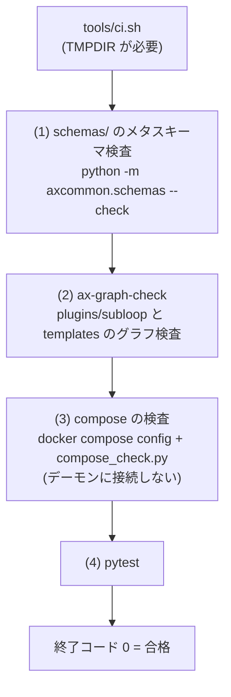

# 開発ガイド（development）

この文書はAX のリポジトリを手元で触る開発者向けの手引きです。リポジトリの構成、開発環境の用意、テストの書き方と実行、CI（`tools/ci.sh`）と `ax-ci` イメージ、検査の道具、コードの作法、新しい束の追加、コミットとリリースの決まりを説明します。
動かし方（運用側の手順）は [はじめ方](getting-started.md)、安全の設計は [セキュリティ](security.md) を参照してください。
記載内容はリポジトリのコードに基づきます。実装途中の部分は「状態」の節に記載します。

## 目次

- [1. リポジトリの構成](#1-リポジトリの構成)
- [2. 開発環境の用意](#2-開発環境の用意)
- [3. テスト](#3-テスト)
- [4. CI（tools/ci.sh）と ax-ci イメージ](#4-citoolscishと-ax-ci-イメージ)
- [5. 検査と生成の道具（tools/）](#5-検査と生成の道具tools)
- [6. コードの作法](#6-コードの作法)
- [7. 新しい束の追加](#7-新しい束の追加)
- [8. コミットの書き方](#8-コミットの書き方)
- [9. リリースの手順](#9-リリースの手順)
- [10. 状態（未実装・未確定のまとめ）](#10-状態未実装未確定のまとめ)
- [11. 参照](#11-参照)

## 1. リポジトリの構成

AX は Compose の中核サービス、プラグイン、ホストのスクリプトで動く自律運用基盤です。

| 場所 | 内容 |
|---|---|
| `compose.yaml` | 網（`ax-core`、`ax-work`、`ax-job`）と秘密の宣言だけを持つ。サービスの定義は `compose.d/` に置く |
| `compose.d/` | 束ごとのサービス定義。サブループは `sl-<id>.yaml` |
| `docker/` | `Dockerfile.core`（全中核が共用する 1 イメージ）と `base.yaml`（サービスの共通設定。`extends` で使う） |
| `core/` | 中核の部品（`intake`、`control`、`timeline`、`ledger`、`resources`、`manager`、`observer`、`inspector`、`hq`、`memory-connector`、`archiver`、`gate`、`egress-proxy`） |
| `axcommon/` | 共通の部品庫（healthz 付きのアプリ、事象と outbox、client、schemas、エラーの分類、既定値、資格、拡張の読み込み） |
| `runtime/` | サブループのグラフを動かす共通の実行系（`runtime.subloop`）とタイマー（`runtime.timer_runner`） |
| `plugins/` | `registry.yaml`（生成物）と `registry.d/`（束ごとの断片）。サブループは `subloop/<id>/`、部品庫の型は `nodes/<名前空間>/`、資源とタイマーは `resource/`・`timer/` |
| `schemas/` | JSON Schema（Draft 2020-12）。`dest/` は行き先ごとの payload、`ext/` は束ごとの追加 |
| `config/` | 公開してよい既定値（`defaults.yaml`、`error-rules.yaml`、`roles.yaml` など）と `standing-rules.md`（ワーカーの常設規則） |
| `host/` | ホストのスクリプト（`ax-env.sh`、`ax-up.sh` など）と `ax` コマンドの入口 |
| `commander/` | 司令塔の手引き（`GUIDE.md`）と対象の定義 |
| `templates/` | 雛形。新しいサブループは `templates/subloop/` |
| `profile/` | 環境ごとの値。git には `example.yaml` だけを置く |
| `ci/` | `ax-ci` イメージの定義（`Dockerfile.ax-ci`）、組立て用スクリプト（`build-ax-ci.sh`）、版の固定（ロックファイル） |
| `tools/` | 検査と生成の道具（`ci.sh`、`compose_check.py`、`build_registry.py` など）と `ci-fixtures/`（ダミーの値） |
| `tests/` | 受け入れ試験。束ごとに `tests/<id>/`、偽の部品は `tests/fakes/` |
| `docs/` | 利用者向けの手引きと開発用の資料 |

生成物は手で直しません。直すときは元を直して作り直します。

| 生成物 | 作り方 |
|---|---|
| `plugins/registry.yaml` | `python3 tools/build_registry.py --write`（`registry.d/` の断片から作る） |

### 拡張点

束どうしの同時編集を避けるため、共有ファイルへの追記はせず、束ごとのファイルに分けます。

| 拡張する物 | 置き場所 |
|---|---|
| サービスの定義 | `compose.d/<束の ID>.yaml`（`docker/base.yaml` を `extends` する） |
| プラグインの登録 | `plugins/registry.d/<束の ID>.yaml` |
| 入口の行き先 | `config/intake-destinations.d/<束の ID>.yaml` |
| 部品の拡張 | `<部品>/ext/<束の ID>.py` の `register(app)`（`axcommon.ext.load_extensions` が読む） |
| 試験 | `tests/<束の ID>/`、偽の部品は `tests/fakes/<束の ID>/` |
| Schema | `schemas/ext/<束の ID>/`、payload は `schemas/dest/` |

## 2. 開発環境の用意

| 項目 | 要求 | 根拠 |
|---|---|---|
| Python | 3.12 以上 | `pyproject.toml` の `requires-python = ">=3.12"` |
| uv | 依存の導入と固定に使う | `ci/uv.version` で版を固定する（CI イメージ） |
| Docker Engine と compose プラグイン | compose の検査（`tools/ci.sh` の手順 3）に要る。デーモンは不要 | `tools/ci.sh` |
| git | LF の改行コードは `.gitattributes` で強制される | `.gitattributes` |
| `TMPDIR` | 一時置き場（HDD など）を指す環境変数。`tools/ci.sh` が未設定だと止まる | `tools/ci.sh` の先頭の検査 |

依存は `pyproject.toml` にあります。実行に要る物は `starlette`、`uvicorn`、`jsonschema`、`PyYAML`、`python-ulid`、`httpx`。開発用の `pytest` と `pytest-asyncio` は `dependency-groups` の `dev` です。版は `uv.lock` で固定します。

```bash
git clone <AX のリポジトリの URL>
cd ax
uv sync --locked --group dev        # 依存の導入（uv.lock と一致するか確かめて入れる）
```

導入後は、リポジトリの根で `python3 -m pytest`、`python3 -m axcommon.schemas --check` などが動きます（`python3 -m` は現在のディレクトリを `sys.path` に載せるため、`PYTHONPATH` の設定は不要です）。

> `uv.lock` は生成済みです。`uv sync --locked` は lock ファイルと依存設定の一致を確認して使います。

依存の導入後、次の検査を実行できます。Compose 検査には Docker が必要です。公開版での実行結果は対象環境で確認してください。

```bash
python3 -m axcommon.schemas --check          # schemas/ 全件のメタスキーマ検査
python3 tools/build_registry.py --check      # registry.yaml が断片と一致するか
AX_CI_STEPS="1 3" bash tools/ci.sh           # CI の手順 1 と 3
```

手順 4（pytest）は依存の導入の後で動きます。

## 3. テスト

テストの設計手順の正本は `docs/test-procedure.md`（S-16.2）です。ここはその要点と、リポジトリ特有の仕組みをまとめます。

### 3.1 配置

| 場所 | 内容 |
|---|---|
| `tests/<束の ID>/` | 束ごとの受け入れ試験。束の中に `cli/`、`api/` などの下位パッケージを置く束もあります |
| `tests/axcommon/` | 共通部品庫の試験 |
| `tests/fakes/` | 偽の部品。共通の物と束ごとの物（`tests/fakes/<束の ID>/`） |
| `tests/conftest.py` | 全束で使う共通の fixture |
| `tests/<束の ID>/conftest.py` | 束ごとの fixture（例: `tests/b7/conftest.py` は `env` fixture を提供する） |

`pyproject.toml` の pytest の設定です。

| 設定 | 値 | 意味 |
|---|---|---|
| `testpaths` | `["tests"]` | 引数なしの pytest は `tests/` を回す |
| `addopts` | `-p no:cacheprovider --import-mode=importlib` | キャッシュを作らない。同名の試験ファイル（例: `b10b/api/test_api.py` と `b16b/intake/test_api.py`）を importlib の取込み方式で区別する |
| `asyncio_mode` | `auto` | 非同期のテストは `async def` で書くだけ |
| `markers` | `realenv` | 実環境でしか通せない試験の印。CI では実行しない |

### 3.2 共通の fixture（tests/conftest.py）

| fixture | 内容 |
|---|---|
| `repo_root` | リポジトリの根の `Path` |
| `ci_env` | `tools/ci-fixtures/ci.env` を dict で読んだ物 |
| `fake_clock` | `tests/fakes/clock.py` の `FakeClock`（install 済み。終了時に戻す） |
| `fake_transport` | `tests/fakes/http.py` の `FakeTransport` |
| `fake_gateway` | `tests/fakes/model_gateway.py` の `FakeModelGateway`（`fake_clock` 付き） |

自動で効く fixture が 2 つあります。

- `_no_network`: 試験中の `socket.connect` と `connect_ex` を拒否します。外部に触れる試験は書けません（`docs/test-procedure.md` の「外部に触れない」を機械で強制する物です）。
- `_repo_dirs`: `AX_SCHEMAS_DIR` と `AX_CONFIG_DIR` をリポジトリ内に向け、schema のキャッシュを空にします。

一時ファイルは pytest の `tmp_path`（`TMPDIR` の下）を使います。`/tmp` やホームに直接書きません。

### 3.3 偽の部品（tests/fakes/）

外部の相手はすべて偽の部品に置き換えます。主な共通の物です。

| 偽の部品 | 代わりになる物 | 主な使い方 |
|---|---|---|
| `tests/fakes/clock.py` | `axcommon.timeutil` の時計と sleep | `advance()` で時間を進める。`sleep()` は待たずに `sleeps` に記録する |
| `tests/fakes/http.py` | `axcommon.client` の Transport | `add()` で応答を登録（未登録は 404。登録は後勝ち）。`down()` / `up()`、`fail_next()`、記録は `calls` |
| `tests/fakes/model_gateway.py` | モデルの入口 | `fake_clock` と組み合わせて使う |
| `tests/fakes/box_fake.py` | 箱（box）の MCP サーバー | 束 b18b の試験で使う。失敗や遅延を注入できる |

束固有の物は `tests/fakes/<束の ID>/` に置きます（例: `tests/fakes/b7/env.py` は `make_env()` で実行系と偽の部品を組んだ物を作る）。

### 3.4 書き方の規則（docs/test-procedure.md の要点）

- 1 回の変更に書くテストは `test_cases_max`（既定 12、範囲 3〜30）件まで。数を増やして安心しない。
- 受け入れの例（すべきこと）と境界の例（してはいけないこと）を、どちらも書く。閉じる・止める・送る・通知する処理を変えるときは、境界の例を必ず入れる。
- 1 テスト 1 つの振る舞い。名前は `test_<対象>_<条件>_<結果>` の形で、振る舞いを文にする。準備が長いときは fixture に出す。
- ネットワーク、実サービス、実モデル、docker・systemd・ssh・sudo を使わない。外部の相手は `tests/fakes/` の物にする。
- 実装の前に、そのテストが意図した理由で赤になることを確かめる（`assert` の不一致で赤になること。import エラーの赤は意図した赤ではない）。
- 秘密の形をした値は、試験のソースに実値で書かず、実行時に文字列を連結して作る（公開検査に当たるため）。
- 実環境でしか通せない試験は `realenv` の印を付け、CI から外す。

### 3.5 実行

```bash
# 変更した束だけ
python3 -m pytest -p no:cacheprovider tests/<束の ID>

# 束の中の下位パッケージも直接渡せる
python3 -m pytest -p no:cacheprovider tests/<束の ID>/api

# 全体は CI に任せる（手順 4）
bash tools/ci.sh
```

ワーカー（`config/standing-rules.md`）は全テストを回さず、変更した部分だけを確かめます。フル実行は CI が行います。

> 状態: 実環境の試験の記録場所
>
> `docs/test-procedure.md` は、`realenv` の試験を `status/<束の ID>.md` の表に記録すると書いていますが、`status/` はまだこのリポジトリにありません。

## 4. CI（tools/ci.sh）と ax-ci イメージ

### 4.1 tools/ci.sh

引数なしで実行し、終了コード 0 が「CI が通る」です（F-14.1）。4 つの手順を順に回します。



| 手順 | 内容 |
|---|---|
| (1) | `schemas/` の全ファイルを Draft 2020-12 のメタスキーマで検査し、`$ref` が解決できるか確かめる |
| (2) | `tools/ax_graph_check.py` を `plugins/subloop` と `templates` に渡して、サブループのグラフを検査する（手順 5.4 参照） |
| (3) | `docker compose config --format json` の出力を `tools/compose_check.py` で検査する。デーモンに接続せず、値は `tools/ci-fixtures/ci.env` のダミーを使う |
| (4) | pytest（`tests/` 全体） |

環境変数で部分実行と差し替えができます。

| 環境変数 | 既定 | 内容 |
|---|---|---|
| `AX_CI_STEPS` | `"1 2 3 4"` | 実行する手順の番号（例: `AX_CI_STEPS=3`） |
| `AX_CI_PYTHON` | `python3` | python の実行ファイル |
| `AX_CI_PYTEST_CMD` | `<python> -m pytest -p no:cacheprovider --import-mode=importlib tests` | 手順 (4) のコマンド全体 |
| `AX_CI_COMPOSE_DIR` | リポジトリの根 | 手順 (3) で compose のファイルを探す根。試験で壊れた compose を入れるために使う |

手順 (3) は、`DOCKER_HOST=unix:///nonexistent` を付けて docker のデーモンに接続しない状態で `docker compose config` を実行します。`compose.yaml` と `compose.d/*.yaml` を重ね、`--profile '*'` で止めてあるサービスも検査に入れ、`--env-file tools/ci-fixtures/ci.env` のダミーの値で変数を展開します。未設定の変数があれば「`variable is not set`」を検出して不合格にします（ci.env に足す）。

`tools/ci-fixtures/` の値はすべてダミーです（`AX_HOST=ci-host`、`AX_SECRETS_DIR=./tools/ci-fixtures/secrets` など）。本物の値と秘密を置きません。

### 4.2 compose_check（tools/compose_check.py）

入力は `docker compose config --format json` の出力（ファイル名か `-` で標準入力）。自作の YAML 走査は使わず、`${…}` の展開と複数ファイルの重ね合わせは compose config に任せます。標準ライブラリだけで動きます。

| 検査 | 内容 |
|---|---|
| (c) | 全サービスの `ports` に、`host_ip` が空、`0.0.0.0`、`::` の物が無い |
| (d) | サブループ（名前が `sl-` で始まるサービス）に `ports` が無い |
| (e) | `volumes` に `/var/run/docker.sock` と `/run/docker.sock` が無い |
| (f) | `gate` 以外のサービスは `--allow-ports` で許した物だけが `ports` を持つ（既定の許可は `gate` だけ） |
| (g) | `gate` は `ax-core` の網だけに入る |
| (h) | `--no-network-check` を付けないとき、`ax-core`、`ax-work`、`ax-job` の bridge 名・ipam（subnet）・`internal` が `compose.yaml` の定義と一致する |

```bash
# 使い方（終了コード: 0 合格 / 1 不合格 / 2 入力が読めない）
docker compose ... config --format json | python3 tools/compose_check.py -
python3 tools/compose_check.py --allow-ports=gate,hq output.json
```

### 4.3 ax-ci イメージ

CI を動かす専用のイメージです（`ci/Dockerfile.ax-ci`）。中で docker build もデーモンへの接続もせず、`tools/ci.sh` を動かすためだけに使います。

構成は複数段のビルドです。

- 1 段目: `docker:29.1.3-cli` から docker の CLI と compose プラグインを取り出す。
- 別の段: `python:3.12-trixie` から git と SSH 関連の実行物を取り出す。
- 最終段: `python:3.12-slim` の上に、uv（版は `ci/uv.version` で固定）と、`pyproject.toml` + `uv.lock` による依存（`uv sync --locked --no-install-project --group dev`）を入れる。

ベースのイメージはダイジェストで固定します（F-14.1）。ダイジェストは `ci/base-image.lock`（`python:3.12-slim`）、`ci/docker-cli.lock`（`docker:29.1.3-cli` と compose の版）、`ci/git-image.lock`（git の取得元）に記録します。組立てはホストで `ci/build-ax-ci.sh <タグ>` を実行します。

```bash
ci/build-ax-ci.sh 1     # ax-ci:1 を作る
```

`ci/build-ax-ci.sh` は、次の状態だと何もせず終了コード 1 で止まります（固定していない物を黙って使わないためです）。

- ロックファイルの `digest` が `UNVERIFIED` のまま（実環境で `docker pull` して RepoDigest を書く）
- `ci/uv.version` が `UNVERIFIED` のまま
- `uv.lock` が未生成（先頭に「未生成」の注記がある）まま

作ったイメージで CI を実行します。

```bash
docker run --rm -e TMPDIR=/tmp/ax-ci -v "$PWD":/src -w /src ax-ci:1 tools/ci.sh
```

> 状態: ロックファイルとコピー元のパス
>
> `ci/base-image.lock` と `ci/docker-cli.lock` の `digest` は、構築時に `docker pull` と `docker image inspect` を実行していないため `UNVERIFIED` です。`ci/Dockerfile.ax-ci` の注記にあるとおり、CLI と compose プラグインのコピー元の 2 つのパスも未確認です（`docker:29.1.3-cli` の中の `ls /usr/local/libexec/docker/cli-plugins` で確かめて、違えば直します）。

### 4.4 GitHub Actions

`.github/workflows/ci.yml` があります。`uv sync --locked --group dev` の後、`TMPDIR="$RUNNER_TEMP" uv run tools/ci.sh` を実行します。契機は現在手動実行（`workflow_dispatch`）だけで、push と pull request の契機は GitHub への公開の後（D-17）に足すことになっています。このリポジトリを触る人は `.github/workflows/` を勝手に変えないでください。

## 5. 検査と生成の道具（tools/）

| 道具 | 役割 | 備考 |
|---|---|---|
| `ci.sh` | CI の本体（4.1） | bash |
| `compose_check.py` | compose の model の検査（4.2） | 標準ライブラリだけ |
| `build_registry.py` | `plugins/registry.yaml` の生成と照合（5.1） | PyYAML |
| `trace_check.py` | 設計文書 3 方向の対応の検査（5.2） | 標準ライブラリだけ |
| `ax_graph_check.py` | サブループのグラフの検査（5.4） | `runtime.subloop.graphcheck` を使う |
| `gen_commander_guide.py` | 司令塔の手引きの生成（`commander/GUIDE.md` から `dist/commander/` へ。git に置かない） | `--check` で一致を調べる |
| `commander_exam.py` | 司令塔のモデルの機械採点（S-8.14） | 偽の入口だけを受け付ける |
| `cutover_note.py` | 切り替え・撤去の記録の追記（`cutover.state` など） | 保持（claim）の確認付き |
| `memory_split.py` | MEMORY 索引の分割（F-24） | `--apply` なしでは書かない |
| `check_dest_schemas.py` | 行き先の Schema と登録簿の一対一の検査（S-6.22） | `jsonschema` と `referencing` が要る。CI の 4 手順には入っていない |

### 5.1 build_registry（tools/build_registry.py）

`plugins/registry.d/*.yaml` の断片を束ねて `plugins/registry.yaml` を作ります。断片の形は `schemas/registry-fragment.schema.json` どおりです。

```yaml
# plugins/registry.d/<束の ID>.yaml
plugins:
  - {id: change, kind: subloop, path: plugins/subloop/change/manifest.yaml}
```

- プラグイン ID の重複は拒否します。ID 順に並べます。
- `path` に manifest が実在するとき、その `id` と `kind` が断片と一致しなければ不合格。実在しない path は警告だけ（束の完成前の断片を許す）。
- 出力は `plugins/registry.yaml` に、先頭に「生成物。手で直さない」の注記を付けて書きます。

```bash
python3 tools/build_registry.py --write   # 作り直す
python3 tools/build_registry.py --check   # 一致するか調べる（CI 用。終了コード 0/1）
```

制御 API は起動時に `registry.yaml` を読み、載っているプラグインだけを登録します。断片を直したら `--write` で作り直し、断片と生成物を同じコミットに入れます。

### 設計文書を使う検査

設計文書を使うトレース検査と索引生成は、公開版に必要な入力が含まれないため実行できません。

### 5.4 ax_graph_check（tools/ax_graph_check.py）

サブループのグラフ（`manifest.yaml` と `graph.yaml`）を検査します。制御 API の `POST /v1/validate` と同じ関数（`runtime.subloop.graphcheck`）を使うので、ローカルで通った物は登録の検査でも通ります。

```bash
python3 tools/ax_graph_check.py plugins/subloop            # サブループ全部
python3 tools/ax_graph_check.py plugins/subloop/work-tdd   # 1 つ
python3 tools/ax_graph_check.py plugins/subloop --json     # JSON で出す
```

- 対象の探し方: 渡したディレクトリ自身、直下、または `<dir>/subloop` に `graph.yaml` があれば、それ（と `manifest.yaml`）を検査します。
- `plugins/subloop/_lib/*.yaml` は部分グラフです。`include` で取り込んだ形に包んで同じ検査を通します。
- 終了コードは 0 = 外れなし（警告はあってよい）、1 = 外れあり、2 = 使い方の誤り。外れたグラフは登録できません（S-7.7）。

### 5.5 axcommon.schemas

```bash
python3 -m axcommon.schemas --check              # schemas/ 全件のメタスキーマ検査
python3 -m axcommon.schemas --validate registry plugins/registry.yaml
```

`--validate <名前> <ファイル>` は、指定した Schema（ファイル名から `.schema.json` を除いた名前）で YAML/JSON の文書を検査します。

## 6. コードの作法

フォーマッタや linter の設定ファイルはリポジトリにありません。周りのコードと同じ書き方をするのが原則です。実在のコードから読み取れる決まりをまとめます。

### 6.1 Python

- 先頭に `from __future__ import annotations` を書く（全ファイル）。
- docstring の 1 行目は日本語で概要を書き、根拠の設計文書の節 ID（`S-…`、`D-…`、`F-…`）を添える。

  ```python
  """時刻（S-2.1: UTC の RFC 3339、ミリ秒まで）。試験で時計を差し替えられる。"""
  ```

- `axcommon/` の import は軽く保つ（標準ライブラリだけ）。重い依存（starlette、uvicorn、httpx、yaml、jsonschema）は、使うモジュールの中で import する。理由は、ホストのスクリプトが `python3 -m axcommon.profile` などで `axcommon` を読むため（`axcommon/__init__.py` の注記）。
- エントリポイントはパッケージに `__main__.py` を置き、`main() -> int` を `raise SystemExit(main())` で呼ぶ形。compose の `command` が `["python", "-m", "<パッケージ>"]` で差し替える。
- 失敗は局所に止める（fail-soft）。拡張 1 件の読み込みや、設定ファイルが読めないことでも部品全体を止めない。例外を握るときは `# noqa: BLE001` の後に理由を日本語のコメントで書く。

  ```python
  except Exception as e:  # noqa: BLE001  拡張 1 件の失敗で部品を止めない
  ```

- エラーは分類して扱う。`axcommon.errors` が `config/error-rules.yaml` の表で分類する。client の失敗は `Unavailable`（つながらない・5xx）と `ApiError`（4xx）に分ける。
- 時刻は `axcommon.timeutil`（UTC の RFC 3339、ミリ秒）。試験では `FakeClock` を `set_clock()` で差し替える。
- ID は `axcommon.ids`（ULID。Crockford の base32）。標準ライブラリで実装してあり、`python-ulid` と同じ形式です。
- 事象の送信は `axcommon.events` を使う。送れないときは例外を出さず outbox（`outbox/pending.jsonl`）に溜め、自分の処理を止めない（S-2.2）。
- 型ヒントを付ける。設定の値など固定的な物は `@dataclass(frozen=True)`。モジュールの定数は `UPPER_SNAKE_CASE` でファイルの上部に置く。
- 試験に渡す側の口（Transport、時計など）は、呼び出し可能な物で差し替えられる形にする。

### 6.2 安全と秘密

- 秘密の値を git に置かない。compose の秘密は `${AX_SECRETS_DIR}/<名前>` のファイル参照で渡し、`tools/ci-fixtures/secrets/` のダミーだけが git に入ります。
- `ports` は `${AX_BIND_ADDR}:<port>:<port>` の形だけ。アドレスなし・`0.0.0.0`・`::` は `compose_check.py` が拒否します（D-14）。
- サブループ（`sl-*`）に `ports` は持たせない。
- docker.sock をコンテナに渡さない（S-11.6）。
- ログや記録にトークンを出さない。出す前に `axcommon.redact` の検査を通す。
- ファイルを削除しない。不要になった物は `archive/` へ移す（`config/standing-rules.md`）。

### 6.3 シェルスクリプト

- `set -euo pipefail` を最初に書く。
- 一時ファイルは `TMPDIR` を使う。`mktemp "$TMPDIR/xxx.XXXXXX"` の形で作り、終了時に消す。
- 特権操作は `sudo -n` を付ける（ワーカーや見張りが呼ぶ前提。`host/ax-up.sh` など）。
- 使い方（使い方のコメント）はスクリプトの先頭のコメントに書き、`-h` は `sed -n` でその範囲を表示する形が `host/ax-env.sh` などにあります。
- 改行は LF（`.gitattributes` が強制する。`.bat` だけ CRLF）。

### 6.4 YAML と Schema

- compose のサービス定義は、`docker/base.yaml` の `extends` で共通設定（`TMPDIR=/tmp-hdd`、healthcheck、ログの大きさ、権限の絞り込み）を受けます。YAML のアンカーはファイルをまたげないため、共通化は `extends` で行います。
- Schema の `$id` は `https://ax.invalid/schemas/<ファイル名>`。ファイル間の `$ref` は相対で書く（`docs/b0/README.md`）。
- 束が自分の Schema を足すときは `schemas/ext/<束の ID>/` か、自分の名前の新しいファイルに置く。payload（入口の行き先）は `schemas/dest/` です。

### 6.5 linter について

> 状態: lint の設定は無い
>
> `.gitignore` に `.ruff_cache/` があり、コードには `# noqa: BLE001`、`# noqa: S310` といった ruff 流儀のコメントが付いていますが、ruff や formatter の設定ファイルはリポジトリに無く、CI にも lint の手順はありません。`# noqa` のコメントは、付けるなら理由を一緒に書くのが現在の流儀です。

## 7. 新しい束の追加

作業の単位を「束」と呼びます（ID は `b0`、`b6a`、`b12b1` のような形）。束は、上の「拡張点」の表の束ごとのファイルと、`docs/<束の ID>/`（覚え書きが必要なとき）、`tests/<束の ID>/`、`tests/fakes/<束の ID>/` で構成します。共有ファイル（`compose.yaml`、`registry.yaml`、`config/intake-destinations.yaml` など）は直接編集しません。

### 7.1 サブループを足す

`templates/subloop/README.md` の手順です。サブループは `plugins/subloop/<id>/` のファイルだけで作り、コードの変更は要りません（D-6.1）。

1. `templates/subloop/manifest.yaml` を `plugins/subloop/<id>/manifest.yaml` として埋める。`example` を自分の ID に直し、`title`・`knobs`・`roles`・`secrets`・`outputs` を決める。`graph.yaml` が使う `{{knobs.名前}}` は、すべて `knobs` に宣言する。外へ影響する型を使うなら `outputs` に載せる。
2. `graph.yaml` を組む。最小の形は「巡回 → 項目ごとの処理 → 結果の記録」。実装を伴うなら、`include: tdd-change` を使う（必須）。内側の循環には `max_loops`、すべてのノードに `limits.timeout_s` を付ける。`bug` を返しうるノードは、`when: bug` の辺か `on_fail` を決める。部品庫の型は `plugins/nodes/<名前空間>/` にあり、型ごとの `with` の Schema は各ファイルの `schema` を読む。
3. `python3 tools/ax_graph_check.py plugins/subloop/<id>` で検査する。外れた物は登録できません。
4. 入口の行き先 `subloop.create`（`work-tdd` の `tdd-change` を通る）で依頼すると、次のファイルが同じコミットに入ります。
   - `plugins/subloop/<id>/`（`manifest.yaml`、`graph.yaml`、`prompts/`）
   - `plugins/registry.d/<id>.yaml`（登録の行）
   - `compose.d/sl-<id>.yaml`（`templates/subloop/compose.sl.yaml.tmpl` から作る。`@@ID@@` を ID に置き換える。`ports:` は持たない）

新しいサブループを登録するとき、調整項目（knobs）の一覧と範囲を利用者に一度見せます（S-4.3）。

### 7.2 中核のサービスを足す

1. `core/<名前>/` にパッケージを作る。入口は `__main__.py` と `app.py`（healthz 付きのアプリは `axcommon.http` を使う）。
2. `compose.d/<束の ID>.yaml` にサービスを定義します。網の所属は、部品の種類に応じて `docker/base.yaml` の 3 つの土台から選びます。

```yaml
services:
  <名前>:
    extends:
      file: docker/base.yaml
      service: ax-core-base     # ax-core だけ / ax-both-base（ax-core + ax-work）/ ax-work-base（ax-work だけ）
    command: ["python", "-m", "core.<名前>"]
```

- 土台が決める物: `TMPDIR=/tmp-hdd` と `${AX_TMP_DIR}` の bind、healthcheck（`python -m axcommon.healthcheck`、ポート 8080）、ログの大きさ、`cap_drop: [ALL]` と `no-new-privileges`。
- `ports` を足すのは `gate` だけ（4.2 の検査 (f)）。部品どうしの通信は網の中の名前で行い、外へ公開しません。
- 秘密は `compose.yaml` に宣言してある名前の中から、必要な物だけを `secrets:` で受けます。

### 7.3 プラグインを登録する

1. `manifest.yaml` を `<種類>/<id>/manifest.yaml` に置く（サブループは `plugins/subloop/<id>/`、資源は `plugins/resource/<id>/`、タイマーは `runtime/timer_runner/` のように実体の置き場所に置く）。
2. `plugins/registry.d/<束の ID>.yaml` に断片を足す（5.1 の形）。
3. `python3 tools/build_registry.py --write` で `plugins/registry.yaml` を作り直す。
4. 断片・生成物・manifest を同じコミットに入れる。

### 7.4 行き先（入口の受付）を足す

入口の行き先は `config/intake-destinations.d/<束の ID>.yaml` に書きます。項目には `name`、`title`、`schema`（payload の Schema のパス）、`handler`、`allowed_from`、`via`、`tier`、`ack` などを載せます（実例は `config/intake-destinations.d/b10a.yaml`）。payload の Schema は `schemas/dest/` か `schemas/ext/<束の ID>/` に置きます。Schema と登録簿の一対一の検査は `python3 tools/check_dest_schemas.py` で確かめられます（S-6.22）。

### 7.5 部品の拡張（ext）を足す

部品（`core/<名前>/`、`plugins/…`）に束ごとの差し込みをする場合は、`<部品>/ext/<束の ID>.py` に `register(app)` を置きます。`axcommon.ext.load_extensions` が名前順に読み込みます。

- `_` で始まるファイルと `__init__.py` は読みません。
- 1 つの拡張の失敗で部品を止めません（fail-soft）。失敗は `/healthz` の `ext_failed` に出ます。

### 7.6 環境変数と既定値を足す

- compose で使う変数は `AX_` で始まる名前にします。
- profile の項目は `profile/example.yaml` に追加し、変換は `axcommon/profile.py` と `host/ax-env.sh` が行います。
- CI 用のダミーの値は `tools/ci-fixtures/ci.env` に足します。compose で参照して ci.env に無い変数は、手順 (3) の「未設定の変数」の検査で落ちます。
- 既定値は `config/defaults.yaml` にあります。設計文書との対応を確かめる `tools/trace_check.py` は、公開版では必要な入力がないため実行できません。

## 8. コミットの書き方

コミットメッセージは `<pkg>: <summary>` の形です。`<pkg>` には、束の ID か、変更の場所（ディレクトリ名）か、機能の名前を書きます。summary は英語の動詞から始めるのが現在の実績です。

| 例（実在のコミット） | `<pkg>` の種類 |
|---|---|
| `b7: add subloop runtime and node implementations` | 束の ID |
| `b16b: connect delivery scope validation` | 束の ID |
| `host: add peer registry script` | 場所 |
| `compose.d: add remaining package overlays` | 場所 |
| `schemas/ext: add pending external contracts` | 場所（子ディレクトリを含む） |
| `plugins/registry.d: add release registry entry` | 場所 |
| `axcommon-ops: add shared operations` | 機能の名前 |
| `retirement: default unverified host-e replacement` | 機能の名前 |

- 1 コミット 1 つの関心にする。
- 生成物を直したときは、元の変更と作り直しを同じコミットに入れる（例: `b0: registry.yaml regenerate for b14/b15 fragments and ...`）。
- サブループの新規登録は7.1 のファイルを同じコミットに入れます。
- ワーカーとしてこのリポジトリを触るときは、`config/standing-rules.md` のとおり、`git push` をせずブランチへの commit までを行います。

## 9. リリースの手順

> 状態: 版の運用は骨組みの段階
>
> リポジトリ自身のタグ運用や変更履歴の公開の仕組みは、まだ整備されていません。現時点で確定している流れを書きます。

- 版番号: `pyproject.toml` と `axcommon/__init__.py` の `version` は `0.1.0`（骨組みの版）です。
- イメージの版: `ax/core:${AX_TAG}` の `AX_TAG` に、main のコミットの短い ID を使います（S-16.7）。サブループは全員が共通の `ax/runtime` イメージを使い、サブループごとのビルドはしません（D-6.1）。
- 配備の流れ（S-16.7）:


   - 変更を受け取れる入口は intake だけです。ホスト見張りが、受け入れの印（タグ）のある main だけを `AX_HOME` に取り込み、イメージを作り、変わった・新しいサービスを 1 つずつ起動して、healthz が通ってから登録します。
   - 中核のサービスが healthz を通らなければ、前のタグで起動し直して `deploy.rolled_back` を書き、ToDo にします。サブループの追加が失敗したときは、そのサービスだけ起動せず、他は続けます。
- GitHub への push は利用者の確認の後（D-17）に有効になります。それまで `.github/workflows/ci.yml` は手動実行（`workflow_dispatch`）だけです。
- 変更の記録: 文書に無い細部を実装者が決めたときは、`docs/CHANGELOG.md` に「日付、何を決めたか、理由、埋めた節」を追記します。追記だけで、書き換えません（S-1.3）。
- 製品（AX が管理する対象のリポジトリ）の公開は、別の話です。`plugins/subloop/release/` のサブループが、製品登録簿（`config/products.yaml`）に従って公開待ちをまとめて実行します。

## 10. 状態（未実装・未確定のまとめ）

| 項目 | 現在の状態 | 場所 |
|---|---|---|
| `uv.lock` | 生成済み。依存設定との一致は `uv sync --locked` で確認する | `uv.lock` |
| CI のベースイメージの固定 | `ci/base-image.lock`、`ci/docker-cli.lock`、`ci/git-image.lock` は `verified` | `ci/` |
| uv の版の固定 | `ci/uv.version` に記録済み | `ci/uv.version` |
| `ax-ci` イメージの CLI のコピー元パス | `Dockerfile.ax-ci` の `COPY --from=dockercli` に指定 | `ci/Dockerfile.ax-ci` |
| GitHub Actions | `workflow_dispatch` のみ。push / pull request の契機は D-17 の後 | `.github/workflows/ci.yml` |
| pytest の実行 | 依存の導入（ネットワーク）の後で可能。オフラインの構築環境では未実行 | 手順 4 |
| CI 手順 (2) の現状 | 進行中の束の状態で、`change` と `release` のグラフが部品庫に無い型を参照して不合格になる（`work-tdd` と `templates/` は合格） | `plugins/subloop/` |
| `status/<束の ID>.md` | `docs/test-procedure.md` が参照するが、リポジトリにはまだ無い | （無し） |
| リポジトリ自身のタグ運用 | 未整備（9 を参照） | （無し） |

## 11. 参照

- [はじめ方](getting-started.md): AX を置いて動かす手順
- [セキュリティ](security.md): 脅威モデルと安全の設計
- [よくある質問](faq.md)、[導入ガイド](adoption-guide.md)、[実行環境](environments.md)
- `docs/test-procedure.md`: テスト設計の手順書（S-16.2）
- `config/standing-rules.md`: ワーカーの常設規則
- `docs/CHANGELOG.md`: 実装者の判断の記録
- `CONTRIBUTING.md`: 貢献の始め方（リポジトリの根）
