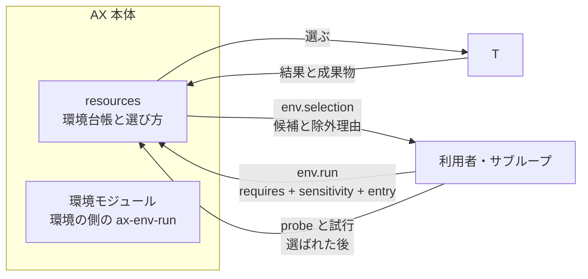

# 実行環境（host / sandbox / cloud box を AX の管理下に入れる）

この文書は別のホストや使い捨ての計算機やクラウドの箱を AX の実行環境として管理下に入れる手順です。
環境モジュールの構成と操作をこの文書で説明します。
この文書は利用者向けの要約と手順で、設計の正本ではありません。ここに無い約束は設計文書が優先します。

> 概要（3行）
> AX は環境ごとに小さなプログラム `ax-env-run` を置き、本体に実行と確認の依頼を出すだけです。環境の種類が違っても依頼の形は同じで、本体のコードは変えずに設定だけ追加します。使う前に `probe` と試行のジョブで確かめ、違えばその環境だけを外します。

## 目次

1. [全体像](#1-全体像)
2. [環境の種類](#2-環境の種類)
3. [環境モジュールの置く場所](#3-環境モジュールの置く場所)
4. [`ax-env-run` のサブコマンド](#4-ax-env-run-のサブコマンド)
5. [`probe` と `validate`](#5-probe-と-validate)
6. [強制コマンドの鍵](#6-強制コマンドの鍵)
7. [`audit-readonly` について](#7-audit-readonly-について)
8. [配置 `placement`](#8-配置-placement)
9. [情報の区分](#9-情報の区分)
10. [新しいホストを足す手順（段階ごと）](#10-新しいホストを足す手順段階ごと)
11. [有効化の条件](#11-有効化の条件)
12. [版と互換](#12-版と互換)
13. [取り外しと鍵の回転](#13-取り外しと鍵の回転)
14. [確かめの項目](#14-確かめの項目)
15. [してはいけないこと](#15-してはいけないこと)
16. [現状の注意](#16-現状の注意)

## 1. 全体像

AX の本体は `resources` という部品が持つ実行環境の台帳で管理します。
環境ごとの作業は「環境ジョブ」と呼び、`job_id` で一意に識別します。



- 「環境の側」は、環境モジュールが動くホスト・コンテナの内側を指します。環境の種類は違っても、実行と結果の形は同じです。
- 依頼の形は三つのアダプタ（`local`、`ssh-host`、`container`）で共通です。違いは環境の中のコマンドを呼ぶ手段だけです。使い捨ての箱（`cloud-sandbox`）は別の仕組みです（§2）。
- 環境モジュールは `ax-env-run` と `manifest.yaml` と入口の定義を持つ一式です。雛形は `templates/env/` にあります。`templates/env-module/` は未実装です。
- 本体のコード変更を伴う契約変更では、契約の版と環境モジュールを更新します。

## 2. 環境の種類

`manifest.yaml` の `kind` と、台帳の `adapter`（同じ値）で決まります。表に無い組み合わせは登録できません。

| 種類（`kind`） | 場所の例 | 接続（`transport`） | アダプタ | 環境モジュール |
|---|---|---|---|---|
| `ssh-host` | 別の VPS、自宅のサーバー、借り物の計算機 | `ssh` | `ssh-host` | `ax-env-run` を `~/.ax-env/` に置く（§3） |
| `container`（tailnet に乗れる） | tailnet に乗れるコンテナ | `ssh`（コンテナの sshd を tailnet で受ける） | `container` | `ax-env-run` を `/ax-env/` に置く |
| `container`（tailnet に直接乗れない） | 別の `ssh-host` 環境の内側のコンテナ | `relay`（経路の台帳の中継を通す） | `container` | 同上。経路の ID `relay_route` を台帳に書く |
| `container`（AX 自身のコンテナ） | AX の compose の中を環境にする場合 | `local` | `local` | 同じ契約 |
| `cloud-sandbox` | box（Simular）と Instabox の使い捨ての箱 | 提供元 API または MCP（ドライバで閉じる） | `cloud-sandbox` | 置かない（下） |

### 使い捨ての箱（`cloud-sandbox`）は環境モジュールの対象外

- box と Instabox は、AX の部品が使うツールとして扱います。`ax-env-run` は置かず、`manifest.yaml` も導入の手順も持ちません。
- 箱の中のラッパー `ax-sbx-run` は、box にも Instabox にも置く実行物で、環境モジュールの `ax-env-run` とは別の物です。共有の外部環境として環境台帳に載り、プラグインではありません。
- 箱の資格は `resources` が持ち、環境には渡しません。用途は隔離実行、公開 Web の画面操作とスクリーンショット、Windows 以外の画面作業だけです。`npx @simular-ai/box connect` は使いません。`box_delete` は呼ばない決まりです。
- Windows の Computer Use は環境ではなくツールです。`kind` に `windows-*` は定義せず、台帳に登録できません。

コード：`core/resources/envs/contracts.py` の `ADAPTERS` と `ENVIRONMENT_STATES`、`core/resources/envs/adapters/base.py`（`BaseEnvironmentAdapter`）、`docs/b18b/box/README.md`（box ドライバ）。

## 3. 環境モジュールの置く場所

環境モジュールの導入は冪等です。同じ操作を何回しても、置き方が台帳の値と違う物は勝手に直しません（`current` が別の版を指すときは切り替えずに止まります）。

環境の中の実行時の配置は次のとおりです。

```
$AX_ENV_HOME/                 既定は ~/.ax-env（ssh-host）、/ax-env（container）
  releases/<module_version>/  導入した版。更新は並べて置く
  current -> releases/<ver>   現在の版への印
  bin -> current/bin          固定のパス。強制コマンド ax-env-run の絶対パス（導入が一度だけ作る）
  entrypoints -> current/entrypoints   固定のパス。入口の実行物 entrypoints/bin/<入口名>
  manifest.yaml               導入時の manifest（本体が登録した物と照合する）
  jobs/<job_id>/              ジョブの記録（§4 参照）
  index/idem/<hash>           idempotency_key から job_id への対応
  run/slots/                  同時実行の枠（max_concurrent）
  archive/                    取り外しと整理で移した物
  tmp/                        一時ファイル（TMPDIR が設定済みならそちらを使う）
  DETACHED                    取り外し済みの印（あれば入口は動かない）
```

- **固定のパス**：`authorized_keys` の強制コマンドは `<ホーム>/.ax-env/bin/ax-env-run` です。入口の実行物は `<ホーム>/.ax-env/entrypoints/bin/<入口名>` です。`bin` と `entrypoints` は `current` を経由する相対のシンボリックリンクなので、更新と切り戻しで `current` だけを切り替えれば、この絶対パスは変わりません。`authorized_keys` の行を書き換えません。
- 導入先は利用者の権限の範囲（ホームの下）に限ります。システムの設定は既定では変えません。管理者権限が要る導入は、`check.sh` が表示して止まります。
- 秘密の値をテンプレートにも `manifest.yaml` にも書きません。資格は名前と置き場所だけを書きます。

### B6 の最小版（現状の導入物）

- B6 の時点では `host/env-module-min/releases/b6/` に最小版があります（`VERSION` は `0.1.0-b6`、`CONTRACT` は `1.0`）。`bin/ax-env-run` はシェルの薄皮で、本体は `lib/ax_launcher.py` です。
- `host/env-module-min/install.sh` が `~/.ax-env/` に置きます。`releases/b6/` の複製と `current -> releases/b6`、`bin -> current/bin` を作ります。`authorized_keys` には触れません。
- B6 の最小版が持つのは `job-start` / `job-status` / `job-stop` / `job-retire` / `job-list` の5つ（worker-pool のジョブ用コンテナの起動に使う。`--caller launcher`）。`--caller env` の `submit` などは終了コード 70（`not_implemented`）で返す設計です。B14b が同じファイルを広げます（`releases/<版>` を並べて `current` を切り替え、`authorized_keys` の行は変えません）。

## 4. `ax-env-run` のサブコマンド

`ax-env-run` は、本体のアダプタが呼ぶ唯一の口です。出力は1行の JSON（`logs` と `fetch` の本体は除く）です。どのサブコマンドも秘密の値を出力に含めません。

| サブコマンド | 内容 |
|---|---|
| `submit <job_id>` | 標準入力から tar（`spec.json` と `in/`）を受け取り、内容ハッシュを確かめ、ジョブを作って開始します。枠が満ちていれば `busy` で返します |
| `status <job_id>` | `state.json` の内容（状態、開始・終了時刻、`seq`） |
| `logs <job_id> --since <seq>` | `events.jsonl` と標準出力・標準エラーの続き |
| `fetch <job_id> [name]` | 成果物の一覧（名前、大きさ、内容ハッシュ）と、名前を指定したときの本体 |
| `cancel <job_id>` | そのジョブのプロセスグループだけを止めます |
| `lookup <idempotency_key>` | `index/idem/` から `job_id` と状態を返します。なければ `none` |
| `release <job_id>` | 回収済みの印。`in/`・`work/`・`out/` を `archive/<job_id>/` へ移します。削除しません |
| `secret-put <target 名>` | 遠隔の秘密投入。値を標準入力で受け、`manifest.yaml` の `secret_targets` の場所に権限 600 で保存します（§4.1）。`--caller env` だけが呼べます |
| `probe` | 環境の確認（§5） |
| `validate` | `manifest.yaml` と入口の定義を検査します（導入前に使います） |
| `version` | `module_version`、`contract`、`manifest.yaml` の内容ハッシュ |

呼び出し元の名前は強制コマンドの引数 `--caller <名前>` で固定します（接続した側は変えられません）。`env` は上の表のサブコマンドだけを許し、`launcher`（`host-a-local` の worker-pool 用）は `job-*` だけを許します。相手のサブコマンドは終了コード 2（`rejected`）で拒否します。省略は `env` と同じ扱いです。未知の名前はすべて拒否します。

終了コードは次のとおりです。失敗でも1行の JSON を返し、`error.class` と短い説明を持ちます。

| コード | 意味 |
|---|---|
| 0 | 成功 |
| 2 | 依頼の不備（`rejected`） |
| 3 | 見つからない |
| 4 | 満枠（`busy`） |
| 5 | 取り外し済みまたは停止の印あり |
| 70 | 内部の失敗 |

ジョブの記録（`jobs/<job_id>/`）は次です。書き込みは一時ファイルに書いてから名前を変えます。切断や再起動の後は、この記録から状態を取り戻せます。

| ファイル | 内容 |
|---|---|
| `spec.json` | 受け取った依頼（秘密を含まない） |
| `state.json` | `state`、`seq`、`started`、`finished`、`module_version`、`contract`、`idempotency_key`、プロセスグループの印 |
| `events.jsonl` | 1行1件の事象（`seq`、`ts`、`level`、`msg`） |
| `stdout.log`、`stderr.log` | 入口の出力 |
| `in/`、`work/`、`out/` | 受け取った入力、作業場所、成果物 |
| `artifacts.json` | 成果物の一覧（名前、大きさ、sha256） |
| `result.json` | 終了時に1回だけ書く（§4.2） |

### 4.1 `secret-put` の約束

遠隔の秘密投入です。ジョブではありません（`jobs/` に記録を作りません）。実行する部品は `resources` の `ssh-host` アダプタだけで、HQ は `secret.push {slot}`（値を含まない）の依頼を出すだけです。

- 呼び方：`ax-env-run --caller env secret-put <target 名>`。値は標準入力（SSH の標準入力）だけで渡します。引数、環境変数、ファイル名に値は載せません。パスは呼び出し元が指定できず、`<target 名>` から `manifest.yaml` の値を引きます。台帳（`config/environments.yaml`）と `manifest.yaml` の両方に載った場所だけが投入先になります。
- 拒否（終了コード 2、`error.class: rejected`。値は読まず、何も書きません）：target 名が `secret_targets` に無い。標準入力が空、または `max_bytes`（1〜65536）を超える。パスの末端がシンボリックリンク。親ディレクトリを `realpath` した結果が、`manifest.yaml` のパスの親ディレクトリと違う。停止の印（`stop_files`）がある。親ディレクトリが無いときは作らず終了コード 3（`target_dir_missing`）。
- 動作：既存のファイルがあれば、上書きの前に同じ親ディレクトリの `archive/<ファイル名>.<UTC日時>` へ複製します（`archive/` は権限 700、複製は権限 600。ホストの外へ退避しません）。次に同じ親ディレクトリに一時ファイルを作り、`fsync`・`chmod 600`・`rename` で置き換えます。書き込みが途中で失敗したら、一時ファイルを `archive/` へ移します（削除しません。権限 600 のまま）。元のファイルは変わりません。
- 出力（1行の JSON）：`{"ok": true, "target": "<名>", "size": <バイト数>, "mtime": "<UTC>", "mode": "600", "archived": "<複製の名前または null>"}`。値、先頭の文字、ハッシュは出しません。確認はサイズと更新時刻で行います。

### 4.2 結果とログの返し方

どの種別でも、同じ形で返します。本体は `result.json` を読み、種別を見ません。

```json
{"schema": 1, "job_id": "...", "state": "succeeded", "outcome": "ok",
 "entry": {"kind": "entrypoint", "name": "ci-run"},
 "module_version": "1.0.0", "contract": "1.0",
 "started": "...", "finished": "...", "exit_code": 0,
 "artifacts": [{"name": "result.json", "size": 123, "sha256": "..."}],
 "summary": "短い要約（秘密を含まない）",
 "error": null, "report": null, "verify": null,
 "cleanup": {"resident_processes": 0, "resident_containers": 0,
             "tracking": "complete", "archived_to": "archive/<job_id>/"}}
```

- `outcome` は `ok`、`blocked`（停止の印などで中身を実行しなかった）、`bug`（入口の失敗）のどれかです。`state` は本体の状態のままです。`blocked` は新しい状態にせず、`outcome` で表します。
- `error` は失敗のときだけ `{class, message}` を持ちます。`class` は `rejected`、`busy`、`timeout`、`stalled`、`exit_nonzero`、`secret_detected`（モジュール側で見つけた場合）、`internal` のどれかです。
- 回収したログと成果物は、本体の秘密検査（S-15.3）を通ってから記録に入ります。検出したらその成果物を取り込まず、ジョブは `failed`、環境は `degraded` にし、カードに出します。モジュール側の検査は代わりになりません。

コード：`host/env-module-min/releases/b6/lib/ax_launcher.py`（B6 の最小版。`dispatch` で `--caller` を分岐する部分）、`core/resources/envs/adapters/base.py`（成果物の内容ハッシュの照合と秘密検査）。

## 5. `probe` と `validate`

### 5.1 `probe` の応答

`probe` は副作用を持ちません。入口の実行物を実行せず、有無と定義の内容ハッシュを見るだけです。外へ送りません。

| 項目 | 内容 |
|---|---|
| `env_id`、`module_version`、`contract`、`manifest_sha256` | 本体の台帳の値との照合に使う（§12） |
| `time`、`clock_skew_s` | 環境の時刻。本体との差 |
| `entrypoints` | 各入口の名前、実行物の有無、定義の内容ハッシュ。`dry_run` に対応する入口は印を付ける |
| `capabilities_checked` | 能力ごとの確認結果。確認できない能力は `unverified` と書き、`ok` にしません |
| `free` | 空き（実行中の数、枠の残り、ディスクの空き） |
| `resident_check` | `no_resident` の環境で、ジョブ単位の隔離と識別で追跡した常駐プロセスとコンテナの数。環境に元からある常駐は数えません。追跡不能なら `unknown` とし、0にしません |
| `worker` | worker を申告した環境だけ。runner の有無、隔離の確認結果 |
| `detached` | `DETACHED` の有無 |

### 5.2 `validate`

導入の前に `manifest.yaml` と入口の定義を検査します。`irreversible: true` の入口は `dry_run: supported` を必須とします。足りない定義は `validate` が拒否します。

## 6. 強制コマンドの鍵

SSH の強制コマンド（`authorized_keys` の `command=`）で、接続した側が `ax-env-run` の呼び出し元とサブコマンドを変えられなくします。

### 6.1 行の形

`restrict` と `from=` で送信元を絞り、`command=` は絶対パスで書きます。`--caller` は強制コマンドが固定するので、接続した側は変えられません。行の形の例です（プレースホルダで書いています。実値は書きません）。

```text
restrict,from="<送信元アドレス>",command="<ホーム>/.ax-env/bin/ax-env-run --caller env" ssh-ed25519 <公開鍵> ax-env-<環境ID>
```

- `host-a-local` の行だけ、送信元も固定します。worker-pool 用の鍵（`launcher-ssh-key`、`--caller launcher`）と `resources` 用の鍵（`env-ssh-host-a-local`、`--caller env`）は別で、使えるサブコマンドも別です。同じ `authorized_keys` に2行が並びます。
- 強制コマンドが使えない環境でも、`ax-env-run` は自分の側でサブコマンドと入口の名前を許可リストと照らして検査します。
- 足す前に `cp -p ~/.ssh/authorized_keys` で控えを作ります。既にある 1 行（例：host-c の `command="sudo ..."`）は書き換えず、環境用の 1 行を足します。

### 6.2 鍵の分離

- 接続用の資格（`conn_credential`）はアダプタ（`resources`）だけが読みます。サブループとワーカーのコンテナには渡しません。`launcher-ssh-key` は worker-pool にだけ渡り、`resources` には渡しません。両方を持つコンテナは作りません。
- 鍵なしの環境（host-d の Tailscale SSH）は送信元で認可され、経路でも `resources` だけに限ります。
- ホストの `DOCKER-USER`（`host/ax-fw.sh` が作る）で、AX のブリッジから `tailscale0` への転送を捨て、`resources` から登録済みの環境への通信だけを許します。例外は1本だけで、退避コネクタ `archiver` から host-b の退避用の口（profile の `archive_dest`）への通信です。

コード：`host/env-module-min/releases/b6/lib/ax_launcher.py`（`parse_invocation` で `--caller` と `SSH_ORIGINAL_COMMAND` を読む）、`host/ax-fw.sh`（`DOCKER-USER` の規則）。

## 7. `audit-readonly` について

`audit-readonly` は読み取り専用の監査の入口です。セキュリティ監視のタイマーが毎日出します。

- 入口は `kind: command`、`exec` は `entrypoints/bin/audit-readonly` です。引数はなく、出力は `audit.tsv` です。読み取り専用で資格は要りません。
- 動く場所：`host-a-local`、`host-b`、`host-e`、`host-c` の4つの環境で同じ定義を使います。`scope: each` で1台ずつ回ります（host-d は対象外）。
- 取得するもの：旧監視と同じ取得項目を1行1項目の TSV にした物です。1行目 `# ...`、行の先頭が分類です。`sudo -n sshd -T` の実効値の行 `sshd_effective` を含みます。root 以外は `sudo -n` を試み、使えなければ通常権限の範囲で採取して `COVERAGE` 行に範囲を書きます。
- 実体：旧監視の採取スクリプト（リモートにファイルを作らない形）を `entrypoints/bin/audit-readonly` に写した物です。構築時に写し、写した版の SHA-256 を導入の記録に残します。リモートにファイルを作らない形です。

## 8. 配置 `placement`

ワーカーの依頼には作業の置き方 `placement` を指定します。

| 値 | 意味 |
|---|---|
| `local`（既定） | 従来どおり host-a のコンテナで動きます。実体は S-8.11（ジョブ用コンテナの起動）です |
| `env` | 他の環境で動きます。環境ジョブ（`entry.kind: worker`）を作ります。該当する環境が無ければ `parked` になり、`local` に黙って回しません |
| `any` | どちらでもよい。負荷分散を許します |

- `env` と `any` の依頼は、環境の側で同じ規則（新しい隔離環境、`workdir` だけを読み書き、許可先だけの通信、`verify` の実行、`STATUS` の読み取り）で動き、枠は系統とモデルの枠と環境の `max_concurrent` の両方を確保します。
- 環境ワーカーの依頼で `irreversible: true`、および `model_gateway` 以外の `secrets` を要求する物は `rejected` です。隔離を確認できない環境へはワーカーは出ません。
- 環境の成功は、`verify`（環境の側で別の手順として実行され、終了コードで合否を決める）と、報告の `STATUS` が両方合格したときだけ成立します。ワーカー本人の合格の主張は採用しません。

## 9. 情報の区分

情報の区分は3つです（S-15.1）。区分を下げません。選び直しても `sensitivity` は変えません。

| 区分 | 例 | 渡してよい先 |
|---|---|---|
| `public` | 公開リポジトリ、公開の文書 | すべてのモデル、すべての実行環境 |
| `private` | 非公開リポジトリのコード | 登録済みのモデル。`data_classes` が `private` を許す実行環境（常設の自前のホストなど）。`cloud-sandbox` には渡しません |
| `sensitive` | 基盤の設定、サーバーの中身、利用者の個人情報が混じる物 | `tier` が `standard` 以上の登録済みのモデルだけ。環境は `data_classes` が `sensitive` を許す物（`cloud-sandbox` は不可） |

- `manifest.yaml` の `data_classes` は申告です。台帳の値より広くても使えません（§12）。探す依頼の実効区分は、依頼・入力・出力のうち最も厳しい物です（`core/resources/envs/contracts.py` の `effective_sensitivity`）。
- `secrets_allowed` は、本体から秘密を渡してよいかです。既定は `false` です。`secret_targets`（遠隔の秘密投入）とは別の関門で、書かなければ空で、`secret-put` は常に拒否されます。
- 利用者が登録した（資源台帳・models に入れた）モデルと提供元へは、それだけで送ってよい許可とみなします。学習利用（`trains_on_input`）は送り先の条件にしません。

コード：`axcommon/policy.py` の `allowed` と `most_restrictive`、`core/resources/envs/contracts.py` の `effective_sensitivity`。

## 10. 新しいホストを足す手順（段階ごと）

新しい VPS やコンテナを管理下に置く手順です。この手順は、環境の種類と数に関わらず同じです。本体のコード変更は要りません。変更するのは設定ファイル（台帳、経路の台帳）の項目だけです。

| 段 | 内容 | 誰が | 確認の目安 |
|---|---|---|---|
| 0. 準備 | ホストに SSH で入れること、必要な前提（シェル、tar、必要な隔離の機能）を確かめる | 利用者 | 接続先と権限 |
| 1. 複製 | 環境用の雛形を用意する。`templates/env-module/` は未実装 | 利用者、または `core.change` | 元のテンプレートが変わっていないこと |
| 2. 記入 | `manifest.yaml` を記入し、必要な入口を `entrypoints/` に足す | 同上 | `ax-env-run validate` が通ること |
| 3. 導入 | 最小版は `host/env-module-min/install.sh` で導入し、`--check` で配置を確認する | 利用者の指示で実行 | `ax-env-run version` が `manifest.yaml` と一致すること |
| 4. probe | 環境の中で `ax-env-run probe` を実行し、応答の形と中身を確かめる | 同上 | 応答が schema に合うこと |
| 5. 台帳への登録 | `config/environments.yaml` に項目を足す。`state: trial` で登録する。経路を使うときは経路の台帳にも登録する | `core.change`（利用者の指示） | 本体が `probe` を呼び、`manifest.yaml` と台帳の照合（§12）が通ること |
| 6. 試行の作業 | 試行用の入口（`ax-trial-*`）で、試行のジョブを `trial_for: <env_id>` で投入する | 本体が自動で実行 | 下の試行の内容がすべて期待どおりであること |
| 7. 有効化 | 試行の結果が揃ったら、`state: available` にする | `core.change`（利用者の指示） | `env.selection` に候補として出ること |

### 10.1 段0 準備

- 導入はホストから行い、コンテナからは行いません。既存の SSH の別名と鍵を使います。
- 足す前に環境の `authorized_keys` の現物を読んで記録します（既に `command=` の行があるか）。
- ローカル環境では scp や ssh を使わず、利用者が `host/env-module-min/install.sh` を実行して `~/.ax-env/` に導入できます。

### 10.2 段1 複製

- `templates/env-module/` は未実装です。環境設定の雛形には `templates/env/` を使います。
- `core.change` の依頼で複製する場合は、複製先を環境ごとに別のディレクトリにします。

### 10.3 段2 記入

- `manifest.yaml` を記入し、必要な入口を `entrypoints/` に足します。
- 値は例です。実際の値を確認し、項目の一覧は §4 の表、雛形は `templates/env/environment.template.yaml` を参照してください。
- `manifest.yaml` と台帳（`config/environments.yaml`）の対応を取ります。台帳は `core/resources/envs/registry/loader.py` が読み、必須の項目と資格の値の有無を検査します。秘密の値を台帳に書けません。

### 10.4 段3 導入

- `templates/env-module/` の導入スクリプトは未実装です。container 種別はイメージを作り `compose up` します。`ports:` は書きません。イメージの版を固定します。
- B6 の最小版の場合は `host/env-module-min/install.sh` です。`~/` 配下の `~/.ax-env/` の既定は `$AX_ENV_HOME` か `$HOME/.ax-env` です。`--check` は何も書かず、置き方だけ確かめます。

### 10.5 段4 probe

- 環境の中で `ax-env-run probe` を実行します。応答が schema に合い、本体の台帳の値と照合します。確認できない能力は `unverified` のまま残し、`ok` にしません。

### 10.6 段5 台帳への登録

- `config/environments.yaml` に項目を足します。`state: trial` で登録します。経路（`transport: relay`）を使うときは、経路の台帳（`config/routes.yaml` に `kind: tunnel`）にも登録します。
- 登録だけでは `confirmed` になりません。`probe` が成功してから `confirmed` にします。
- 台帳の更新（追加、能力、区分、`rank`）は、利用者の指示と設計の変更（`core.change`）だけで行います。

### 10.7 段6 試行の作業

- `trial` の環境は、自動選択に出ません。`GET /v1/envs/select` の候補、負荷分散、`scope: each` のどれにも入りません。試行のジョブ（`trial_for` を持つ物）だけが、その環境へ入れます。
- 試行のジョブは `sensitivity: public` で `secrets` を持たず、`ax-trial-*` の入口だけを呼べます。それ以外の入口は、`trial` の間は `rejected` です。
- 試行の内容：`ax-trial-echo`（成果物の名前・大きさ・ハッシュが返り、`lookup` と同じ `idempotency_key` の再投入が1件）、`ax-trial-cancel`（指定したジョブだけが止まる）、`ax-trial-canary`（秘密の形を模した文字列を出力し、本体の秘密検査が止める）、区分の拒否（`private` の依頼が、`public` だけの環境へ渡らない）、`ax-trial-resident`（`no_resident` の環境でジョブが起動した常駐のプロセスとコンテナが 0）、`ax-trial-worker`（worker を申告した環境だけ。`verify` の終了コードが返る）。
- 試行に失敗した環境は `trial` のまま残り、有効化しません。他の環境と本体は影響を受けません。

### 10.8 段7 有効化

- 試行の結果が揃ったら、`state: available` にします。
- 有効化の判断は、利用者の指示と `core.change` の承認が要ります。試行が通っただけでは有効化しません。

### 10.9 API の呼び方（本体の資源台帳の口）

```text
POST /v1/env/jobs                     投入。選び方（S-25.4）に従い環境を選ぶ
GET  /v1/env/jobs/{id}                状態（9つの状態のうち環境の側で付けられるものは下記）
GET  /v1/env/jobs/{id}/logs?since=    ログの末尾
GET  /v1/env/jobs/{id}/artifacts      成果物の一覧
GET  /v1/env/jobs/{id}/artifacts/{name} 成果物の本体
POST /v1/env/jobs/{id}/cancel         指定したジョブだけを取り消す
GET  /v1/envs                         台帳の状態、空き、除外の理由と期限
GET  /v1/envs/select?path=J           選ぶだけ（枠を取らず、走らせない）
POST /v1/envs/{id}/probe              到達、能力、空きの確認
```

- 環境の側で付ける状態は `queued`、`running`、`succeeded`、`failed`、`timed_out`、`stalled`、`cancelled`、`rejected` です。`lost` は本体の側が、記録を読めないときに付けます。
- 選ぶ API（`GET /v1/envs/select`）は `path` が `J`（既定。`env.run` の選び）か `G`（経路 G の選び。`tools` を持つ依頼）です。`path=J` は `requires` と `sensitivity` が必須です。枠は取りません。`record` は経路 G でだけ `env.selection` を書くために使います。

## 11. 有効化の条件

有効化（`state: available`）の条件です。すべて満たす必要があります。

1. `probe` が通り、`manifest_sha256` が台帳の値と一致する
2. 契約の版が互換（`MAJOR` が本体と同じで、`MINOR` が本体以下）
3. 試行のジョブ（`ax-trial-*`）がすべて期待どおり
4. 利用者の指示と `core.change` の承認がある

有効化できない条件です。

- 試行が失敗した
- `probe` の応答が schema に合わない
- 契約の不一致（その環境だけ `excluded`、理由 `contract_mismatch`）
- `manifest.yaml` の食い違い（その環境は `degraded`、理由 `manifest_drift`。再登録まで台帳の値で動く）

有効化の後も、環境は随時 `degraded`・`excluded`・`draining`・`retired` に移ります（§12 と §13）。

## 12. 版と互換

- 契約の版は `MAJOR.MINOR` です。本体は対応する範囲（`MAJOR` と、`MINOR` の上限）を台帳の見出し `contract_supported` に持ちます。モジュールの `contract` は `manifest.yaml` と `probe` の応答に載ります。
- 互換：`MAJOR` が本体と同じで、`MINOR` が本体以下なら互換です。`MINOR` は追加だけの変更に限ります。項目の削除・意味の変更は `MAJOR` を上げます。
- 不一致（`MAJOR` が違う、またはモジュールの `MINOR` が本体より新しい）の環境は、その環境だけ `excluded` にします。`probe` が互換に戻れば自動で `available` に戻ります。期限は待ちません。
- `module_version`（`X.Y.Z`）は更新の管理に使います。互換の判定には使いません。ジョブの記録には開始時の `module_version` と `contract` を残します。
- `probe` の `manifest_sha256` が、登録時の値と違えば、事象にして環境を `degraded` にします（理由 `manifest_drift`）。再登録（`core.change`）まで、台帳の値で動きます。
- 台帳より `manifest.yaml` が広い申告（区分、能力、上限）は無視します。台帳が優先します。台帳より `manifest.yaml` が狭い申告は、狭い方を実効値とします（安全側）。

## 13. 取り外しと鍵の回転

### 13.1 取り外し

- 取り外しは `install/detach.sh`（B6 の場合は `host/env-module-min/` の置き換え）で行います。削除しません。作業ディレクトリ、ジョブの記録、`releases/` を `archive/detached-<日時>/` へ移します。container 種別は `compose stop` で止め、コンテナとボリュームは残します（`rm` 系を使いません）。台帳の項目は残し、`state` を変えるだけにします。
- `DETACHED` を作り、入口は動かなくなり、`probe` は `detached` を返します。本体は環境を `draining`、実行中のジョブの終了後に `retired` にします。
- 削除はしない決まりです。古い実行記録・ログ・一時物は `archive/` へ移します。戻しにくい操作（削除・リネーム）は事前に利用者へ確認します。

### 13.2 更新

- `install/update.sh` で新しい版を `releases/` に並べて置き、`current` を切り替えます。前の版は残ります。
- 実行中のジョブがあるときは、既定で止まります（`--drain` を付けると、新しいジョブを受けず、終わるのを待ってから切り替えます）。ジョブの記録は開始時の版を持ち、実行中のジョブは開始時の版で完走します。
- 戻すときは `current` を前の版へ向け直します。`contract` が持ち上がる場合があります。本体が対応する範囲外なら、`probe` で不一致になり、その環境だけが外れます（§12）。

### 13.3 鍵の回転

- 鍵の回転は「新しい鍵を作り、古い鍵を失効させる」形です。使っているコンテナは restart します（`host/env-module-min/` の場合は `store.reload` ではなく、対象の SSH 鍵ファイルの置き換えと restart です）。
- `launcher-ssh-key` は SSH 鍵です。接続先の `authorized_keys` に登録した対応する公開鍵を失効させます。caller `ax` の gateway key は別の鍵で、その回転と失効は `docs/b6b/procedure-caller-ax-key.md` を参照してください。個別の指示が無い限り失効はしません。
- 回転した後は §5 の `probe` と §4 の `version` で通ることを再確認します。通らなければ環境は `excluded` になり、その環境だけを要る作業は `parked` になります。回転の前後で信頼性が下がる時間があっても、他の環境への影響はしません。

## 14. 確かめの項目

環境を管理下に入れたら、次の項目を確認します。B6 の実環境の確認（`docs/b6b/real-env-checks.md` の T-40、T-118、T-122、T-124、T-182）を含みます。

| 項目 | 確かめ方 |
|---|---|
| `ax-env-run version` が `manifest.yaml` と一致する | `ax-env-run version` の出力と `manifest.yaml` の `module_version` と `contract` を比べる |
| `probe` の応答が schema に合う | `ax-env-run probe` の応答が `schema/probe.schema.json` に合うこと。`capabilities_checked` の `unverified` が残っていないこと |
| 強制コマンドの制限 | `job-list` と `probe` を同じ鍵で送ると、`--caller env` の `job-*` は終了コード 2（`rejected`）で拒否される。`--caller launcher` の `probe` は拒否される。許可した送信元以外の `ax-work` のコンテナからは接続できない |
| 隔離 | 偽の runner で `job-start` し、`sudo -n docker inspect` で `Privileged` が false、`CapAdd` が空、`ReadonlyRootfs` が true、`ax-job` 網、`Mounts` が `/work` と `/tmp-hdd` の2つだけ、ソケットの bind が無いことを確かめる |
| 外へ届かない | `ax-job` のコンテナから AX のホスト（例えば AX のホスト（`<AX_HOST>`）のモデルゲートウェイのポート）と任意の外部ホストへ直接届かない。`egress-proxy` 経由で許可先だけが通り、ないホストへの `CONNECT` は 403 |
| 許可リストの拒否 | `ax-env-run` に未知のサブコマンドとイメージ指定を送ると拒否される |
| fail-soft | 環境が使えなくても、他の環境と AX 本体は止まらず、該当する作業だけが `parked` になる |
| `audit-readonly` の実効値 | `sudo -n sshd -T` の実効値の行 `sshd_effective` が `passwordauthentication no` であること（S-25.14） |
| 常駐の管理外 | host-e・host-a・host-d に元からある常駐コンテナは AX が起動した物ではないので、数えず、停止・撤去・管理しないこと。`resident_check` の数値に混ぜないこと |

## 15. してはいけないこと

| してはいけないこと | 理由 |
|---|---|
| 環境モジュールに秘密の値を書く（`manifest.yaml`、テンプレート、ジョブの記録） | 資格の値は `secrets_dir` と、環境の中の `work_credentials` の置き場所にだけ置く。台帳と manifest は名前と場所だけを書きます |
| `authorized_keys` の 1 行を書き換える | 入口の絶対パスは `current` を経由して不変です。既存の 1 行は残し、足すだけにします |
| `resources` に `launcher-ssh-key` を渡す | worker-pool 専用の鍵です。`resources` には別の鍵 `env-ssh-*` を渡します。両方を持つコンテナは作りません |
| コンテナから ssh して導入する | 導入はホストから行います。ホストの別名と鍵で実行します |
| 公開ポートを足す | 環境の経路は tailnet と経路の台帳を再利用します。新しい公開ポートを作りません |
| 削除する | 取り外しと整理は、環境内の `archive/` への移動で行います |
| `manifest.yaml` の申告を独断で広げる | 台帳の値より広くても使えません。台帳の更新は利用者の指示（`core.change`）だけです |
| `private` や `sensitive` を `cloud-sandbox`（box、Instabox）に渡す | 箱は `public` だけを受けます |
| 個人情報・秘密を外部へ送る | 秘密と個人情報を含む物は、送る前に記録から除きます |
| Windows を環境として登録する | Windows の Computer Use は環境ではなくツールです |

## 16. 現状の注意

- **`templates/env-module/`（設計文書の正本）と `templates/env/`（この文書の雛形）の扱い**：この repo の `templates/` に env-module のテンプレートはまだありません。`templates/env/` は利用者向けの雛形（この文書の雛形）です。設計が正本の `templates/env-module/` が将来入ったら、そちらが正本になります。
- **B6 の最小版の状態**：`host/env-module-min/` は B6 の最小版です。`--caller env` のサブコマンド（`submit` など）は B14b が実装します。`tests/b14b1/` は所有 API の偽物でのみ確認する形で、実在の接続は未実行です（`docs/b14b1/adapters/README.md` と `docs/b18b/README.md` の「確認」の節）。
- **リース版は機能していない（no release）**：この repo でビルドされた `ax-env-run` のリース版（`releases/b6/` の複製以外）はまだありません。現実には、holed な環境（初日の5環境）への導入は「テンプレートと契約（B14b）の後に行う」とされています。`host-d` の Tailscale SSH で強制コマンドが使えるかは未確認です。使えなくても `ax-env-run` 側の検査で足ります。
- **情報の区分と環境の選び方**：`POST /v1/env/jobs` と `GET /v1/env/jobs/{job_id}` は `core/resources/envs/jobs.py` が実装し、resources が組み込みます。環境選択と `placement` の分岐は `core/resources/ext/b18b.py` にありますが、その B18 の port には未接続の部分があります。

---

実装と雛形は `host/env-module-min/`、`core/resources/envs/`、`templates/env/` にあります。
