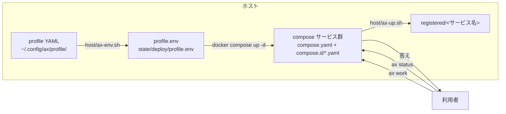

# はじめ方

この文書はAX を自分のホストに置き、最初の作業依頼まで通す手順です。
コードは `docs/` の設計どおりに動くことを前提に書いています。まだ実装が無い部分は「状態」の節に正直に書きます。

- 対象: AX を初めて立ち上げる人
- 必要なこと: ホストに Docker と compose が入り、Python 3.12 が使えます

## 目次

1. [全体像](#1-全体像)
2. [必要なもの](#2-必要なもの)
3. [置き場所](#3-置き場所)
4. [profile を書く](#4-profile-を書く)
5. [秘密ファイルを作る](#5-秘密ファイルを作る)
6. [環境変数ファイルを作る](#6-環境変数ファイルを作る)
7. [部品を起動する](#7-部品を起動する)
8. [状態の確かめ方](#8-状態の確かめ方)
9. [最初の依頼を出す](#9-最初の依頼を出す)
10. [止め方と片づけ](#10-止め方と片づけ)
11. [状態](#11-状態)
12. [うまくいかないとき](#12-うまくいかないとき)

## 1. 全体像

AX は docker compose のサービス群です。ホスト側は小さなシェルスクリプトしか使いません。
設定は `profile` という YAML ファイルに集まり、その内容から `host/ax-env.sh` が環境変数ファイルを作ります。
起動は `host/ax-up.sh` が行い、依頼は `ax` コマンド（入口 `intake` を呼ぶだけ）が送ります。



- 設定の正本はホストの `profile` です。リポジトリの中の `profile/example.yaml` は見本でしかありません。
- 秘密は `secrets_dir` の下のファイルに置き、値そのものは git に一切入れません。
- 状態は `ax_state_dir` の下に集まります（登録ファイル、イベント、ソケットなど）。

## 2. 必要なもの

| 項目 | 版・例 | どこに書いてあるか |
|---|---|---|
| Docker Engine | 29 系（`docker:29.1.3-cli` を参照） | `ci/docker-cli.lock` |
| Docker Compose | 2.40 系前後 | `ci/docker-cli.lock` の `compose_version` |
| ホストの Python | 3.12 以上 | `pyproject.toml` の `requires-python = ">=3.12"` |
| コンテナの Python | `python:3.12-slim` | `docker/Dockerfile.core`、`ci/Dockerfile.ax-ci` |
| uv | ビルド引数 `UV_VERSION` で渡す | `docker/Dockerfile.core`、`ci/uv.version` |
| sudo | パスワードなしで使えること | `host/ax-up.sh`（`sudo -n`） |

確認コマンドです。

```bash
python3 --version                 # 3.12 以上であること
uv --version
docker --version
docker compose version
git --version
```

### 状態: uv の版と依存の固定

- `ci/uv.version` に uv の版があり、`uv.lock` には依存の固定情報が収録されています。固定情報の存在はインストールの成功を意味しません。
- 依存は `pyproject.toml` の `dependencies` に一覧があります：`starlette`、`uvicorn`、`jsonschema`、`PyYAML`、`python-ulid`、`httpx`。
  開発用の `pytest` と `pytest-asyncio` は `dependency-groups` の `dev` にあります。

### 状態: ベースイメージのダイジェスト

- `ci/base-image.lock` と `ci/docker-cli.lock` の status は `verified` です。対象環境での取得やビルドの成功は別に確認してください。

## 3. 置き場所

AX はクローンした場所（`AX_HOME`）と、ホスト側の設定・状態を分けて持つ設計です。

| 場所 | 既定 | 内容 |
|---|---|---|
| `AX_HOME` | `~/.local/share/ax/prod` | リポジトリのクローン。イメージのビルドと compose の実行の場所 |
| profile | `~/.config/ax/profile/<名前>.yaml` | 環境の設定（`host/ax-env.sh` の既定の名前はスクリプトに固定してあります。§4 の状態を参照） |
| `secrets_dir` | `~/.config/ax/secrets`（権限700） | 秘密のファイル置き場 |
| `ax_state_dir` | `~/.local/state/ax` | 状態置き場（`/state` の実体） |
| `tmp_dir` | `<temp-dir>/ax` | 一時置き場（コンテナの `TMPDIR` は `/tmp-hdd`） |
| `~/.local/bin/ax` | （`host/ax` へのリンク） | `ax` コマンドの実体（`host/ax-up.sh` がリンクを作る） |

これらの既定値は `profile/example.yaml` に書いてあり、実物の値は `axcommon/profile.py` と `host/lib/hostwatch/envfinish.py` が検査します。
`AX_HOME` の既定は `axcommon/profile.py` の `DEFAULT_AX_HOME`（`~/.local/share/ax/prod`）です。
`ax-up.sh` も同じ既定を使います（環境変数 `AX_HOME` で上書きできます）。

clone の置き方です（例を手元に置く場合）。

```bash
git clone <AX のリポジトリの URL> ~/.local/share/ax/prod
cd ~/.local/share/ax/prod
export AX_HOME="$PWD"
ax_state_dir="$HOME/.local/state/ax" # profile の ax_state_dir に合わせる
```

## 4. profile を書く

### 雛形

`templates/profile/profile.template.yaml` をコピーし、すべての項目にコメントが付いた状態から埋めます。
項目の一覧は `profile/example.yaml` と同じです。書くときの注意は次のとおりです。

- `host` / `bind_addr` / `secrets_dir` / `tmp_dir` / `archive_target` / `environments_file` / `memory_endpoint` / `model_gateway` / `models_file` / `ntfy_endpoint` / `ntfy_topic` / `ax_state_dir` / `commander_socket` は必須です（`axcommon/profile.py` の `REQUIRED`）。空では通りません。
- `public_proxy_ip` と `gate_port` は任意で、空なら `gate_port` は既定の `8909` になります。
- `secrets_dir` / `tmp_dir` / `ax_state_dir` / `commander_socket` は絶対パスで書きます（`~` は展開できます）。相対パスはエラーになります。
- `environments_file` と `models_file` は `AX_HOME` からの相対パスで書きます。絶対パスはエラーになります。
- `bind_addr` は tailnet のアドレスか `127.0.0.1` のどちらかにします。`0.0.0.0` は通りません（`host/lib/hostwatch/envfinish.py` の `check_bind_addr`）。tailnet のアドレスは `tailscale ip -4` の出力と一致する必要があります。
- `${ax_state_dir}` の形で他の項目を参照できます（`seat_socket`、`seats_file`、`gate_peers_file` など）。
- 秘密の値は profile に書きません。場所と変数名だけを書き、値は `secrets_dir` のファイルに置きます。

### 例

```yaml
host: host-a
bind_addr: 127.0.0.1
secrets_dir: ~/.config/ax/secrets
tmp_dir: <temp-dir>/ax
archive_target: host-b
environments_file: config/environments.example.yaml
memory_endpoint: https://memory.example.invalid/mcp/
model_gateway: https://model-gateway.example.invalid/
models_file: config/models.example.yaml
ntfy_endpoint: https://notifications.example.invalid/
ntfy_topic: hub
commander_unit: example-commander.service
ax_state_dir: ~/.local/state/ax
commander_socket: ${ax_state_dir}/commander/commander.sock
seat_user: ax-seat
seat_socket: ${ax_state_dir}/seat/seat.sock
seats_file: ${ax_state_dir}/seat/seats.yaml
seat_gate_path: /usr/local/lib/ax-seat/ax
gate_port: 8909
gate_peers_file: ${ax_state_dir}/gate/peers.json
archive_sources: profile/archive-sources.yaml
env_ssh_targets:
  - {id: example-env, host: example-env.tailnet, port: 22}
archive_dest: {host: example-archive.tailnet, port: 2202, user: archive-user}
public_proxy_ip: 100.x.x.x
hq_access:
  iss: example-issuer
  jwks_url: https://example.invalid/jwks
  aud_secret: hq-access
  allowed_users_file: hq-allowed-users
  email_slot: hq-access-email
```

`hq_access` を書く場合、`iss` / `jwks_url` / `aud_secret` / `allowed_users_file` / `email_slot` の 5 項目すべてが必須です（`envfinish.py` の `check_types`）。

profile の置き場所は `~/.config/ax/profile/` です。実行するホストの名前をファイル名にするのが分かりやすいでしょう。

### 状態: 既定の profile の名前

`host/ax-env.sh` と `host/ax-up.sh` は、`--profile` を省くと `~/.config/ax/profile/default.yaml` を読みます。`AX_PROFILE_FILE` で別の場所を指定でき、`--profile` を渡した場合はその指定が優先されます。

```bash
mkdir -p ~/.config/ax/profile
cp templates/profile/profile.template.yaml ~/.config/ax/profile/default.yaml
```

## 5. 秘密ファイルを作る

秘密は `${secrets_dir}` の下に置きます。すべて権限 `0600`（`compose.yaml` の秘密の宣言と `ax-up.sh` の作り方がともに 600）です。
ファイルの名前と置き場所だけを一覧にします。値はここに書きません。

### 要るファイル

`templates/secrets/` に、必要な名前の一覧（`README.md`）と、値の入っていない置き場（空のファイル。自動作成される物は名前の最後に `.tmp-placeholder` を付けた物）があります。
実物は `${secrets_dir}` の下に作ります。

| 置き場所（`${secrets_dir}` の下） | 誰が使うか | 備考 |
|---|---|---|
| `model-gateway-key` | モデル呼び先 `model_gateway` の caller 鍵 | モデルゲートウェイの利用に必要な鍵を用意します |
| `control-apply-token` | 制御の適用 | `compose.yaml` の秘密 |
| `control-tokens/manager` | 管理役 | `compose.yaml`。`ax-up.sh` は `manager` の分だけ自動で作ります |
| `control-tokens/backup` | 予備役 | `compose.yaml` |
| `control-tokens/inspection` | 点検役 | `compose.yaml` |
| `control-tokens/emergency` | 緊急 | `compose.yaml` |
| `github-token` | GitHub の連携 | 利用する連携に必要な権限を確認します |
| `jev-key` | Jev | 機能の条件（無くても切り替えは止めません） |
| `pii-list` | 個人情報の伏せ字一覧 | `timeline`、`memory-connector`、`observer` が使う |
| `archive-ssh-key` | 退避の鍵 | `archiver` |
| `archive-known-hosts` | 退避先の既知ホスト | `archiver` |
| `launcher-ssh-key` | 環境への SSH | `worker-pool` |
| `hq-access` | HQ の公開入口の aud の値 | `hq` |
| `hq-allowed-users` | HQ の許可利用者 | `hq` / `gate` |

### 自動で作られるファイル

- `${secrets_dir}/plugin-tokens/<id>`：プラグインごとに、`ax-up.sh` が無いときだけ作ります（32 バイトの乱数の 16 進、権限 600）。
- `${secrets_dir}/core-tokens/worker-pool`：`worker-pool` と `resources` のサービスで、無いときだけ作ります。
- `${secrets_dir}/core-tokens/manager`、`core-tokens/intake`、`core-tokens/observer`、`core-tokens/gate`：対応するサービスの起動時に、無いときだけ同じ形式で作ります。いずれも 32 バイトの乱数を16進で保存し、権限は 600 です。値は出力しません。
- `${ax_state_dir}/core-tokens.sha256`：`<部品名> <sha256 の 16 進>` の行を追記します（トークンの値は出しません）。

作り方の例です（値は入れないでください。実値は発行したところから転送します）。

```bash
mkdir -p ~/.config/ax/secrets/control-tokens ~/.config/ax/secrets/core-tokens ~/.config/ax/secrets/plugin-tokens
chmod 700 ~/.config/ax/secrets

# 例: caller 鍵を JSON から転送する形（値は画面に出さない）
# magpie gateway-key add ax の後、値を secrets_dir/model-gateway-key へ直接書く（権限 600）
touch ~/.config/ax/secrets/model-gateway-key
chmod 600 ~/.config/ax/secrets/model-gateway-key
```

`templates/secrets/` は git に値の入っていない雛形だけがあります（空のファイルと `README.md` のみ）。
実物を作るときは、`templates/secrets/README.md` の一覧の名前で `${secrets_dir}` の下に作ってください。

## 6. 環境変数ファイルを作る

`host/ax-env.sh` が profile から `${ax_state_dir}/deploy/profile.env` を作ります。
手で直してはいけません（先頭のコメントに書いてあります）。

```bash
# 検査だけ（何も書かない）
host/ax-env.sh --profile ~/.config/ax/profile/default.yaml --check

# 実際に書く
host/ax-env.sh --profile ~/.config/ax/profile/default.yaml
```

- `--profile` を省いたときの既定の名前は §4 の「状態」のとおりです。
- `--out FILE` で出力先を変えられます（試験用。既定は `${ax_state_dir}/deploy/profile.env`）。
- 終了コードは `0` 成功、`1` 必須の項目の不足・相対パス・`bind_addr` の不正・型の違いなど（何も書かない）、`2` 使い方の誤りです。
- 値は標準出力に出さず、変えた変数の名前だけを表示します。
- 生成される変数の一覧は `axcommon/profile.py` の `MAPPING` を見てください（`AX_HOST`、`AX_BIND_ADDR`、`AX_SECRETS_DIR`、`AX_TMP_DIR`、`AX_STATE_DIR`、`AX_COMMANDER_DIR`、`AX_ARCHIVE_TARGET`、`AX_MEMORY_ENDPOINT`、`AX_MODEL_GATEWAY`、`AX_NTFY_ENDPOINT`、`AX_NTFY_TOPIC`、`AX_ENVIRONMENTS_FILE`、`AX_MODELS_FILE`、`AX_PUBLIC_PROXY_IP`、`AX_GATE_PORT`、`AX_HOME`、`AX_UID`、`AX_GID`、`AX_HQ_UID`、`AX_HQ_GID`）。

## 7. 部品を起動する

### イメージのビルド

初回は有効な profile、Docker Compose、パスワードなしで使える `sudo -n`、必要な vendor を用意してください。Git の `local` remote に対象の `main` とそのコミットを指す `accepted/<sha>` タグが必要です。初回クローンの HEAD は対象の `main` と一致させます。参照がまだない場合は、[固定試験と受入参照の作成手順（英語）](../guide/getting-started.md#build-start-and-inspect)に従ってください。

クローン内で次を実行します。§6 で環境変数ファイルを作成済みでも、同じ profile を指定してください。

```bash
export AX_HOME="$HOME/.local/share/ax/prod"
export AX_PROFILE="$HOME/.config/ax/profile/default.yaml"
"$AX_HOME/host/ax-env.sh" --profile "$AX_PROFILE"
"$AX_HOME/host/ax-deploy.sh"
```

`ax-deploy.sh` は必要なイメージがなければ構築します。初回に `current.env` がなければ対象コミットからタグを作ります。構築に失敗した場合は配備を完了せず、再試行できます。`ax-up.sh` はイメージを構築しません。

この初回導入手順は偽の Git と Docker を使った試験で確認しています。この手順による実際の Docker ビルド、配備、サービス起動は未検証です。一部のサービスは別途、本番に配備して限定的に確認しました。AX 全体の受入は未完了です。AXD は GitHub の正規ログイン後の実画面を確認できていません。配備の詳細は [運用ガイド](operations.md) を参照してください。

### サービスの起動

必要なイメージが用意された環境では、`host/ax-up.sh` が 1 サービスずつ起動し、healthz の後に見張りへ登録します。以下のサービス群で最初の依頼まで通るかは未検証です。

```bash
host/ax-up.sh --profile ~/.config/ax/profile/default.yaml observer intake timeline ledger
```

処理の順番は次のとおりです（`host/ax-up.sh` の `--help` の要約）。

1. 状態置き場を作る：`${ax_state_dir}/{deploy,commander,host-requests,hostwatch/registered,redact,jobs,locks,cutover}`（`commander` と `cutover` は権限 0700）
2. `host/ax-env.sh` で `${ax_state_dir}/deploy/profile.env` を作る
3. プラグイン／部品の資格を、無いときだけ作る（`plugin-tokens/<id>` と、起動する中核部品に対応する `core-tokens/<component>`）
4. `${ax_state_dir}/redact/index` が無ければ `host/ax-redact-index.sh` を実行する
5. `sudo -n docker compose -p ax --project-directory ${AX_HOME} --env-file …profile.env --env-file …current.env -f compose.yaml [-f compose.d/*.yaml …] up -d <サービス名>`
6. healthcheck が `healthy`（無ければ `running`）になるまで最大 120 秒、2 秒間隔で待つ
7. 通ったら `${ax_state_dir}/hostwatch/registered/<サービス名>` を作る（空のファイル）

- `--dry-run` で実行内容だけを表示できます（何も作りません）。
- 同じサービスの同時実行は `${ax_state_dir}/locks/up-<サービス名>.lock` の `flock` で拒否します。
- 監視の部品（`observer`）を最初に登録する決まりがあります（起動順の決まり）。複数のサービスを渡すと `observer` が先頭に寄ります。
- 初回の起動では `ax` コマンドへのリンク（`~/.local/bin/ax`）も作ります。
- `intake` の役割: 入口です。`commander.sock` のディレクトリを bind して受けます（`compose.d/b5.yaml`）。司令塔と `ax` コマンドはこの経路を使います。

### 状態: 最低必要なサービス集合

「最初の依頼」までに要るサービスは、設計のうちではっきりした順番は文書に無い部分があります。
`host/ax-up.sh` の注記（D-15 の起動順、F-14.2）に沿って、`observer` を先に登録するのが無難です。
作業依頼（`ax work`）を確かめるなら、`intake` と時系列（`timeline`）・台帳（`ledger`）の起動も要ります。
どの束がいつ通るかは `docs/CHANGELOG.md` と各束の文書を参照してください。

## 8. 状態の確かめ方

### ホスト側の確認

```bash
# 登録されたサービスの確認（空のファイルがあるサービス）
ls "${ax_state_dir}/hostwatch/registered/"

# compose の状態。各ファイルに -f を付ける
compose_files=(-f "$AX_HOME/compose.yaml")
for f in "$AX_HOME"/compose.d/*.yaml; do [ -f "$f" ] && compose_files+=(-f "$f"); done
sudo -n docker compose -p ax --project-directory "$AX_HOME" \
  --env-file "${ax_state_dir}/deploy/profile.env" \
  --env-file "${ax_state_dir}/deploy/current.env" \
  "${compose_files[@]}" ps

# healthz の最後の状態
sudo -n docker inspect --format '{{.State.Health.Status}}' <コンテナ ID>
```

### `ax status` で確認する

`ax` は入口（`intake`）を呼ぶだけの道具です。ホストでは commander の Unix ソケット経由で届きます。

```bash
ax status
ax status --json
ax todos
ax events --kind deploy.up
```

- `ax status` は読み取りの照会で、`GET /v1/read/status` へ届きます。指示は送りません。
- 接続先は既定で `~/.local/state/ax/commander/commander.sock` です。環境変数 `AX_SOCKET` や `~/.config/ax/config.yaml` の `socket` で変えられます。
- tailnet から呼ぶ場合は `AX_GATE_URL=http://<tailnet 名>:8909` を設定します。トークンは `AX_GATE_TOKEN` か権限 600 の `~/.config/ax/gate-token` から読みます（`host/lib/ax_cli/transport.py`）。

## 9. 最初の依頼を出す

```bash
ax work --project <プロジェクト名> --title "..." --role summary
```

- 役割（`--role`）は `impl` / `impl_hard` / `summary` / `research` / `second_opinion` / `screen` / `assist` のどれかです（`host/lib/ax_cli/__init__.py`）。
- 依頼は `work.request` として `POST /v1/instructions` に送られます。同じ内容の再送は同じ `--request-id` を使います（書き込みの再送には同じ ID）。

進み具合は `ax events` と `ax todos` で確認します。部品が起動していない、または経路が届いていない場合は、エラー（`socket_unreachable` / 終了コード 3など）が出るので、先に §8 の確認をしてください。

```bash
# 例: 起動結果の事象を読む
ax events --kind deploy.up --limit 20
```

### 状態

- CLI の実装状況は [CLI reference](../guide/cli.md) を参照してください。`ax cancel` と `ax stop` は対象の ToDo またはジョブに要求を送ります。要求だけでは停止の完了を確認できません。
- `ax subloop create --spec FILE` と `ax core change --spec FILE` は JSON オブジェクトを読み、変更を依頼します。実行できるかは送信先の実装と権限によります。

## 10. 止め方と片づけ

AX は「削除しない」を原則の基盤です。アンインストールは「止める」ことではなく、「移して置く」ことです。

### 部品を止める

```bash
compose_files=(-f "$AX_HOME/compose.yaml")
for f in "$AX_HOME"/compose.d/*.yaml; do [ -f "$f" ] && compose_files+=(-f "$f"); done
sudo -n docker compose -p ax --project-directory "$AX_HOME" \
  --env-file "${ax_state_dir}/deploy/profile.env" \
  --env-file "${ax_state_dir}/deploy/current.env" \
  "${compose_files[@]}" stop <サービス名>
```

- `host/ax-up.sh` は起動専用で、停止用のスクリプトはリポジトリにありません。停止は compose の `stop` で行います。
- `docker compose stop` はコンテナを停止した状態で保持します。`docker compose down` はプロジェクトのコンテナと、Compose が作成したネットワークを削除します。外部ネットワークは削除されません。見張りの登録ファイル（`hostwatch/registered/<サービス名>`）はどちらの操作でも自動では消えないため、再起動時は登録状態を確認してください。

### 退避と除去

- 退避元（`archive_sources`）から元の除去を有効にするのは `${ax_state_dir}/archive/reap-enabled` の印があるときだけです。印が無ければ何もしません（`host/ax-archive-reap.sh`）。
- 除去を止めたい場合は、印をその場所から移して別に置き、`archive/verified/` の manifest の一覧を撤去の archive へ写します（削除しません）。結果は `cutover.state`（subject `reap-stop`）へ残します。

### 状態

- 部品の本体を確認する運用文書（S-24）の切り替え・撤去は、司令塔側の手順（`tools/cutover_note.py` など）が決めるもので、この `getting-started` の範囲外です。`ax go removal` 等は上記のとおり未実装です。自分のホストで AX を手放す場合も、ファイルの削除はせず `archive/` へ移す運用にしてください。

## 11. 状態

- ロックファイルは収録済みです。実際のインストールとビルドは対象環境で確認してください。
- `ax` CLI の未実装分（`DEFERRED` と `subloop` / `core` の `--spec` 形式）は §9 の状態に書きました。
- `host/ax` の実体（`host/lib/ax_cli`）は標準ライブラリだけで動き、追加の依存は要りません。

## 12. うまくいかないとき

| 症状 | 確かめること |
|---|---|
| `host/ax-env.sh --check` が「必須の項目が無い」で失敗する | 必須の profile の項目、絶対パス、`bind_addr` の値を確認する（§4） |
| `bind_addr` が通らない | `0.0.0.0` は不可。tailnet のアドレス（`tailscale ip -4`）または `127.0.0.1`（§4） |
| `compose up` が秘密ファイルの不足で失敗する | `${secrets_dir}` の下の必要なファイルと権限 600 を確認する（§5） |
| サービスが `healthy` にならない（120 秒で失敗） | `docker inspect` で healthz の理由を確認し、`docker logs` を見る。`docker compose build` の失敗（依存取得やイメージ取得の失敗を含む）も確認する（§7） |
| `ax status` が `socket_unreachable` を返す | `intake` が起動しているか、ソケットの場所（既定 `~/.local/state/ax/commander/commander.sock`）を確認する（§8） |
| 秘密の値がエラー文やログに出る | 値の出し方は直ちに止めてください。AX は値をログや例外へ出さない方針です（`axcommon/creds.py`）。出力を見直すことが必要です |
