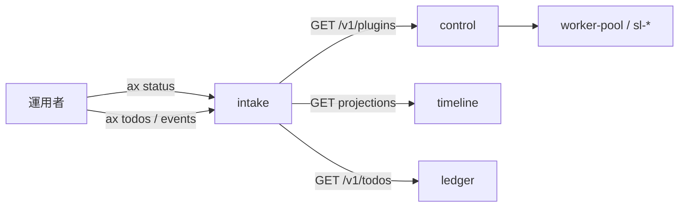
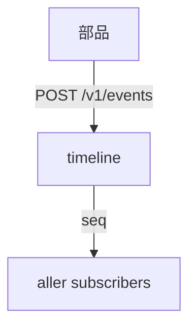
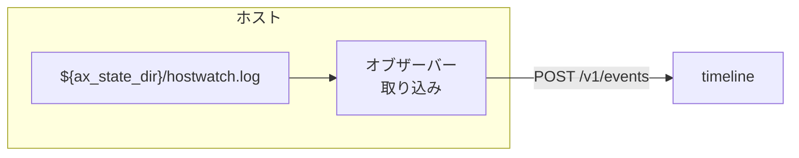
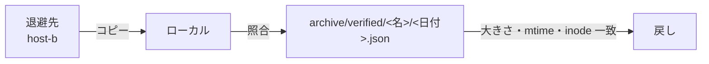

# 運用：日常の監視と制御

> 3 行でいうと、AX の日常は「読むだけの照会と、期限付きの命令で守る」です。状態は `ax status` や時系列記録で読み、止め方や交換は制御命令とホスト見張りで行います。削除はしません。古い物は `archive/` へ移します。

この文書はAX を動かし続ける日常の運用です。

- 対象: AX を動かしている人
- 前提: `getting-started.md` で起動まで済んでいること

## 目次

1. 状態の見つけ方: `ax status`、`ax todos`、`ax events` と部品の API
2. [動作モードと調整項目](#2-動作モードと調整項目)
3. [停止する働きと draining](#3-停止する働きと-draining)
4. [見守る役割と警報](#4-見守る役割と警報)
5. [ログと時系列記録](#5-ログと時系列記録)
6. [退避（archiver）](#6-退避archiver)
7. [復元と作り直し](#7-復元と作り直し)
8. [版上げとイメージ](#8-版上げとイメージ)
9. [戻す操作（rollback）](#9-戻す操作rollback)
10. [ホストの timer と見張り](#10-ホストの-timer-と見張り)
11. [鍵と席の回転](#11-鍵と席の回転)
12. [HQ の承認の運用](#12-hq-の承認の運用)
13. [運用の状態](#13-運用の状態)

## 1. 状態の見つけ方

### 1.1 基本の命令

```bash
ax status
ax status --json
ax todos
ax events --kind health.alert --limit 20
ax events --kind deploy.up --limit 5
```

- `ax status` は読み取りの照会です。`GET /v1/read/status` へ届きます（`core/intake/dest/b12/read_relay.py`）。
- 中継する先は固定です（S-6.7）。`control` のプラグインと生きている命令、`timeline` の投影（`plugins`、`runs`、`controls`）を 1 つの JSON にまとめます。各中継先は `read_relay_timeout_s`（既定 5 秒）で打ち切ります。
- 1 つの中継先が落ちていても、他の結果と `HTTP 200` で応答します。`ax status` が「応答する」とは、この `HTTP 200` を得ることです。管の小さな表は `{"<部品>": {"ok": true, "data": ...}}` か `{"<部品>": {"ok": false, "error": "unavailable"}}` です。

### 1.2 ToDo と事象の絞り込み

```bash
ax todos --state todo --project dreamforge
ax todos --state parked
ax events --kind error.classified --limit 20
ax events --after 1050000 --kind control.issued --limit 20
```

- `ax todos` の絞り込みは `--state`、`--project`、`--subloop`、`--due` です（`GET /v1/todos?state=&project=&subloop=&due=`）。
- `ax events` の絞り込みは `--after`（`seq`）、`--kind`、`--subloop`、`--project`、`--subject`、`--limit` です（`GET /v1/events?after=&kind=&subloop=&project=&subject=&limit=`）。`kind` はカンマ区切りで複数書けます。
- 終了コードの意味は [CLI リファレンス](cli-reference.md#11-終了コード) を見てください。

### 1.3 部品の API で直接読む

部品は中核の網で HTTP の口を持ちます。`/` の `healthz` が通るかどうかで生存を確かめられます。

| 部品 | 読む口 | 内容 |
|---|---|---|
| `timeline` | `GET /v1/events`、`GET /v1/projections/{name}` | 事象と投影。名前は `plugins`、`runs`、`jobs`、`controls`、`health` の 5 つです（S-3.6） |
| `control` | `GET /v1/plugins`、`GET /v1/plugins/{id}/effective`、`GET /v1/commands?state=` | 登録簿と生きている命令（S-5.7） |
| `ledger` | `GET /v1/todos`、`GET /v1/todos/{id}` | ToDo の一覧と 1 件（S-9.3） |
| `resources` | `GET /v1/resources`、`GET /v1/ledger`、`GET /v1/selections` | モデルの状態と実績。資源画面の元です（S-12.1） |
| `worker-pool` | `GET /v1/jobs`、`GET /v1/jobs/{id}` | ジョブの待機・実行・完了の一覧です（S-8.8） |
| `manager` | `GET /v1/manager` | 周回の回数と直近の判断（`core/manager/app.py`） |
| `inspector` | `GET /v1/inspection` | 現在の段と次回予定（`core/inspector/app.py`） |
| `archiver` | `/healthz` の追加項目 | `last_run_at`、`last_failed`、`runs`、`reap_enabled`（`core/archiver/app.py`） |

部品同士の呼び出しは中核の網の `ax-core` で行います。ホストの外から直接叩くものではありません（S-15.5）。`/` の `healthz` の形は §10.3 に書きました。



## 2. 動作モードと調整項目

プラグインごとに動きを変えるには、制御命令を出します。`ax control` が受ける書き手は `host/lib/ax_cli/__init__.py` と `docs/b12/cli/README.md` が正です。

### 2.1 コマンド形

```bash
ax control <target> set_mode '{"mode":"collect_only"}' --reason '点検のため新しい実行を止める' --lease 60
ax control <target> set_mode '{"mode":"run"}' --reason '点検が終わったため戻す'
ax control worker-pool set_knob '{"name":"free_success_threshold","value":0.8}' --reason '無料モデルの除外条件を上げる'
ax control <target> exclude_resource '{"resource_id":"<model-id>","until":"2026-11-08T12:00:00.000Z"}' --reason '利用枠切れのため期限付きで外す'
ax control <target> include_resource '{"resource_id":"<model-id>"}' --reason '枠が戻ったため戻す'
ax control <target> cancel '{"run_id":"<id>"}' --reason '止めてよい'
ax control <target> run_now '{}' --reason '今すぐ 1 回動かす'
```

- `include_resource`、`cancel`、`run_now` は現在未実装で、`operation_not_implemented` として拒否されます。
- `target` は `plugins/registry.yaml` に載っている ID です。生成物は `python3 tools/build_registry.py --write` で作ります。手で直してはいけません。
- `args` は JSON のオブジェクトです。`set_knob` は `name` と `value`、`exclude_resource` は `resource_id` と `until`（未来の時刻）を持ちます。
- `--reason` は空にできません。理由は制御 API が `control.rejected` を書いて拒否します（S-5.4）。
- `--lease` は命令の期限（分）です。`issued_by=commander` の命令は期限が必須です（S-5.4）。既定は `seat_control_lease_min`（既定 30 分）です。範囲は 1〜240 分です（`config/defaults.yaml`）。
- 同じ内容を再送するときは同じ `--request-id` を使います。省略すると `ax` が ULID を作って出力に載せます。

### 2.2 mode の表

各 mode の動作は次のとおりです。

| mode | 巡回（新しい項目を探す） | 新しい実行・項目の起動 | 実行中の物 |
|---|---|---|---|
| `run` | する | する | 続ける |
| `collect_only` | する（見つけた項目は記録して待たせる） | しない | 続ける |
| `poll_paused` | しない | 待っている項目は起動する | 続ける |
| `draining` | しない | しない | 最後まで続ける |

- モードを変えても、実行中の物は止めません。制御命令の `cancel` は現在未実装です。別の `ax cancel` は対象の ToDo またはジョブに取消要求を送りますが、停止の完了は別に確認してください。
- `collect_only` は実行を制限するモードです。対象に `collect_only_handler` があれば収集し、なければ巡回せず `skipped_mode` を記録します。
- 資源プラグイン `worker-pool` の `draining` は、新しいジョブを受け付けるが起動しません。ただし `draining` の前に存在する項目の後続ノードのジョブは起動します。役割 `manager` と `backup_manager` のジョブは例外です（S-5.2）。

### 2.3 命令の検証と重なり

制御 API が拒否する条件は S-5.4 にあります。要点だけ書きます。

| 条件 | 内容 |
|---|---|
| 1 | `target` が登録済みのプラグインです。中核の部品は対象外です（止めできません） |
| 2 | `op` が `target` の `capabilities` に合います。`mode` なら `capabilities` に入っている必要があります |
| 3 | `set_knob` の `name` が宣言されていて、`value` が型と `min`・`max` に合います |
| 4 | `issued_by` が `user` 以外なら期限があり、`control_max_lease_min`（既定 60 分）以内です。`inspection` の点検命令は `drain_max_h`（既定 6 時間）が上限です |
| 5 | `manager` と `backup` は 1 命令で 1 プラグインだけです。全プラグインを一度に変える命令は `user`・`inspection`・`emergency` だけが出せます |
| 6 | `reason` が空でない |
| 7 | 利用者設定の印がある値は、利用者以外が変えられません。`who` が付いている `set_knob` は `issued_by` がそこに含まれる場合だけ変えられます |
| 8 | `exclude_resource` の `until` は未来で、`expires_at` と一致し、`on_expiry: release` です |
| 9 | 送信対象を持つ処理を `run` にする場合は `permission_ids` が要ります（S-23.8） |
| 10 | `commander` の命令は期限を持ち、利用者設定の印を付けたり、印のある値を変えたりしません |

複数の命令が重なったときの優先順位は `emergency` > `user` > `inspection` > `commander` > `manager` = `backup` です（S-5.5）。有効な値は「最も優先順位の高い、生きている命令」で決まります。生きている命令がなければ manifest の既定値です。

### 2.4 期限と解除

- 期限を過ぎた命令は自動では無効にしません。状態を `expired_pending` にし、効力は残ります（S-5.6）。点検の外で黙って元に戻さないためです。
- 解放は `POST /v1/commands/{id}/release`、延長は `POST /v1/commands/{id}/renew` です。延長は 1 命令につき `control_max_renewals`（既定 3 回）までです。
- `on_expiry` は `ask_issuer`（既定。出た者が決める）と `release`（期限で自動解除。点検係の命令は必ずこれ）です。
- `user` の命令は期限なしで足りてよいです。解除は利用者の指示か緊急ボタンで行います。

### 2.5 調整項目（knob）

- `knob` の型と範囲はプラグインの `manifest.yaml` が宣言します（S-4.3）。型は `integer`、`number`、`boolean`、`string`、`enum`、`duration`、`list` です。`effective` は `immediate`（すぐ）、`next_run`（次の実行から）、`restart`（再起動で）です。
- 範囲（`min`・`max`・`enum`）を変えることはルールの変更です。利用者の指示（入口の `core.change` か `subloop.create`）でだけ `git` で変えます。点検でも管理役でも変えません。
- `who` を付けると、変えてよい発行者を絞れます。モデル関係の値は `who: [user]` です。モデル関係を除く上限の値は `who: [inspection, user]` です（S-4.3）。

具体例として、`worker-pool` の knob は `plugins/resource/worker-pool/manifest.yaml` にあります。`role_candidates`（役割ごとの既定候補の順）、`family_cap` と `model_cap`（同時実行の上限）、`jev_enabled`（Jev の判断を使うか）、`lower_fallback_enabled` と `lower_fallback_wait_s`（下位候補への切り替え）、`promotion_passes` と `demotion_failures`（昇降格の回数）、`free_success_threshold` と `free_minimum_runs` と `free_recent_failure_min`（無料モデルの除外条件）です。モデル関係は利用者だけが変えられ、管理役と点検係は提案だけです。

## 3. 停止する働きと draining

一時的に止めたいときは、終わるのを待たずに止める物と、終わるまで待つ物があります。

### 3.1 cancel と mode の使い分け

| したいこと | 命令 | 効き方 |
|---|---|---|
| 1 件の取消を依頼する | `ax cancel --todo-id <id> --reason <理由>` または `ax cancel --job-id <id> --reason <理由>` | 対象に取消を要求します。実行中のジョブが止まったかは別に確認します |
| 新しい巡回と起動だけ止める | `set_mode: draining` | 実行中の物は止めません。終わるまで待つ運用です |
| 見つけるけれど起動しない | `set_mode: collect_only` | 巡回と記録だけを行います |
| 巡回は止めて待機分は動かす | `set_mode: poll_paused` | 巡回しませんが、待っている項目を起動します |

```bash
ax cancel --job-id <id> --reason '止めてよい理由'
ax control <target> set_mode '{"mode":"draining"}' --reason '点検のため終わるのを待つ'
```

### 3.2 点検の draining は自動で戻る

点検の段 2 で全プラグインに `set_mode: draining` を出す命令は、利用者ではなく `inspection` が出します（S-13.2）。期限は `drain_max_h`（既定 6 時間）で、`on_expiry: release` です。点検係が落ちても点検中のまま残りません。期限で必ず解除されます。

手順は点検の段が決めます。人が使える `ax control` で同じことが必要なら、利用者の命令でも同じ形で出せます。常時 `draining` のままにしないでください。点検による `draining` は期限切れで解除されます。利用者の命令は `on_expiry` が `ask_issuer` の場合、期限切れでも効力が残り `expired_pending` になります。

## 4. 見守る役割と警報

見守る役割は 4 つです。役割ごとに持つ物と行く先が分かれます。

| 役割 | 置き場 | 口 | 役目 |
|---|---|---|---|
| `observer`（見守り） | `core/observer/` | `/healthz` のみ（ax-core、8080） | 検査を回し、警報を出す。客観的な信号だけです |
| `manager`（管理役） | `core/manager/` | `/healthz` と `GET /v1/manager` | 障害対応、制御の解除、修繕、保留の見直し、タイマーの提案 |
| `backup_manager`（予備役） | `core/observer/standby/` | `manager` と同じ周回 | 管理役が不調なときだけ 1 回起動する予備役 |
| `inspector`（点検係） | `core/inspector/` | `/healthz` と `GET /v1/inspection` | 定期点検を回す（S-13） |
| `hostwatch`（ホスト見張り） | `host/lib/hostwatch/` | なし（systemd の timer） | コンテナの外で走り、特権操作で起こし直す（S-11.5） |

### 4.1 observer の検査（S-11.2）

`observer` は LLM を使いません。`observe_s`（既定 60 秒）ごとに検査を回します（S-11.1）。検査の表は S-11.2 が正です。

| 検査 | 条件 | 宛先 |
|---|---|---|
| 生存 | ある部品の `health.beat` が `stale_beats`（既定 3）回分ない | プラグインなら `manager`、中核ならホスト見張り（再起動）+ `manager` |
| 見張りの異常 | 各サブループの見張り用ノードが警報を出した | `manager` |
| 期限切れの命令 | `expired_pending` が `expired_grace_min`（既定 15 分）を超えた | 出した者。出た者が `manager` なら予備役 |
| 遅れ | 時系列記録の購読の遅れが `lag_alert_s`（既定 300 秒）を超えた | `manager` |
| 飢え | 役割の待ちの列が `starve_min`（既定 60 分）進まない | `manager` |
| 繰り返し | 同じ `error.classified` が `repeat_threshold`（既定 5 回/時間）を超えた | `manager` |
| 管理役の不調 | `manager.cycle` が `manager_silent_min`（既定 30 分）ない。判断が `manager_bad_streak`（既定 3）回続けて捨てられた。`unknown` の事象が `unknown_unhandled_min`（既定 30 分）扱われない | 予備役 |
| 点検中の沈黙 | 点検の減らし込み中に、管理役が `drain_silent_min`（既定 10 分）動かない | 点検係へ「再開」の指示（S-13.3） |

同じ警報は `alert_dedup_min`（既定 30 分）の間に 1 回だけ出します。

生存の検査は二段階です。時系列記録が使えるときは `health.beat` を読みます。使えないときは各部品の `/healthz` を直接見ます（`core/observer/checks.py` の `check_liveness`）。作業側の網（ax-work）の部品には ax-core から `/healthz` が届きません。時系列記録が戻るまで判定しません。

### 4.2 manager の周回（S-10）

- 管理役は `ps` と読み取りの口しか持ちません。`GET /v1/manager` が `/healthz` の他にあります（`core/manager/app.py`）。
- 起きる契機は時系列記録の購読と `manager_tick_min`（既定 10 分）の時計です（S-10.1）。
- 1 回の周回の順番は S-10.2 が必須とします。自分の命令の期限切れから先に扱います。
- 管理役にできることとできないことの表は S-10.4 にあります。戻しにくい操作はしません。`waiting_user` の件への代理の回答もしません。

### 4.3 予備役の呼び出し（S-11.3）

管理役が不調なとき、オブザーバーが `backup.activated` を書いて予備役を呼びます。

1. 予備役は必ず `ledger.add` で ToDo（`管理役の不調: …` の題）を 1 件作ります（必須）。
2. 予備役が出した命令は `issued_by=backup` です。管理役が戻ったら、管理役が引き継いで解除か延長を決めます。
3. 直近 `backup_window_days`（既定 7 日）に `backup_limit`（既定 2 回）以上動いたら、根本原因の ToDo を次の点検の最優先にし、利用者向けのカードにも出します（S-11.4）。

予備役のモデルは `backup_manager` です。

### 4.4 点検（S-13）の運用

点検は `inspection_interval_h`（範囲 24〜168 時間、初期 24）の間隔で走ります（S-13.1）。1 巡は 8 段です（S-13.2）。細かい順番は `core/inspector/inspector.py` が行います。

| 段 | 内容 | 担当 |
|---|---|---|
| 1 予告 | `inspection_notice_min`（既定 30 分）前に `inspection.phase=notice` を書く | 点検係 |
| 2 減らし込み | 全プラグインに `set_mode: draining` を出す。期限は `drain_max_h` | 点検係 |
| 3 待つ | 実行中が 0 になるか、`drain_wait_h`（既定 2 時間）に達するまで待つ。達しても長い作業は止めない | 点検係 |
| 4 見直し | 系統別の使用量推移と GPT・Claude の選択理由の内訳を HQ に表示し、最適化を提案する。変更は利用者が行う | 管理役 |
| 5 退役 | `excluded` が続いたモデルの `retired` への変更を提案する | 管理役 |
| 6 恒久修繕 | 繰り返した失敗と、予備役の件の修繕を ToDo にする。予備役の件が最優先 | 管理役 |
| 7 要約 | 確定した知識を記憶コネクタへ送る（S-14.2） | 管理役 |
| 8 再開 | 点検係の命令をすべて解除する | 点検係 |

点検中に管理役が動かなかったら、段 4〜7 を飛ばして段 8 を行います（S-13.3）。「黙ったら自動で戻る」の場所はここだけです。

利用者の変更の記録は D-12 に契約がなく、`POST /v1/review-changes` は 501 を返す保留の口です（`core/inspector/app.py`）。記録の受け渡しは書かれた契約を待つことが正です。

### 4.5 警報の読み方

```bash
ax events --kind health.alert --limit 20
ax events --kind backup.activated --limit 10
```

- 警報は `health.alert` の事象です（S-3.3）。`data` に `check`、`target`、`severity` を持ちます。
- 同じ警報は `alert_dedup_min` の間 1 回だけです。続けて出なければ、警報を消す操作は不要です。

## 5. ログと時系列記録

### 5.1 時系列記録（S-3）

- 追記だけです。書き換えと削除の API を持ちません（S-3.1）。
- 各事象に `seq` を振ります。読み方は `seq` のカーソルです。
- 事象の形式と種類は `schemas/` の定義を確認します。

```bash
# 状態の流れを読む
ax events --kind run.state --limit 20
ax events --kind job.state --limit 20
ax events --kind error.classified --limit 20
ax events --kind health.beat --limit 10
```



- `ax` の読み取り中継は `wait` を付けません（S-6.7）。待つ読みは部品の API で `GET /v1/events?after=&wait=`（`longpoll_s`、既定 30 秒まで）を使います。
- 送り先の中核（時系列記録、台帳、記憶コネクタ）に届かないとき、送る側は自分のボリュームに溜め、届くようになったら順に送ります（S-2.2）。届かないことを理由に自分の処理を止めません。

### 5.2 投影（S-3.6）

`projections` は事象だけから決まる表示用の表です。名前は 5 つで固定です。

| 名前 | key | 値（要点） |
|---|---|---|
| `plugins` | プラグイン ID | `manifest_version`、`mode`、`registered_at`、`mode_changed_at` |
| `runs` | run の ID | `subloop`、`project`、`state`、`active` |
| `jobs` | ジョブの ID | `state`、`model`、`role`、`active` |
| `controls` | 命令の ID | `target`、`op`、`args`、`reason`、`issued_by`、`expires_at`、`state`、`active` |
| `health` | 部品の名前 | `host`、`last_beat_at`、`uptime_s`、`lag_s` |

- 他の名前は 404 を返します。
- 壊れたときは作り直しができます。`ax-admin rebuild-projections` です（`core/timeline/admin.py`）。ホストの中で、`timeline` の DB と退避先の書き出しから作り直します。

```bash
# 作り直し（ホストで。稼働中の timeline と同じ DB を開いてよい。作り直しの間だけ追記が待たされます）
python3 -m core.timeline.admin rebuild-projections --db /data/timeline.sqlite --archive /data/archive [--verify]
```

- `--verify` は作り直す前と全行の `value` と `upto_seq` が一致することを確かめます（違えば終了コード 2）。
- 退避済みの区間（`archive/` の JSON Lines）は `seq` の順に先に読んでから DB の事象を直します。

### 5.3 ホスト側のログ

ホスト側は `hostwatch.log` を書きます。１行は S-3.2 の形の事象です（`host/lib/hostwatch/hostlog.py`）。

| ファイル | 内容 |
|---|---|
| `${ax_state_dir}/hostwatch.log` | ホスト見張りが `deploy.up`（`host/ax-up.sh`）、`host.sudo_unavailable`・`host.sudo_restored`（`host/lib/hostwatch/watch.py`）、要求の処理結果を書く |
| journal | `ax-hostwatch.service` の標準出力と標準エラー（systemd の記録） |

届けば時系列記録へ取り込みます。届かなければホストのログとして残ります。

退避の略図です。



## 6. 退避（archiver）

退避コネクタ `archiver` が古い物を退避先へ送ります。

| 置き場 | 内容 |
|---|---|
| 各ボリュームの `archive/`（`/vol/<名>`、名前は `vol-<名>`） | AX の各ボリュームの `archive/` が対象です。`compose.d/b1.yaml` が定義します |
| 退避元のホストのパス（`/src/<名>`） | `archive-sources.yaml` の一覧から作ります |
| 退避先 | `archive_dest`（profile。初期値は host-b） |
| 照合済みの manifest | `${ax_state_dir}/archive/verified/<名>/<日付>.json`。照合に成功した物だけを書きます |
| 印 | `${ax_state_dir}/archive/reap-enabled`。この印がある間だけ元の除去（reap）が働きます |

`archiver` の動きは `core/archiver/app.py` と `core/archiver/engine.py` が要点です。

1. `AX_ARCHIVE_INTERVAL_S`（既定 3600 秒、1 時間）ごとに巡回します。起動後の最初の巡回は `AX_ARCHIVE_FIRST_DELAY_S`（既定 60 秒）後です。
2. `archive_after_days`（既定 14 日）より古い物を退避先へコピーします（S-14.3）。コピー先で内容ハッシュを再計算し、元の内容と照合します。
3. 内容が一致したときだけ元を移します。検証不能・失敗・不一致のときは元を残し、失敗を記録します。
4. 内容の照合を実装して `T-2` と `T-78` を通すまで、元を消す動作は有効にしません（コピーだけを行います）。

`archive_after_days` の既定は 14 日です（`config/defaults.yaml`、S-17）。

```bash
# 状態を確認する
curl -s http://127.0.0.1:8080/healthz | python3 -m json.tool
```

`/healthz` の追加項目（`core/archiver/app.py`）は `last_run_at`、`last_failed`、`runs`、`reap_enabled` です。

状態を変えずに試す方法です。

```bash
host/ax-archive-reap.sh --dry-run
```

- `archive/verified/` の manifest があるものだけが対象です（`host/ax-archive-reap.sh`）。
- 印 `reap-enabled` が無ければ何もせず終了コード 0 で終わります（`host/ax-archive-reap.sh` の `[ ! -e "$marker" ]`）。

## 7. 復元と作り直し

退避が読み取れた後、元の形へ戻します。文書で決まっているのは次の手順だけです。

### 7.1 種類ごとに見る物

| 記録 | 復元の元 |
|---|---|
| 時系列記録（S-3） | `timeline_hot_days`（既定 30 日）より古い区間は `archive/timeline/*.jsonl` に書き出し済みです。DB の事象は消しません |
| 投影（S-3.6） | `archive/timeline/*.jsonl` と DB の事象の両方から作り直す（§5.2） |
| 退避元の元の除去（reap） | `${ax_state_dir}/archive/verified/<名>/<日付>.json`（照合済みの manifest） |
| 削除の API | 持たない（禁止。S-14.3） |

### 7.2 手順

1. 退避先からファイルをコピーします。元の除去はまだしません（印 `reap-enabled` を足さない）。
2. 照合済み manifest がある物だけを戻します。各ファイルの大きさ・更新時刻・inode が manifest と同じ物を確認します（`host/ax-archive-reap.sh` の 2 段階の確認）。
3. 照合済み manifest が無い物は残します。退避元一覧を `archive-sources.yaml` で確認します。
4. 時系列記録の退避区間は、`archive/timeline/index.json` を読み、指定した区間を取ります（`core/timeline/archive.py`）。



退避元の一覧の既定パスは `~/.config/ax/profile/archive-sources.yaml` です。このファイルは各環境で用意します。項目は `name`、`path`、`min_age_days`、`include`、`exclude`、`keep_original`、`remove_original` です（S-16.3）。

> 状態: 退避先の読み取りと書く手順
>
> 上の手順は `core/archiver/engine.py` の動作で確かめられます。自動の復元 API は持ちません。

## 8. 版上げとイメージ

新しく出す版は `accepted/` の印のある `main` だけを取り込みます（S-16.7、`host/lib/hostwatch/deploy.py`）。

| 手順 | 内容 | 終了コード |
|---|---|---|
| 1 | `git fetch`（`local main` と `accepted/*` のタグ） | - |
| 2 | 取り込もうとする版に `accepted/<sha>`（sha は 7〜40 桁の先頭一致）が無ければ止めます | 10 |
| 3 | `git merge --ff-only FETCH_HEAD` で `AX_HOME` へ取り込みます | - |
| 4 | `current.env` を `previous.env` へ `cp -p` してから新しい `AX_TAG`（`main` の短い ID 12 桁）を書きます | - |
| 5 | `vendor/claude` を置き、`docker compose build`（`--profile build` の作業用イメージを含む） | - |
| 6 | 変わった・新しいサービスを `host/ax-up.sh` で 1 つずつ起動します | - |
| 7 | 変わった中核のサービスの `healthz` が通らなければ `previous.env` の `AX_TAG` で起動し直します | 11 |

- 別の配備が実行中のときは 4 で止まります。
- サブループの追加の失敗は、そのサービスだけ起動せず他は続けます（終了コード 12）。
- ビルドか起動が失敗したときは `pending.json` に変更前のタグとサービス定義を残し、次回要求ではこの記録から再開します（`docs/b8/hostwatch.md`）。
- 元のイメージは消しません（`host/lib/hostwatch/deploy.py` の `rollback`）。

### 8.1 手で版上げするとき

```bash
host/ax-deploy.sh
```

- ホスト見張りが `deploy` 要求を読んだときに呼ぶ手はずです。手で呼んでもよいです（`host/ax-deploy.sh` の注記）。

### 8.2 イメージを引く操作

AX のイメージは `docker compose build` で作ります（`host/lib/hostwatch/deploy.py` の手順 d）。`docker compose pull` を自動で回す手厚い巡回は文書で決まっていません。依拠する書物は S-11.6 の末尾だけです。tailnet のサイドカー（S-25.12）を置くときは、構築時に `sudo -n docker pull` が要る（S-11.6）との注記だけが文書にあります。

## 9. 戻す操作（rollback）

中核の差し替えとサブループの追加は、`host/ax-deploy.sh` の配備手順で行います（S-16.7）。

### 9.1 自動の rollback

変更した中核サービスのヘルスチェックが失敗したときは、`previous.env` の `AX_TAG` で同じサービスを起動し直します。

| 場面 | 行うこと |
|---|---|
| ビルドが失敗した | `previous.env` を戻して終わります（`host/lib/hostwatch/deploy.py` の `rollback`。新しいイメージは残します） |
| 中核が通らない | `previous.env` の `AX_TAG` で同じサービスを起動し直し、`deploy.rolled_back` を書きます。オブザーバーが ToDo（parked）にします |
| サブループの失敗 | そのサービスだけ起動しません。他は続けます |

`previous.env` は `${ax_state_dir}/deploy/previous.env` です。配備の前に `cp -p` で置きます。

> 状態: `deploy.rolled_back` の状態
>
> 上の表は S-16.7 と `host/lib/hostwatch/deploy.py` で確認できます。`deploy.rolled_back` が書ける場所は `hostwatch.log` です（`host/lib/hostwatch/hostlog.py`）。時系列記録への届き方は任意です。

### 9.2 手で戻すとき

```bash
# 手で戻すときの順序（S-16.7）
# 1. previous.env を current.env へ戻す
# 2. 新しい AX_TAG で起動し直す（host/ax-up.sh）
# 3. healthz が通ることを確かめる
# 4. 登録済みで変わったサービスを 1 つずつ起動する
```

`host/ax-up.sh` は起動専用で、停止用のスクリプトはリポジトリにありません。停止は compose の `down` で行います（`docs/manual/getting-started.md` の §10 の表）。

## 10. ホストの timer と見張り

### 10.1 hostwatch の timer（S-11.5）

ホスト見張りは systemd の timer で `host_watch_s`（既定 60 秒、範囲 30 〜 300）ごとに動く短いスクリプトです。コンテナの外で動き、特権操作は `sudo -n` で行います（S-11.6）。

```text
host/ax-hostwatch.timer（~/.config/systemd/user/ax-hostwatch.timer）
host/ax-hostwatch.service（~/.config/systemd/user/ax-hostwatch.service）
host/ax-hostwatch.sh（1 周期の本体。host/lib/hostwatch/watch.py）
```

| 項目 | 内容 |
|---|---|
| `OnBootSec` | 30s |
| `OnUnitActiveSec` | 60s（`host_watch_s` の既定値と同じ） |
| `AccuracySec` | 1s |
| `Unit` | `ax-hostwatch.service` |
| `TimeoutStartSec` | 4200（`deploy` を 1 周期の中で行うため長くします） |

1 周期の内容は `docs/b8/hostwatch.md` が詳しいです。要点は次のとおりです。

1. `sudo -n true` を実行します。失敗したら 2・3・5 を行わず、`host.sudo_unavailable` を書きます（成功から失敗に変わったときだけ）。戻ったら `host.sudo_restored`。
2. `sudo -n docker compose … ps --all --format json` で状態を見ます。対象は `hostwatch/registered/<名前>` にある compose のサービスだけです。`exited`・`dead`・`created`・`unhealthy`・コンテナ無しを起動し直します。未登録の依存サービスは起動しません。`ps` が失敗したときは起動し直しません。
3. `observer.beat` が `observer_stale_s`（既定 180 秒）より古い（または無い）とき、`observer` を起動し直します。
4. `commander_unit` に当たる名前と、`paseo`・`paseo-*` は対象から除きます。登録の無い部品は起動しません。
5. `host-requests/` の要求を実行します（§10.2）。

1 周期の煩雑は `flock -n` で飛ばします。`hostwatch/registered/hostwatch` の印は作りません。timer が動いていることは `systemctl --user is-active ax-hostwatch.timer` で見ます（`docs/b8/hostwatch.md`）。

### 10.2 host-requests/ の要求（S-11.6）

コンテナからホスト見張りへ頼む方法です。置き場は `${ax_state_dir}/host-requests/`（コンテナでは `/state/host-requests/`）です。

| 操作 | 形 | 書ける者 |
|---|---|---|
| `restart` | `{"op": "restart", "name": "ledger"}` | `observer` と `emergency` |
| `deploy` | `{"op": "deploy"}` | `intake`（名前なし） |
| `seat-sync` | `{"op": "seat-sync"}` | `intake`（名前なし） |

- 1 要求 = 1 ファイル `<ULID>.req`、中身は 1 行の JSON です（`docs/b8/host-requests.md`）。
- 書けるのは `restart` が `observer` と `emergency`、`deploy` と `seat-sync` が `intake` です。ワーカーとサブループは `/state` を見られず、書けません。
- イメージ名、タグ、パス、サービスの定義は書けません。キーは `op` と `name` だけです。
- 処理した要求は `host-requests/done/` へ移します（削除しません）。処理できない要求は `host-requests/rejected/` へ移し、結果を記録します。
- `sudo -n` が失敗している間は、要求を読んでも実行せず置いたままにします。

### 10.3 /healthz の形

すべての部品は `GET /healthz` を持ちます（S-2.1）。共通の実装は `axcommon/http.py` の `create_app` です（`axcommon.http`）。

```json
{"ok": true, "component": "<名前>", "version": "<版>"}
```

- `extra_health` の項目を足せます（`manager` は `cycles` と `last_cycle_at`、`archiver` は `last_run_at` など）。
- 拡張の読み込みに失敗した名前は `ext_failed` に載ります（`axcommon.http` の `ext_failures`）。
- healthcheck は `python -m axcommon.healthcheck`（`axcommon/healthcheck.py`）です。`AX_HEALTH_PORT`（既定 8080）の `/healthz` を `127.0.0.1` に GET し、200 で `{"ok": true}` なら終了コード 0 です。
- `docker/base.yaml` の `healthcheck` は `interval: 10s`、`timeout: 5s`、`retries: 6`、`start_period: 20s` です（`docker/base.yaml`）。

### 10.4 席の同期の timer（S-6.13）

SSH の席の `authorized_keys` を更新する timer です。

| 項目 | 内容 |
|---|---|
| unit | `host/systemd/ax-seat-sync.service`（`Type=oneshot`、`User=root`、`ExecStart` は `host/ax-seat.sh sync`） |
| timer | `host/systemd/ax-seat-sync.timer`（`OnBootSec=30s`、`OnUnitActiveSec=30s`） |

- ホスト見張りの `seat-sync` 要求が主で、timer は補足です（`host/systemd/ax-seat-sync.service` の注記）。
- `host/ax-seat.sh sync` が本社の sync です（`host/lib/ax_gate.py` の `host_main`）。

## 11. 鍵と席の回転

### 11.1 caller 鍵（`magpie gateway-key`）

`model-gateway-key` は caller `ax` の鍵です。発行と回転の手順は `docs/b6b/procedure-caller-ax-key.md` が正です。

| 操作 | 命令 | 後に行うこと |
|---|---|---|
| 発行 | `magpie gateway-key add ax` | 値を `secrets_dir/model-gateway-key` へ直接書きます（権限 600）。標準出力には出しません |
| 回転 | `magpie gateway-key rotate <id>` | 手順 3 で書き直し、鍵を使うコンテナを `restart` します |
| 失効 | `magpie gateway-key remove <id>` | 利用者が個別に指示した場合だけ行います |

書く道具は `~/.local/bin/magpie` です（`docs/b6b/procedure-caller-ax-key.md`）。変更前の控えは `~/.config/magpie/caller-keys.json` を `cp -p` で控えにします（同書 1）。

### 11.2 サンドボックスのゲートトークン（`axg-`）

箱（box と Instabox）のゲート用の短命トークンです。`POST /v1/envs/{id}/gate-token` で `worker-pool` の資格だけが発行できます（S-25.27）。

| 項目 | 内容 |
|---|---|
| 形 | `axg-` + 64 文字の 16 進（`resources` は sha256 だけを持ちます） |
| 有効期限 | `min(budget_min + 5 分, S-17 sandbox_gate_token_max_min)`（既定 180 分） |
| 呼び出し回数 | `sandbox_gate_calls_max`（既定 200 回） |
| 無操作の失効 | `sandbox_gate_idle_s`（既定 600 秒）で失効します |
| 枠 | 1 ジョブにつき 1 枠を持ちます |

回転は発行で足ります。古いトークンはジョブの終了か期限・無操作で自動で失効します。手で失効させる場合は `POST /v1/envs/{id}/gate-token/{token_id}/revoke` です（`core/resources/api.py`）。

### 11.3 席と承認の回転

席（SSH・tailnet）は `${ax_state_dir}/seat/seats.yaml`（profile の `seats_file`）です。変更できるのは `intake` だけです（S-6.8）。

| 操作 | 命令 | 備考 |
|---|---|---|
| 席を追加する | HQ の画面 | `seat.add`（`from=hq` のみ）。単独の `ax` にコマンドは置きません |
| 席の段を上げる | HQ の画面 | `seat.tier`（第二要素が要ります） |
| 自分の席を失効する | `ax seat revoke` | 自分だけです |
| 1 席だけを fail-closed で失効する | `host/ax-gate-revoke.sh <seat_id>` | HQ が使えないときの道具。印は消さない（`host/ax-gate-revoke.sh`） |

席の段を上げる作業は HQ で行います。`ax` に `seat.add` のコマンドはありません（S-16.8）。

承認の第二要素（TOTP）の登録と取り替えは、HQ の `POST /v1/hq/approval/enroll` です（`core/hq/ext/b12b2.py`）。種は `intake` にもコンテナにも渡しません（S-6.10）。

### 11.4 席の同期と peers.json

- `host/ax-peers.sh` は tailnet の端末表を `${ax_state_dir}/gate/peers.json` に原子的に更新する道具です（`host/ax-peers.sh`）。S-6.14、F-9.4。
- `host/ax-seat.sh sync` は `authorized_keys` を更新します（`host/lib/ax_gate.py` の `sync`）。
- 実行するのは go の後です（`host/ax-peers.sh` の注記）。

## 12. HQ の承認の運用

### 12.1 承認の流れ

| 順序 | 内容 |
|---|---|
| 1 | 司令塔が `tier: irreversible` の行き先に指示を送ります。入口は実行しません。内容と `digest`（正規化した JSON の SHA-256）を保存し、`approval.requested` を書きます。応答は `202 {approval_id, status: "pending_user"}` で、`ax` の終了コードは 4 です |
| 2 | 台帳に同じ内容のカードを作ります（`waiting_user`、種別 `approval`）。`user_only` であり、司令塔の受け口からは答えられません |
| 3 | 利用者が HQ の承認画面を開き、保存した内容がそのまま表示されます。第二要素のコードを入れて「承認」を押します |
| 4 | 入口は `digest` が一致し、期限内（`approval_ttl_min`、既定 60 分）で未使用なことを確かめます。合えば `approval.granted` を書いて保存した内容を実行し、`approval.executed` を書きます |
| 5 | 利用者は却下もできます（`approval.denied`）。取り下げは `approval.withdraw` です |

権限の段で足りないときは拒否します（終了コード 6）。司令塔の受け口は `confirm_irreversible` を出せません（`from=hq` で承認 ID が付いた指示だけが持てます）。

GitHub change サブループの `change.approval.record` は通常の承認後の実行とは別で、本人の判定を記録するだけです。source では HQ と intake を通じた本人承認への接続を限定試験で確認しています。実操作の直前に対象の状態をオンラインで再照会します。本番での一連の動作は未確認です。

本人の正規ログインと通知の端末受領は実環境で未検証です。通知 provider の受付は端末への到達を意味せず、受領が確認できない場合は `unknown` のままです。

### 12.2 HQ の口（b12b2）

| 経路 | 用途 |
|---|---|
| `GET /seats` | 席、承認待ち、第二要素、ホスト操作の警告を表示します |
| `GET /approvals/{approval_id}` | intake の保存済み内容を表示します |
| `GET /approval/settings` | 第二要素の登録状態を表示します |
| `POST /v1/hq/approvals/{approval_id}/grant` | 画面に結び付いた digest を承認します |
| `POST /v1/hq/approvals/{approval_id}/deny` | 承認待ちを却下します |
| `POST /v1/hq/seats/prepare` | Schema を検査し、席の操作内容を確認画面に保存します |
| `POST /v1/hq/seats/apply` | 確認画面の内容を intake へ送ります |
| `POST /v1/hq/approval/enroll` | TOTP の QR を一度だけ返します |

HQ の画面は `hq.sock`（`ax-hq` と root だけが開ける）から tailnet の直接入口へ届きます。HQ が他の部品の API を直接変更しません（S-12.1）。

> 状態: HQ の口の接続
>
> 上の表は `docs/b12b2/hq/README.md` の「画面と操作」表と `core/hq/ext/b12b2.py` の `register` で確認できます。`hq_verifier` の wire が未接続のときは 501 を返します（同書の「接続する部品」）。未接続のときは承認の経路は動かず、止まります（fail-closed）。

### 12.3 緊急（emergency）

`emergency` は `from=hq` のみです。`seat.lock all` と `lockdown` の HQ 専用経路は `docs/manual/security.md` と S-6.11 が正です。

| 項目 | 内容 |
|---|---|
| 行き先 | `config/intake-destinations.d/b10a.yaml` の `emergency`（`tier: irreversible`） |
| scope | `all`、`commanders`、プラグイン ID（S-12.3） |
| 手末端 | HQ の開始要求を認める。`POST /v1/emergency`（`core/intake/dest/b10a/service.py`） |
| HQ の画面から | `GET /v1/emergency/scopes` と `POST /v1/emergency`（`core/hq/ext/b10a.py`） |

実行は `emergency.*` の事象に記録されます（S-12.3 の 1〜3）。

### 12.4 go の追認と照合

`ax go ratify` と `ax approval` は現在の CLI では未実装です。承認は利用可能な HQ 経路と権限を確認して扱ってください。

> 状態: `ax approval` の接続
>
> 上の 2 命令は `ax` の CLI の `DEFERRED`（`host/lib/ax_cli/__init__.py` の `DEFERRED`）です。実体は後続の b12b 担当で実装します。取り付けの記録は `core/intake/approval/integration.py` の `GET /v1/approvals`・`GET /v1/approvals/{id}`・`POST /v1/approvals/{id}/grant`・（deny は行き先 `approval.deny` 経由）で確認できます。

## 13. 運用の状態

## 13.1 状態の書き方（DOCS の共通の書き方）

- この文書は `docs/manual/` の共通の書き方です。3 行の概要、目次、表、図を使います。
- コード・命令・識別子は英語のままです。日本語は平易に書きます。
- まだ実装が無い部分は「状態」の節に書きます。出鱈目に書きません。
- 命令は存在する物だけを書き、存在しない物は存在しないと書きます。
- 外のホスト名、IP アドレス、秘密の値は書きません。

下の表はこの文書で使った情報の出所です。実行環境で確かめるときはこの表を参照してください。

| 章 | 主な出所 |
|---|---|
| §1 状態の見つけ方 | `host/lib/ax_cli/__init__.py`、`core/intake/dest/b12/read_relay.py`、S-6.7、S-16.8 |
| §2 動作モードと調整項目 | `ax control` の受け口、`plugins/registry.yaml`、S-5.2〜S-5.7、S-4.3 |
| §3 停止する働きと draining | `ax control` の `cancel` と `set_mode`、S-5.2、S-13.2 |
| §4 見守る役割と警報 | `core/observer/checks.py`、`core/manager/app.py`、`core/inspector/app.py`、`host/lib/hostwatch/`、S-11 |
| §5 ログと時系列記録 | `core/timeline/admin.py`、`host/lib/hostwatch/hostlog.py`、S-3 |
| §6 退避（archiver） | `core/archiver/app.py`、`host/ax-archive-reap.sh`、S-14.3 |
| §7 復元と作り直し | `host/ax-archive-reap.sh`、`core/timeline/archive.py`、S-14.3 |
| §8 版上げとイメージ | `host/lib/hostwatch/deploy.py`、`host/ax-deploy.sh`、S-16.7 |
| §9 戻す操作（rollback） | `host/lib/hostwatch/deploy.py`、S-16.7 |
| §10 ホストの timer と見張り | `host/ax-hostwatch.timer`、 `host/ax-hostwatch.service`、`host/lib/hostwatch/watch.py`、`host/ax-up.sh`、S-11.5、S-11.6 |
| §11 鍵と席の回転 | `docs/b6b/procedure-caller-ax-key.md`、`host/ax-gate-revoke.sh`、`host/ax-seat.sh`、`host/lib/ax_gate.py`、`core/hq/ext/b12b2.py`、S-6.8、S-6.10、S-25.27 |
| §12 HQ の承認の運用 | `docs/b12b2/intake/README.md`、`docs/b12b2/hq/README.md`、`core/hq/ext/b12b2.py`、`config/intake-destinations.d/b10a.yaml`、S-6.10 |
| §13 運用の状態 | この文書の執筆 |

## 参照

- `docs/manual/getting-started.md` （起動）、`docs/manual/workflows.md` （依頼から配送までの流れ）
- `config/defaults.yaml` （S-17 の値）、`config/inspection.yaml` （点検の予定）
- `config/intake-destinations.yaml` と `config/intake-destinations.d/*.yaml` （行き先の登録簿）
