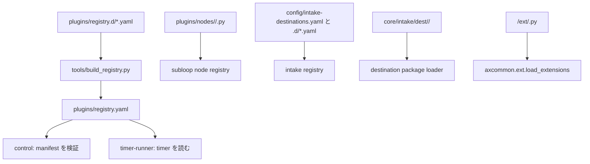

# プラグインで AX を広げる

AX は宣言を登録簿に載せ、実装を決められた差し込み口へ置くことで機能を広げる。
登録できるプラグインの種類は、現在 `subloop`、`resource`、`timer` の3つである。
`node` と `destination` は別のローダーで扱うため、manifest を登録する種類ではない。

## 目次

- [全体像](#全体像)
- [種類と登録方法](#種類と登録方法)
- [manifest と登録簿](#manifest-と登録簿)
- [サブループを追加する](#サブループを追加する)
- [ノードを追加する](#ノードを追加する)
- [resource を追加する](#resource-を追加する)
- [timer を追加する](#timer-を追加する)
- [destination を追加する](#destination-を追加する)
- [拡張フックと Schema](#拡張フックと-schema)
- [テストと偽物](#テストと偽物)
- [作例 1: サブループ](#作例-1-サブループ)
- [作例 2: timer](#作例-2-timer)
- [テンプレート一覧](#テンプレート一覧)

## 全体像

次の図は、追加物がどのローダーを通るかを示す。`plugins/registry.yaml` は生成物であり、直接編集しない。



一つの追加物が壊れても、ローダーは原則としてその追加物だけを失敗として記録し、ほかを止めない。たとえばノードの読み込み失敗はその型を無効にし、destination package の失敗はその package だけを無効にする。

## 種類と登録方法

| 種類 | 主な置き場 | 宣言 | 実行・読み込み側 |
|---|---|---|---|
| `subloop` | `plugins/subloop/<id>/` | manifest と `plugins/registry.d/*.yaml` | `runtime.subloop` を動かすサービス |
| `resource` | `plugins/resource/<id>/` または対応する中核部品 | manifest と registry 断片 | compose で起動する部品自身 |
| `timer` | `plugins/timer/<id>/` | manifest と registry 断片 | 共有の `timer-runner` |
| `node` | `plugins/nodes/<namespace>/<type>.py` | Python の `schema` と `run()` | サブループの node registry |
| `destination` | `config/intake-destinations*.yaml` と `core/intake/dest/<bundle>/` | 行き先登録簿、payload Schema、必要なら `register(app)` | intake registry と destination package loader |

### Status

`schemas/common.schema.json` の `plugin_kind` は `subloop`、`resource`、`timer` だけを受け付ける。したがって `node` や `destination` を `kind` にした manifest や registry 断片は作れない。両者用のテンプレートも manifest を置かず、実際のローダーが読むファイルだけを含めている。

## manifest と登録簿

manifest は [manifest Schema](../../schemas/manifest.schema.json) に従う YAML である。必須なのは `schema_version`、`id`、`version`、`kind`、`title`、`image`、`execution`、`schedule`、`capabilities`、`health`、`sensitivity` である。

| 項目 | 内容 |
|---|---|
| `id` | 英小文字、数字、ハイフンによるプラグイン ID。registry 断片と一致させる。 |
| `kind` | `subloop`、`resource`、`timer` のいずれか。 |
| `image` | 動かすコンテナイメージ。サブループと timer は既存の共通イメージを使う。 |
| `execution` | LLM を使わない `mechanical`、またはノードがワーカーを使う `llm`。 |
| `schedule` | `interval`、`cron`、`event` のいずれか。`missed` は `record_only` に固定する。 |
| `capabilities` | 対応する mode。`draining` は必須。 |
| `knobs` | 制御 API で変える値。範囲を変えるには manifest の変更が要る。 |
| `health` | `heartbeat_s` を持つ。値は15〜300秒。 |
| `sensitivity` | 扱う情報の最大区分。 |
| `roles`、`secrets`、`outputs`、`depends_on_plugins` | 使用する役割、秘密名、外部影響の種類、依存するプラグインを宣言する任意項目。秘密の値は書かない。 |

`kind: subloop` では `graph` が必須である。`accepts_items: true` もサブループだけが使える。

### registry.d と生成された登録簿

各実装束は自分の断片を `plugins/registry.d/<bundle>.yaml` に置く。断片の行は `id`、`kind`、`path` を持つ。

```yaml
plugins:
  - id: example-timer
    kind: timer
    path: plugins/timer/example-timer/manifest.yaml
```

[`tools/build_registry.py`](../../tools/build_registry.py) は断片を読み、ID の重複、断片と manifest の `id`・`kind` の不一致、Schema 違反を検査する。正常なら ID 順に並べた `plugins/registry.yaml` を作る。

```bash
python3 tools/build_registry.py --write
python3 tools/build_registry.py --check
```

`--write` は生成物を更新する。通常の変更では断片と manifest を先に編集し、`--write` の結果を同じ変更として確認する。CI 向けの `--check` は登録簿を変更しない。

## サブループを追加する

サブループは巡回や item の処理を graph で表すコンテナである。まず [既存のサブループテンプレート](../../templates/subloop/README.md) を使う。

1. `plugins/subloop/<id>/manifest.yaml` と `graph.yaml` を作る。
2. `graph.yaml` の `{{knobs.<name>}}` ごとに、manifest の `knobs` へ同じ名前を宣言する。
3. 各ノードに `limits.timeout_s` を設定する。循環する辺には `max_loops` を設定する。
4. 外部へ影響する型は manifest の `outputs` に宣言する。公開に至る全経路には `gate.secret_scan` を置く。
5. 実装を行う `worker.run` の役割が `impl` または `impl_hard` なら、`include: tdd-change` の中に置く。
6. `plugins/registry.d/<bundle>.yaml` に `kind: subloop` の断片を追加する。
7. `compose.d/sl-<id>.yaml` に1サービスを定義する。サブループの compose 定義は `ports:` を持てない。
8. graph と registry を検査する。

```bash
python3 tools/ax_graph_check.py plugins/subloop/<id>
python3 tools/build_registry.py --write
python3 tools/build_registry.py --check
```

### Status

雛形 [`templates/subloop/compose.sl.yaml.tmpl`](../../templates/subloop/compose.sl.yaml.tmpl) と既存の [`compose.d/sl-work-tdd.yaml`](../../compose.d/sl-work-tdd.yaml) を比較し、`AX_PLUGIN_ID`、データ volume、`control-apply-token`、プラグイン固有 token、`ax-work` 側の制約を確認してから作る。

## ノードを追加する

ノードは登録済みプラグインではなく、サブループが使う部品庫の型である。ローダーは `plugins/nodes/` の名前空間ディレクトリを名前順に読み、各 Python ファイルから型を作る。

最小のノードは次を持つ。

```python
TYPE = "example.echo"  # 省略すると <namespace>.<filename>
schema = { ... }        # graph の with を検査する JSON Schema

async def run(ctx, inp):
    ...
```

`TYPE` で既定の型名を上書きできる。`META` は状態を追加で宣言するための任意の辞書である。外部へ操作を開始する型では、`META` の設定に応じて `reconcile(ctx, key)` も実装する。

同じ型名が複数見つかると、後から読んだ型は無効になる。Node 用に manifest、registry 断片、compose overlay は不要である。

## resource を追加する

resource は独立して動くサービスや資源を扱う登録済みプラグインである。manifest と registry 断片に加え、そのプロセスを起動する compose overlay が要る。

1. `plugins/resource/<id>/manifest.yaml` を作る。
2. サービスの実装を置く。すべてのプラグインは `/healthz`、`/status`、`/apply` を提供する。
3. `compose.d/<bundle>.yaml` に service、必要な volume、ネットワーク、secret 名を追加する。secret の値は compose や manifest に書かない。
4. `plugins/registry.d/<bundle>.yaml` に `kind: resource` の行を追加する。
5. registry を再生成して関連する試験を実行する。

resource の実行方法には共通ローダーがない。`command`、状態保存、`/apply` の認証、制御 API の effective を定期的に読む処理は、resource 自身が実装する。

## timer を追加する

timer は個別コンテナを持たない。共有の `timer-runner` が registry から `kind: timer` の manifest を読み、各プラグインの `handler.py` を読み込む。

```python
async def run(ctx):
    ...
```

`handler.py` が無い timer は handler として実行されない。timer の handler は自分のプラグイン ID 用 token だけを使って作業側 API を呼ぶ。ほかの timer の token を使わない。

追加時は次をそろえる。

1. `plugins/timer/<id>/manifest.yaml` と `handler.py`。
2. `plugins/registry.d/<bundle>.yaml` の `kind: timer` の行。
3. `compose.d/<bundle>.yaml` の `timer-runner` に渡す `plugin-token-<id>` secret と、その secret の宣言。
4. `python3 tools/build_registry.py --write` の生成結果。

timer 自身の compose service は作らない。`timer-runner` の service に追加する secret だけが必要である。

## destination を追加する

destination は入口が受け付ける指示の種類であり、プラグイン manifest ではない。登録簿は基点の `config/intake-destinations.yaml` を先に読み、続けて `config/intake-destinations.d/*.yaml` をファイル名順に読む。

行には少なくとも `name`、`title`、`schema`、`handler`、`allowed_from`、`via`、`tier` が要る。

```yaml
- name: example.echo
  title: 例の入力
  schema: schemas/dest/example.echo.json
  handler: in-process
  allowed_from: [commander]
  via: [local]
  tier: read
  ack: sync
```

上の `handler: in-process` は、同じ変更で Python handler を登録するテンプレート用の値である。コード handler が無いとき、intake は `handler` を URL として raw POST する。そのため in-process handler を置かない destination にこの値を使ってはいけない。

in-process handler は `core/intake/dest/<bundle>/__init__.py` の `register(app)` で登録する。

```python
app.state.intake.dest_handlers["example.echo"] = handler
```

handler の形は `handler(app, dest, body, ident) -> (status, result)` である。destination package は名前順に読み込まれ、1 package が失敗してもほかの package は読み込まれる。

payload Schema は JSON Schema 2020-12 とし、`additionalProperties: false` を指定する。標準の destination は `schemas/dest/<name>.json` に置く。

### Status

`tools/check_dest_schemas.py` は現在、コードで定義した destination の固定集合と `schemas/dest/` の完全一致を検査する。新しい destination を追加するには、config と Schema だけでなく、その集合を定義する実装と試験も変更する必要がある。このため、destination テンプレートは入力の形と差し込み口を示すが、単独では完全な追加にならない。

## 拡張フックと Schema

### `register(app)` の拡張フック

共通の拡張ローダー [`axcommon.ext.load_extensions`](../../axcommon/ext.py) は、`<component>/ext/<bundle>.py` を名前順に読み、各ファイルの `register(app)` を呼ぶ。先頭が `_` のファイルと `__init__.py` は対象外である。

```python
def register(app) -> None:
    # app.state に、対象コンポーネントが公開する差し込み口だけを追加する。
    ...
```

`register(app)` の失敗は `app.state.ext_failures` に記録され、対象コンポーネントは動き続ける。差し込み先の `app.state` が何を提供するかはコンポーネントごとに異なるため、既存の同じコンポーネントの拡張を先に確認する。

### `schemas/ext/`

`schemas/ext/<bundle>/` は、個別の束が使う追加契約を置く場所である。そこにある Schema を自動で一括読み込みする共通ローダーはない。利用するコンポーネントが Schema を明示して検査するため、追加時はそのコンポーネントの loader と試験を確認する。

`schemas/ext/` は、manifest Schema の代わりでも、標準 destination の payload Schema の置き場でもない。前者は `schemas/manifest.schema.json`、後者は `schemas/dest/` を使う。

## テストと偽物

ネットワークや実サービスを使わずに試験する。共通 fixture として `repo_root`、`tmp_path`、`fake_clock`、`fake_transport` がある。状態を持つ偽物は `tests/fakes/<bundle>/` に置き、外部 API、時計、永続化、実行環境を小さな in-memory の実装へ置き換える。

次の境界を少なくとも確かめる。

| 対象 | 最低限の試験 |
|---|---|
| node | loader が `schema` と `run()` を読めること、入力と返す状態。 |
| resource | manifest が Schema に合うこと、`/status` と `/apply` の認証・状態遷移。 |
| timer | registry から handler が見つかること、予定外の再実行をしないこと、token の取り違えをしないこと。 |
| destination | 登録簿と payload Schema、`register(app)`、handler の status と result。 |
| ext hook | 読み込み成功と、壊れた拡張がほかを止めないこと。 |

テンプレートの test stub は `repo_root` と `tmp_path` を使う形にしている。コピー後は、対象束の試験ディレクトリに移し、実際の ID と境界条件へ置き換える。

## 作例 1: サブループ

ここでは `example-loop` という、入力を収集するだけのサブループを作る流れを示す。

1. [subloop テンプレート](../../templates/subloop/README.md)を `plugins/subloop/example-loop/` の基礎にする。
2. manifest の `id` を `example-loop` にする。graph が使う knob をすべて `knobs` に宣言する。
3. graph に、収集ノードと結果を記録するノードを置く。各ノードに `limits.timeout_s` を設定する。
4. 次の断片を `plugins/registry.d/example.yaml` に置く。

   ```yaml
   plugins:
     - id: example-loop
       kind: subloop
       path: plugins/subloop/example-loop/manifest.yaml
   ```

5. `compose.d/sl-example-loop.yaml` を、既存の [`sl-work-tdd`](../../compose.d/sl-work-tdd.yaml) と同じ構造で作る。service 名を `sl-example-loop`、`AX_PLUGIN_ID` を `example-loop` にし、専用データ volume と `control-apply-token`、`plugin-token-example-loop` を渡す。`ports:` は追加しない。
6. 次を実行する。

   ```bash
   python3 tools/ax_graph_check.py plugins/subloop/example-loop
   python3 tools/build_registry.py --write
   python3 tools/build_registry.py --check
   ```

7. graph、registry、compose、対象束の試験を同じ変更として確認する。

サブループを実際に登録する経路には、入口の `subloop.create` と `core.change` による制約がある。単に registry を編集して運用中の構成へ投入する手順ではない。

## 作例 2: timer

ここでは `example-timer` を共有の `timer-runner` で実行する流れを示す。

1. [`templates/plugin/timer/`](../../templates/plugin/timer/README.md) の `manifest.yaml` と `handler.py` を `plugins/timer/example-timer/` にコピーし、ID、予定、処理内容を直す。
2. `handler.py` に `async def run(ctx)` を実装する。外部へ出す前に必要な検査を行い、再実行しても安全な処理にする。
3. `plugins/registry.d/example.yaml` に timer の行を追加する。

   ```yaml
   plugins:
     - id: example-timer
       kind: timer
       path: plugins/timer/example-timer/manifest.yaml
   ```

4. template の `compose.fragment.yaml` を `compose.d/example.yaml` の一部として使い、`timer-runner` に `plugin-token-example-timer` を渡す。timer 用の service は追加しない。
5. registry を再生成して検査する。

   ```bash
   python3 tools/build_registry.py --write
   python3 tools/build_registry.py --check
   ```

6. handler の単体試験に加え、timer-runner が manifest と handler を読む試験、mode が `run` 以外のとき新しい実行を始めない試験を追加する。

## テンプレート一覧

| 場所 | 用途 |
|---|---|
| [`templates/subloop/`](../../templates/subloop/README.md) | 既存のサブループ manifest、graph、prompt の雛形。 |
| [`templates/plugin/node/`](../../templates/plugin/node/README.md) | node module と、その中に埋め込む入力 Schema の雛形。 |
| [`templates/plugin/resource/`](../../templates/plugin/resource/README.md) | resource manifest、最小 HTTP 実装、registry と compose の断片。 |
| [`templates/plugin/timer/`](../../templates/plugin/timer/README.md) | timer manifest、`async def run(ctx)`、registry と timer-runner 用 compose 断片。 |
| [`templates/plugin/destination/`](../../templates/plugin/destination/README.md) | destination の登録簿断片、payload Schema、`register(app)` と handler の雛形。 |
