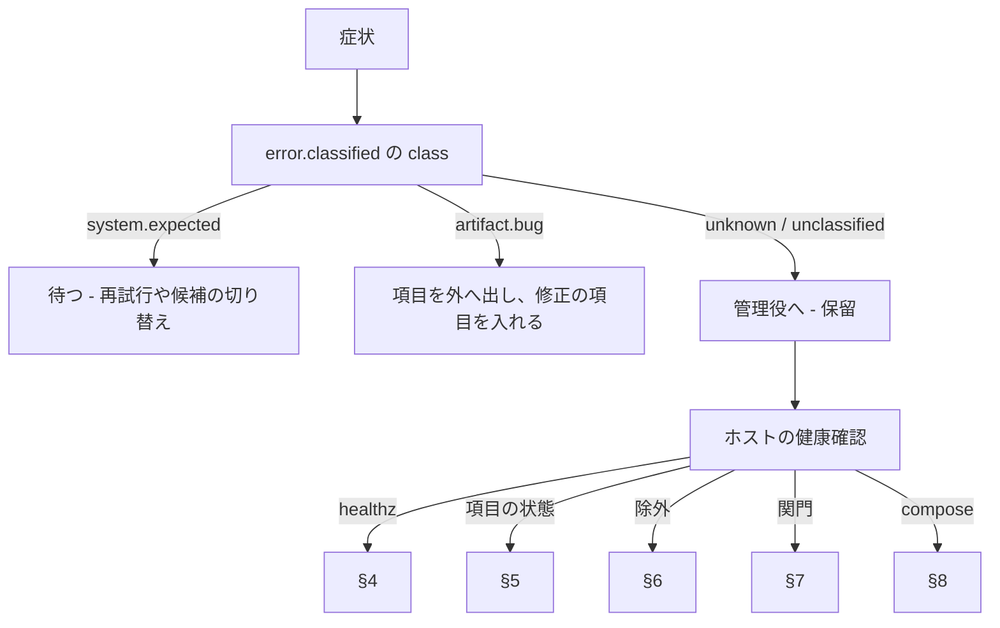

# 障害対応：症状から直し方へ

> 3 行でいうと、AX の障害は「症状→原因→直し方」で探します。分類は `config/error-rules.yaml` で行い、行き止まりは「保留」として管理役へ回します。秘密の値はログに出しません。直し方は手順で書き、分からない所は分からないと書きます。

この文書は、AX が壊れたときの直し方です。

- 対象: AX を動かしている人
- 前提: `operations.md` の知識（読むだけの照会と制御命令）があります

## 目次

1. [判断の流れ](#1-判断の流れ)
2. [分類表（`error-rules.yaml`）](#2-分類表error-rulesyaml)
3. [症状表](#3-症状表)
4. [healthz](#4-healthz)
5. [項目の状態（parked・failed）](#5-項目の状態parkedfailed)
6. [資源の除外（exclude）](#6-資源の除外exclude)
7. [関門の失敗（gate errors）](#7-関門の失敗gate-errors)
8. [compose の問題](#8-compose-の問題)
9. [未実装の命令（DEFERRED）と未確定の入力](#9-未実装の命令deferredと未確定の入力)
10. [席と権限](#10-席と権限)
11. [直行の手順](#11-直行の手順)
12. [状態](#12-状態)
13. [参照](#13-参照)

## 1. 判断の流れ

AX の障害は次の順で判断します。症状を 1 つ選んで原因と直し方を探します。



1. `ax events --kind error.classified` で分類を見ます。`config/error-rules.yaml` が上から順に当たりを探し、最初に当たった規則を使います（`axcommon/errors.py` の `ErrorRules.classify`）。
2. クラスごとに違う直し方です。下の表を見てください。

| クラス（`error-rules.yaml`） | 意味 | 動作 |
|---|---|---|
| `system.expected` | 想定の範囲内。枠・時間切れ・経路の失敗 | 待って再試行や候補を切り替えます。合否に数えません（`counts_as_failure: no`） |
| `artifact.bug` | 出した場所が `hint` で `code` を指す。成果物のバグ | 項目を外へ出し、修正の項目を入れる。`counts_as_failure: yes` です |
| `unknown` / `unclassified` | 上のどれにも当たらない | 管理役の受信対象（S-10）。`hold` 状態です |

分類ができなかった物（どれにも当たらない物）は `unknown` / `unclassified` になり、管理役の受信対象です（S-10）。

## 2. 分類表（`error-rules.yaml`）

`config/error-rules.yaml` が正です。`axcommon/errors.py` が読みます。1 規則の中の鍵（`match` の `http_status`、`body_regex`、`exception`、`exit_code`、`hint`）は、書いた物がすべて当たったときに当たります（AND）。別の書き方で当てたいときは規則を分けます（OR）。

点検で足してよいです。足す場合も `class` は `system.expected` / `artifact.bug` / `unknown` のどれかです（同ファイルの先頭注記）。

| class | code | match | 動作（`error-rules.yaml` の `action`） | 合否への影響 |
|---|---|---|---|---|
| `artifact.bug` | `test_fail` | `hint: [test_fail]` | 項目を外へ出し、修正の項目を次の実行に入れる | `yes` |
| `artifact.bug` | `verify_fail` | `hint: [verify_fail]` | 項目を外へ出し、修正の項目を次の実行に入れる | `yes` |
| `artifact.bug` | `gate_fail` | `hint: [gate_fail]` | 項目を外へ出し、修正の項目を次の実行に入れる | `yes` |
| `artifact.bug` | `bad_output` | `hint: [bad_output]` | 項目を外へ出す。無料モデルなら成績に記録する | `yes` |
| `system.expected` | `quota` | `body_regex: "(insufficient[_ ]quota|quota (exceeded|exhausted)|usage limit|out of (credits|quota)|利用枠)"` | 尽きた系統を枠回復まで外し、該当ジョブだけカードで待たせる | `no` |
| `system.expected` | `rate_limit` | `http_status: [429]` | 待って再試行する。モデルなら `exclude_rate_limit_min` 分だけ外す | `no` |
| `system.expected` | `rate_limit` | `body_regex: "rate[ _-]?limit"` | 待って再試行する。モデルなら `exclude_rate_limit_min` 分だけ外す | `no` |
| `system.expected` | `timeout` | `http_status: [408]` | `system_retries` 回まで指数的に待って再試行する | `no` |
| `system.expected` | `timeout` | `exception: [TimeoutError, TimeoutException, ReadTimeout, ConnectTimeout, WriteTimeout, PoolTimeout, asyncio.TimeoutError]` | `system_retries` 回まで指数的に待って再試行する | `no` |
| `system.expected` | `provider_down` | `http_status_range: [500, 599]` | 次の候補へ切り替える | `no` |
| `system.expected` | `provider_down` | `exception: [ConnectionRefusedError]` | 次の候補へ切り替える | `no` |
| `system.expected` | `network` | `exception: [gaierror, ConnectError, ConnectionError, ConnectionResetError, ConnectionAbortedError, NetworkError, RemoteProtocolError]` | 待って再試行する | `no` |
| `system.expected` | `network` | `body_regex: "(name or service not known|temporary failure in name resolution|network is unreachable|no route to host)"` | 待って再試行する | `no` |
| `unknown` | `unclassified` | （規則に当たらない物） | 管理役の受信対象（S-10） | `hold` |

> 状態: `artifact.bug` の `hint` の指し方
>
> `config/error-rules.yaml` は `artifact.bug` の 4 つの `code` だけが `hint` で指します（上表）。実際のノードの `bug()` はコードを指定済みです（例: `plugins/nodes/verify/cmd.py` の `bug("verify_failed", …)`）。`hint` を指定する側の呼び出し形は実装者が決めた物で、`docs/CHANGELOG.md` にあります。

## 3. 症状表

症状ごとに原因と直し方を書きます。命令は存在する物だけを挙げます。

| 症状 | 原因 | 直し方 |
|---|---|---|
| `ax status` が `socket_unreachable` を返す（終了コード 3）。接続先は `commander.sock` です | `intake` が起動していないか、ソケットの場所が違う | 1. `docker compose ps` で `intake` の状態を確認します。2. `host/ax-up.sh intake` で起動します。3. 接続先は `AX_SOCKET`・`~/.config/ax/config.yaml`・`${ax_state_dir}/commander/commander.sock` の順で決まります（`host/lib/ax_cli/transport.py`） |
| サービスが `healthy` にならない（120 秒で失敗） | healthz の理由（起動直後で未処理、拡張の読み込み、設定の不一致） | 1. `docker inspect` で healthz の理由を確認します。2. `docker logs` を見ます。3. `docker compose build` の失敗（`uv.lock` 未生成などが含む）も確認します（`docs/manual/getting-started.md` の §12） |
| `host/ax-up.sh` が「座ること」で終わる（flock の拒否） | 同じサービスの別のが実行中です（`${ax_state_dir}/locks/up-<名前>.lock` の `flock -n`） | 1. 別の許可を待つか、その実行を止めてから再実行します。2. `--dry-run` で何をしようとしているか確認します |
| `host/ax-env.sh --check` が失敗する | profile の項目、絶対パス、`bind_addr` の値 | `docs/manual/getting-started.md` の §4 と §12 を見ます。`bind_addr` は tailnet のアドレスか `127.0.0.1` で、`0.0.0.0` は通りません |
| `compose up` が秘密ファイルの不足で失敗する | `${secrets_dir}` の下の必要なファイルが無い | `docs/manual/getting-started.md` の §5。ファイルは権限 600 にします。`templates/secrets/README.md` の表に名前一覧があります |
| `ax control` が拒否される（`control.rejected`） | 制御 API の検証に外れた | §2 の表を確認します。理由には `reason` が空の場合や、必要な期限がない場合があります |
| `ax work` が承認待ち（終了コード 4） | `tier: irreversible` の行き先です | HQ で利用者本人が承認します（`operations.md` の §12.1）。司令塔が `confirm_irreversible` を付けても通りません |
| `ax work` が `tier_insufficient`（終了コード 6） | 席の段が行き先の tier に足りません | HQ で段を上げるか、別の席で出します（S-6.9）。「回避しない。迂回の道を探さない」（`commander/GUIDE.md`） |
| 指示が衝突（終了コード 8） | 別の位置が同じ対象を持っています | 持ち主と期限を利用者に伝え、待つか HQ で解きます（`commander/GUIDE.md`）。指示を上書きしません |
| 'head' の `TimeoutError`・レート上限（429） | 提供元が使えません | `error-rules.yaml` の `rate_limit` / `timeout` で待つ運用です。管理役は `exclude_resource` で一時的に外します（`operations.md` の §2.1） |
| 退避先へ送れません（archiver の失敗） | 退避先の通信、鍵、除外の一覧 | `core/archiver/app.py` の `/healthz` の追加項目（`last_failed`）を確認します。失敗時は元を残します。詳細は `docs/b1/README.md` の archiver の節です |
| hostwatch が動かずsudoで失敗する（`host.sudo_unavailable`） | sudo が使えません（`sudo -n true` が失敗） | 1. 利用者が sudo を使えるようにします。2. 復旧後は `host.sudo_restored` が出ます。3. 溜まった要求は戻った後に処理します（`host/lib/hostwatch/watch.py`）。特権操作を要しない機能は続けます |
| 司令塔の席が使えません（終了コード 7） | 席が未登録、失効、停止、期限切れです | HQ で席の登録・延長を行います（S-6.8）。失効した席が依頼していた承認待ちは却下され、命令と保持を外します（S-6.11） |
| gate が `locked` を返す（503） | 席範囲のロック（`seat.lock`）がかかっています | HQ で `seat.unlock` します（S-6.11）。HQ と local は影響を受けません |

## 4. healthz

### 4.1 形と読み方

すべての部品は `GET /healthz` を持ち、`{"ok":true,"component":"<名前>","version":"<版>"}` を返します（S-2.1、`axcommon/http.py`）。

```bash
curl -s http://127.0.0.1:8080/healthz | python3 -m json.tool
```

| 項目 | 内容 |
|---|---|
| `ok` | `true` なら通ります |
| `component` | 部品の名前です |
| `version` | 版です |
| `ext_failed` | 拡張の読み込みに失敗した名前の一覧です（読めなくても部分は続きます） |
| 追加項目 | `extra_health`（`manager` の `cycles`、`archiver` の `last_run_at` など） |

healthcheck は `python -m axcommon.healthcheck`（`axcommon/healthcheck.py`）です。`AX_HEALTH_PORT`（既定 8080）の `/healthz` を `127.0.0.1` に GET し、200 で `{"ok": true}` なら終了コード 0 です。`docker/base.yaml` の `healthcheck` の間隔は `interval: 10s` です（§10.3）。

### 4.2 部品ごとの口

| 部品 | 口 |
|---|---|
| `timeline` | `GET /v1/events`、`GET /v1/projections/{name}`（`core/timeline/api.py`） |
| `control` | `GET /v1/plugins`、`GET /v1/plugins/{id}`、`GET /v1/commands?state=`（`core/control/app.py`） |
| `ledger` | `GET /v1/todos`、`GET /v1/todos/{id}`（`core/ledger/app.py`） |
| `resources` | `GET /v1/resources`、`GET /v1/resources/{id}`、`GET /v1/ledger`、`GET /v1/selections`（`core/resources/api.py`） |
| `worker-pool` | `GET /v1/jobs`、`GET /v1/jobs/{id}`（`plugins/resource/worker-pool/api.py`） |
| `manager` | `GET /v1/manager`（`core/manager/app.py`） |
| `inspector` | `GET /v1/inspection`（`core/inspector/app.py`） |
| `emergency` | `POST /v1/emergency`（`core/intake/dest/b10a/service.py`） |
| `hq` | `GET /`、`GET /seats`、`GET /approvals/{approval_id}`（`core/hq/ext/b12b2.py`） |

### 4.3 生存の検査（S-11.2）

時系列記録が使えるときは `health.beat` を読みます。使えないときは各部品の `/healthz` を直接見ます（`core/observer/checks.py` の `check_liveness`）。作業側の網（ax-work）の部品には ax-core から `/healthz` が届きません。時系列記録が戻るまで判定しません。

```bash
# 生存の警報を読む
ax events --kind health.alert --limit 20
# ホスト見張りが起こし直した記録を読む
# hostwatch.log の deploy.up
```

## 5. 項目の状態（parked・failed）

### 5.1 ToDo の状態（S-9.2）

| 状態 | 意味 |
|---|---|
| `todo` | まだ誰も持っていない |
| `running` | ワーカーかサブループが持っている。ToDo は `running` で、司令塔は `ax todos --state running` で見ます |
| `review` | 結果の確認待ち |
| `waiting_user` | 利用者の回答待ち。理由は 7 種です（`physical`、`secret_input`、`money`、`publish`、`irreversible`、`preference`、`range_review`） |
| `parked` | 外へ出された。`reason` と `check_at` が必須です。`check_at` を過ぎたら管理役の見直し対象です（S-10.2 へ直行します） |
| `done` | 完了 |
| `dropped` | 不要になった。理由が必須です |

`parked` の `check_at` を過ぎたら管理役が見直します（S-10.2 の 5）。司令塔は勝手に状態を変えません。

### 5.2 項目の受け取り待ち（inbox）

`POST /items` の受け取りは `accepts_items: true` のサブループだけ受けます（S-7.10）。

| 症状 | 原因 | 直し方 |
|---|---|---|
| `inbox_full`（429） | 受け取り待ちが `inbox_max`（既定 50）に達しています（`runtime/subloop/inbox.py`） | 1. 別の `max_parallel_items` を上げるか、2. `run` に戻してから再送します。`parked` になった ToDo は `check_at`（1 時間後）に再開します（S-7.10） |
| サブループが落ちていて受け取れない | 503 を返します | 起動が済んだら再送します。同じ `item_key` は 1 回だけ受け付け、2 回目は受付済みを返します（S-7.10） |

### 5.3 実行の状態（run の状態）

| 状態 | 内容 |
|---|---|
| `planned` → `launching` → `submitted` → `running` | 順番に進みます（`launching` は外へ影響する操作の直前に必ず書く） |
| `completed`、`failed`、`timed_out`、`cancelled`、`lost` | 終わった状態です |
| `planned` → `skipped` | mode やモデル不足で起動しなかった |
| `missed` | 予定の時刻に起動できなかった。後から追いかけて実行しません（S-3.4） |

### 5.4 司令塔の報告（STATUS:）

司令塔の `ax work` のジョブは `STATUS:` を書き、親へ報告します（`plugins/resource/worker-pool/supervise.py`）。

| 報告 | 意味 | 次にすること |
|---|---|---|
| `STATUS: ready` | 完了して確認済みです | 親へ戻します |
| `STATUS: blocked` | 決定かアクセスが無くて継続できません | `HUMAN_ACTION:` を書いて利用者へ出します（`docs/manual/workflows.md` §16 の表） |
| `STATUS: failed` | 試したが動きません | 失敗理由を親へ伝え、再開するか新しい依頼をします |
| `STATUS: dropped` | 行う仕事が無くなりました（既に直っていたなど） | 親へ理由を伝え、閉じます |

## 6. 資源の除外（exclude）

### 6.1 除外の形

資源（モデルなど）は期限付きで候補から外せます。制御命令の `exclude_resource` が持ちます（S-5.3、S-5.4 の 8）。

```bash
ax control <target> exclude_resource '{"resource_id":"<model-id>","until":"2026-11-08T04:41:00.000Z"}' --reason '利用枠切れのため一時的に外す'
ax control <target> include_resource '{"resource_id":"<model-id>"}' --reason '枠が戻ったため戻す'
```

- `exclude_resource` は対象の資源の ID と未来の `until` が必須です。`on_expiry: release` です（S-5.4 の 8）。
- `include_resource` は当該の一時除外だけを解除します。停止・退役や他の除外理由は解除しません（S-5.3）。
- 資源台帳に書きます（`core/resources/store.py` の `exclusions` テーブル）。`POST /v1/resources/{id}/exclude` が口です（`core/resources/api.py`）。

### 6.2 除外と停止と退役

| 状態 | 違い |
|---|---|
| `excluded` | 一時的に候補から外れます。`until` の期限の後に戻ります。`include_resource` でも戻せます |
| `retired` | `excluded` が続いた資源への退役提案です（点検の段 5。S-13.2）。`set_status` で変えます（`core/resources/store.py`） |
| `active` | 通常の状態です（`core/resources/store.py` の `status`） |

管理役は資源の除外を期限付きで行えます（S-10.4）。点検の見直しでは資源の期限付き除外と解除を行えます（S-4.3 の変更権限表）。

### 6.3 直し方

- 資源が繰り返し失敗する（同じ `error.classified` が `repeat_threshold` を超える）ときは、管理役が恒久修繕の ToDo を作ります（S-10.2 の 4）。
- 退役したいときは、点検の提案（段 5）を待ちます。`retired` の変更は `who: [user]` で、利用者だけが変えられます。

## 7. 関門の失敗（gate errors）

### 7.1 対象（S-7.4）

| 型 | 内容 |
|---|---|
| `verify.cmd` | 検証コマンドです。終了コード 0 で `ok`、それ以外で `bug` です |
| `gate.tests_unchanged` | テストファイルが変わっていないこと |
| `gate.red` | テストが今のコードで意図どおり失敗すること |
| `gate.coverage_changed` | 変更行のカバレッジが `gate_changed_coverage`（既定 0.8）以上であること |
| `gate.lint` / `gate.types` | 静的検査です |
| `gate.mutation` | 対象に合うときだけ変異テストを行います |
| `gate.secret_scan` | 秘密と個人情報の検査です（S-15.3） |

`gate.secret_scan` を使うときは、前のノードで `gate.secret_scan` があることを外へ公開する型の検査（S-7.7 の 8）で確かめます。

### 7.2 直し方

| 症状 | 原因 | 直し方 |
|---|---|---|
| `verify_failed`（`verify.rc` 値） | 検証コマンドが非 0 で終わりました | 1. `verify.rc` と `log_tail`（`plugins/nodes/verify/cmd.py`）を見ます。2. 修正を入れて次の実行に回します。`bug` の辺は `worker.run(impl)` へ戻し、`tdd_impl_loops`（既定 3）で上限しています |
| `test_fail` / `gate_fail` | テスト・グラフの鍵が不合格です | 1. どの鍵が不合格か、`error.code` を見ます。2. 修正を入れて次の実行へ回します |
| `tests_unchanged` | テストファイルを変えた | 「テストを書かない・変えない」（常設規則）を守り、再実行します |
| `secret_scan` | 秘密か個人情報が正文に入ります | S-15.3 の基準で伏せるか、公開範囲を狭めます。値そのものは出すな |
| グラフの登録が拒否される | グラフ検査（S-7.7）で外れた | `python3 tools/ax_graph_check.py <path>`（§8.2）で検査します |

## 8. compose の問題

### 8.1 形と組み方

compose は `compose.yaml`（網と秘密の宣言）と `compose.d/<束>.yaml`（サービス）の 2 本立てです（`compose.yaml` の先頭注記）。

| 網 | 役割 |
|---|---|
| `ax-core` | 中核（入口、制御 API、台帳、時系列記録の書き込み側） |
| `ax-work` | 作業側（サブループ、ワーカー、タイマー） |
| `ax-job` | ジョブの網（`internal: true`） |

`compose.yaml` の `x-ax-ports-rule` は「ports は `${AX_BIND_ADDR}:<port>:<port>` の形だけ。`0.0.0.0` とアドレスなしは `tools/compose_check.py` が拒否する」（`compose.yaml`）。

### 8.2 直し方

| 症状 | 原因 | 直し方 |
|---|---|---|
| `compose up` が変数不足で失敗 | `profile.env` に無い変数が compose にある | `host/ax-env.sh --check`（§11）を流し、変数を補います。CI は `tools/ci-fixtures/ci.env` を使います（`tools/ci.sh`） |
| `compose_config` の変数の展開が違う | profile の変数対応（F-18.6） | `host/ax-env.sh --out FILE` で作り直します。値は `axcommon.profile` の `MAPPING` が正です |
| `ports` の検査で落ちる（`tools/compose_check.py`） | `host_ip` が空・`0.0.0.0`・`::` | `${AX_BIND_ADDR}` か `127.0.0.1` に結び直します（§8.1） |
| `docker compose ps` が空 | 登録の無い部品は起動しません | `host/ax-up.sh <サービス名>` で起動します。`hostwatch/registered/` に空のファイルがある物だけが対象です |

検査の道具は `tools/` にあります。

```bash
# compose の検査（docker compose config の出力を tools/compose_check.py で検査）
compose_files=(-f "$AX_HOME/compose.yaml")
for f in "$AX_HOME"/compose.d/*.yaml; do [ -f "$f" ] && compose_files+=(-f "$f"); done
docker compose -p ax --project-directory "$AX_HOME" --env-file "$ax_state_dir/deploy/profile.env" --env-file "$ax_state_dir/deploy/current.env" "${compose_files[@]}" --profile '*' config --format json | python3 tools/compose_check.py -

# グラフの検査（S-7.7）
python3 tools/ax_graph_check.py plugins/subloop templates
python3 tools/ax_graph_check.py plugins/subloop/work-tdd
python3 tools/ax_graph_check.py plugins/subloop/work-tdd --root . --json
```

- `tools/ax_graph_check.py` は `runtime.subloop.graphcheck` の `errors_for_body` を使う道具です（`tools/ax_graph_check.py`）。
- `tools/compose_check.py` の使い方は `docs/manual/development.md` の §4.2 にあります。

## 9. 未実装の命令（DEFERRED）と未確定の入力

CLI の実装状況は [CLI reference](../guide/cli.md) を参照してください。`DEFERRED` に載る `claim` は専用処理で実装されています（`host/lib/ax_cli/__init__.py`）。

| 命令 | 状態 |
|---|---|
| `ax brief` | 概要を読み取ります。取得できない情報と部分取得は結果に示されます |
| `ax whoami` | `DEFERRED` です |
| `ax guide` | `DEFERRED` です |
| `ax show` | `DEFERRED` です |
| `ax approvals` / `ax approval` | `DEFERRED` です |
| `ax seats` / `ax decisions` / `ax destinations` | `DEFERRED` です |
| `ax done` / `ax park` / `ax stop` / `ax cancel` / `ax update` / `ax decide` / `ax handoff` / `ax claim` / `ax seat revoke` | 要求を構築して送信します。送信先や権限によって実行結果は異なります |
| `ax resume` / `ax change` / `ax go` / `ax permission` / `ax gate` | 未実装です |
| `ax subloop create --spec FILE` / `ax core change --spec FILE` | JSON オブジェクトを読み、変更を依頼します。送信先や権限によって実行結果は異なります |

> 状態: DEFERRED の数え方
>
> `DEFERRED` の一覧には専用の処理が先に呼ばれる `claim` も含まれます。一覧だけで実装の有無を判断せず、CLI reference を参照してください。

## 10. 席と権限

### 10.1 席の状態（S-6.11）

| 状態 | 意味 |
|---|---|
| `active` | 通常の状態です |
| `suspended` | 席の自動停止中。読む操作だけ許すことがあります。席が `commander_rate_window_min` の間に `commander_rate_max` を超える指示を出す、または拒否が `commander_reject_suspend` 回続くと停止します（S-6.11） |
| `revoked` | 席の失効。次の要求から拒否します（`seat_revoked`） |
| expires_at | 席の期限です。過ぎたら拒否します（`seat_expired`） |
| `seat_revoke`（他の席） | `from=hq` のみ。1 席だけを `host/ax-gate-revoke.sh <seat_id>` で fail-closed にもできます |

### 10.2 lockdown（S-6.11）

`lockdown` は緊急ボタンの範囲に `commanders` を足すと実行します（S-12.3）。すべての身元の段を `read` に下げます。HQ だけが解除できます。

| 操作 | 命令 | 備考 |
|---|---|---|
| `seat.lock` | HQ の画面 | `ssh`、`tailnet`、`all` の範囲。`ssh` の範囲では `authorized_keys` を空にします |
| `seat.unlock` | HQ の画面 | 第二要素が要ります |
| `lockdown` | HQ の「緊急」画面 | `commanders` の範囲。`local` を含む全ての司令塔の段を `read` に下げます |
| `approved` | HQ の画面 | `go.confirm`（`tier: irreversible`）。HQ から承認してから実行します |

`ax` にこれらの命令はありません（S-16.8）。HQ の画面だけです。

## 11. 直行の手順

直す手順を短くまとめます。

### 11.1 状態確認（S-24 の条件 5 の一部）

```bash
# 1. オブザーバーの beat の時刻が observer_stale_s 以内か
# 2. compose の全サービスが running か
# 3. 投影 health の last_beat_at が stale_beats × heartbeat_s 秒以内か
# 4. オブザーバーの検査が 2 周回回って alarm がないか
ax status
```

### 11.2 基本の直し方

| 対象 | 命令 |
|---|---|
| サービスの起動 | `host/ax-up.sh <サービス名>` |
| サービスの停止 | [導入ガイドの停止手順](getting-started.md#10-止め方と片づけ) |
| profile の検査 | `host/ax-env.sh --check`（§8.2）または `python3 -m axcommon.profile --profile <file> --check`（`axcommon/profile.py`） |
| 退避先の補足 | `docs/b6b/procedure-caller-ax-key.md` の「回転と失効」 |
| tox の発効 | `python3 tools/ax_graph_check.py <path>`（§7.2） |

### 11.3 コマンド一覧（存在する物だけ）

| コマンド | 用途 |
|---|---|
| `ax status` / `ax todos` / `ax events` | 読み取りの照会（§1） |
| `ax work --project <proj> --title "..." --role <role>` | 作業の依頼（`work.request`） |
| `ax answer <todo_id> <回答> --quote '利用者の言葉'` | ToDo カードへの回答（`ledger.answer`） |
| `ax control <target> <op> [args] --reason .. [--lease ..]` | 制御命令（`control.command`） |
| `ax subloop create --spec FILE` / `ax core change --spec FILE` | サブループと中核の変更（`subloop.create` / `core.change`） |
| `python3 -m core.timeline.admin rebuild-projections [--db PATH] [--archive DIR] [--verify]` | 投影の作り直し（`core/timeline/admin.py`） |
| `python3 tools/ax_graph_check.py plugins/subloop templates` | グラフの検査（§8.2） |
| `python3 tools/build_registry.py --write` | registry の生成（§2.1） |
| `python3 tools/compose_check.py` | compose の検査（§8.2） |
| `python3 tools/commander_exam.py --model <名前>` | 司令塔試験（`tools/commander_exam.py`） |
| `python3 tools/cutover_note.py ...` | 切り替え・撤去の記録を追記（`tools/cutover_note.py`） |
| `host/ax-up.sh <サービス名>` | 起動（`host/ax-up.sh`） |
| `host/ax-deploy.sh` | 配備（`host/ax-deploy.sh`。ホスト見張りが `deploy` 要求を読んだときに呼ぶ） |
| `host/ax-archive-reap.sh [--dry-run]` | 退避の元の除去（`host/ax-archive-reap.sh`） |
| `host/ax-gate-revoke.sh <seat_id>` | HQ が使えないときの席の失効（`host/ax-gate-revoke.sh`） |
| `host/ax-seat.sh {install,sync,revoke-all,status,add} --profile FILE` | 席の管理（`host/lib/ax_gate.py` の `host_main`） |
| `host/ax-redact-index.sh` | 伏せ字索引の作り直し（`host/ax-redact-index.sh`） |
| `host/ax-peers.sh [--profile FILE]` | tailnet の表の更新（`host/ax-peers.sh`） |
| `python3 -m axcommon.profile --profile FILE --check` | profile の検査（`axcommon/profile.py`） |
| `python3 -m axcommon.schemas --check` | スキーマの検査（`axcommon/schemas.py`） |

## 12. 状態

AX の実装はまだ作り直しのものが多いです。ここでは、問題を直す妨げとなる箇所だけ書きます。

| 部分 | 状態と理由 |
|---|---|
| CLI の各命令 | 実装状況と送信先の制限は §9 と [CLI reference](../guide/cli.md) を参照してください |
| `ax subloop create --spec` / `ax core change --spec` | JSON オブジェクトを読み、変更を依頼します（§9） |
| 行き先の `handler` が `not-implemented:` の物 | 対応する実体が無い物の行き先です。指示は payload の検査より前に `501 contract_unresolved` で拒否されます。例: `b12b2.yaml` の多くの `not-implemented:`。一覧は `GET /v1/destinations` の `x-ax-unresolved` で分かります |
| `ax approval verify` / `export-go` | 実体は `core/intake/approval/go.py` と `core/intake/approval/integration.py` で実装しています。取り付け（`hq_verifier`）は後です |
| `commander.read.summary` の集計 | b12b3 が集計します。SSH 接続の開始と終了は b12b1 です（§9） |
| `core/hq/ext/b12b2.py` の `POST /v1/hq/approval/enroll` | `docs/b12b2/hq/README.md` のとおり、faceting の差し込み口は `FactorService` で用意しています。未接続のときは 501 で止まります |
| `ax-env-run probe`・`validate`・`version` | ENV-MODULE §5 の実装が B14b です（`host/env-module-min/releases/b6/lib/ax_launcher.py`） |
| 退避先の読み方 | `docs/b1/README.md` の archiver の節を見てください。`b1` の範囲は便宜的に TODO として残しています |

## 13. 参照

- `config/error-rules.yaml` （分類表）、`config/defaults.yaml` （S-17 の値）
- `docs/manual/operations.md` （運用）、`docs/manual/workflows.md` （作業の流れ）、`docs/manual/security.md` （席と権限の守り方）
- 検査の道具は `docs/manual/development.md` の §5
- 席と承認の細部は `docs/manual/security.md` の §4〜§6 と `docs/manual/api-intake-gate-hq.md`
