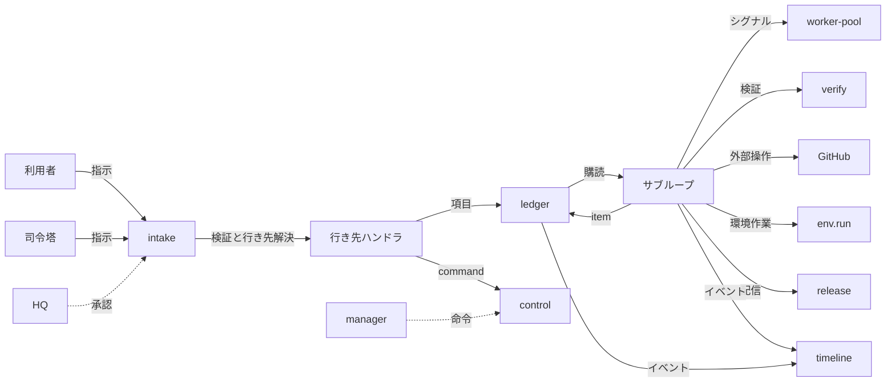
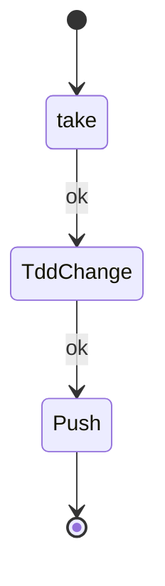
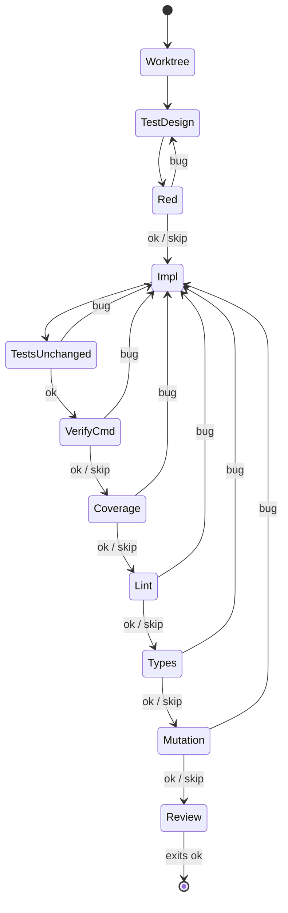
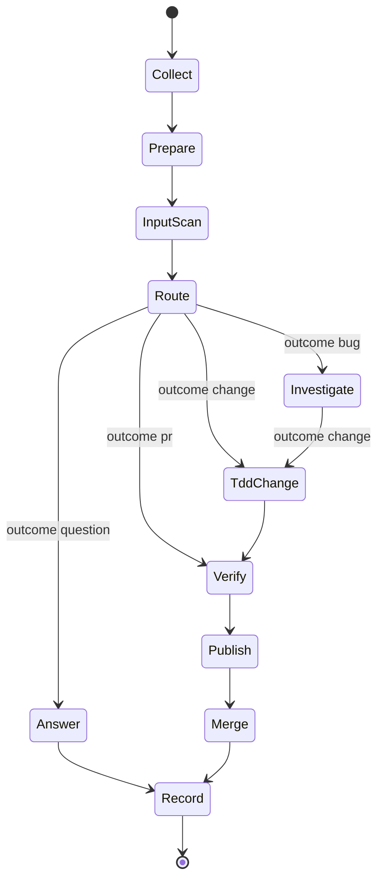
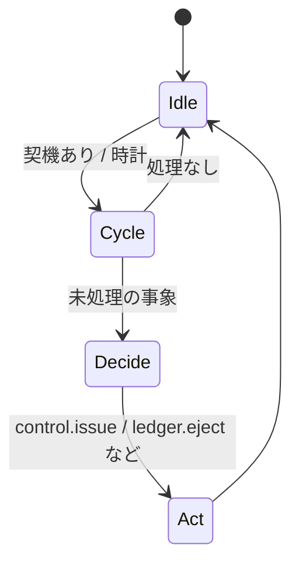

# 作業の流れ：依頼から配送までの出生

この文書はAX で仕事が始まって、終わるまでの道筋を説明します。
依頼は入口（intake）から台帳（ledger）の項目になり、サブループを走ります。
サブループはノードをつなぐことで進み、承認が必要な所は HQ で承認してもらいます。
配送と記録は時系列（timeline）に残ります。

> 概要（3行）
> 依頼は行き先の登録簿に従い、台帳の項目として記録されます。標準のサブループがグラフに従いノードを動かし、失敗は項目ごとに出します。戻しにくい操作は HQ の承認が通らなければ進みません。

## 目次

- [1. 全体像](#1-全体像)
- [2. 依頼の受け取り](#2-依頼の受け取り)
- [3. 台帳の項目](#3-台帳の項目)
- [4. サブループの実行](#4-サブループの実行)
- [5. ノードの種類](#5-ノードの種類)
- [6. 再開と継続](#6-再開と継続)
- [7. 上限と中断の規則](#7-上限と中断の規則)
- [8. HQ の承認](#8-hq-の承認)
- [9. 配送と公開](#9-配送と公開)
- [10. 時系列](#10-時系列)
- [11. 標準サブループ `work-tdd`](#11-標準サブループ-work-tdd)
- [12. 標準サブループ `change`](#12-標準サブループ-change)
- [13. 標準サブループ `release`](#13-標準サブループ-release)
- [14. 標準タイマー](#14-標準タイマー)
- [15. 資源の枯渇と緩和](#15-資源の枯渇と緩和)
- [16. 管理役とその予備役](#16-管理役とその予備役)
- [17. エラー分類](#17-エラー分類)
- [18. 状態](#18-状態)

Related: 所有者の設定方法は [plugins.md](plugins.md). サブループを作る手順とノードの作り方は、そちらを参照しています。

## 1. 全体像

仕事の流れは次の図のとおりです。

流れを順番に書くと、こうなります。

1. 司令塔か HQ の利用者が指示を送ります。入口（intake）が受けます。
2. 入口は、行き先の登録簿（`config/intake-destinations.yaml` と `config/intake-destinations.d/*.yaml`）で行き先を選びます。
3. 行き先のハンドラが内容を台帳（ledger）の項目にしたり、制御（control）へ渡したりします。
4. サブループが項目を受け取り、グラフ（`graph.yaml`）の順にノードを動かします。
5. ノードはワーカー（worker-pool）を使い、検証（verify）を回し、GitHub や環境へ作業を出します。
6. 戻しにくい操作は HQ の承認を待ちます。許可がなければ進みません。
7. 配送と公開は、時系列（timeline）へイベントとして記録されます。

## 2. 依頼の受け取り

### 2.1. 入口（intake）の仕事

入口は、司令塔と HQ からの指示を受け、検証して、登録簿に載った行き先へ渡すだけです。中身の判断はしません。

行き先は、入口の登録簿（`core/intake/registry.py`）で読み込みます。登録簿の行は、次を持ちます。

| 項目 | 意味 |
|---|---|
| `name` | 行き先名（例: `work.request`） |
| `schema` | 本文の JSON Schema（`schemas/dest/<name>.json`） |
| `handler` | 渡し先（HTTP 先か内部関数） |
| `allowed_from` | 許可する送り主（`commander` / `hq`） |
| `via` | 許可する経路（`local` / `ssh` / `tailnet` / `hq`） |
| `tier` | 段（`read` / `operate` / `irreversible`） |
| `irreversible` | 戻しにくい操作か |
| `ack` | 応答の形（`sync` / `async`） |
| `default_expiry_min` | 命令の期限の既定（分） |

登録にない行き先は送れません。行き先名は、登録簿に書いてある名前だけです。

### 2.2. 依頼の種類

登録簿に載っている代表的な行き先は、次のとおりです。

| 行き先 | 役割 | 段 | 変わる物 |
|---|---|---|---|
| `work.request` | 作業の依頼。実装も読み取りも受けます | `operate` | ブランチと検証 |
| `core.change` | 中核の変更。承認後に `core/` のブランチで進めます | `irreversible` | `core/` のブランチ |
| `subloop.create` | 新しいサブループの作成依頼 | `operate` | `subloop/` のブランチ |
| `control.command` | プラグインへの制御命令 | `operate` | プラグインの mode と knobs |
| `ledger.answer` | ToDo カードへの回答 | `operate` | ToDo の状態 |
| `approval.grant` / `approval.deny` | HQ 承認（HQ からだけ） | `irreversible` | 承認の状態 |
| `permission.change` | 配送先の許可の変更 | `irreversible` | 配送の許可 |
| `emergency` | 緊急ボタン（HQ からだけ） | `irreversible` | 停止系 |

同じ名前が複数のファイルに現れる場合があります（`b12.yaml` と `b12b2.yaml` の `work.request` など）。読み込むときは、早いほど優先されます。

### 2.3. `work.request`

作業の依頼です。Schema は `schemas/dest/work.request.json` です。

| 役割 | 必要な物 | 進み先 |
|---|---|---|
| `impl` / `impl_hard` | `body` と `acceptance.examples` / `acceptance.boundaries` | `work-tdd` の `tdd-change` |
| `research` | `title`、`body`、登録済み `target`、完全な `revision`。資料は任意 | worker-pool の読み取りジョブ |
| `summary` / `second_opinion` / `screen` / `assist` | `title` だけ | worker-pool の読み取りジョブ |

`research` の入力と資料登録は [CLI リファレンス](cli-reference.md#ax-work) を参照してください。

実装の依頼は、`core/intake/dest/b12/work/__init__.py` の `submit_implementation` が受けます。内容を `core/intake/dest/b12/mappers.py` の `work_item` で S-7.10 の作業項目に直し、`common.submit_item` で台帳とサブループへ渡します。

読み取りの依頼は、同じファイルの `submit_read` が受けます。`job_id` を持つジョブを worker-pool へ出し、重複は `job_delivery_uncertain` として止めます。冪等キーが違う内容を送れば `idempotency_mismatch` で拒否します。

### 2.4. `core.change`

中核の変更です。Schema は `schemas/dest/core.change.json` です。段は `irreversible` で、HQ の承認が必要です。

直接の呼び出しは `core/intake/dest/b12/core_change/__init__.py` の `handle` が受けます。承認無しでは `approval_required`（HTTP 403）で拒否します。承認後に `execute_approved` が走ると、`common.approved` で記録済みの承認（`destination=core.change`、`granted` 済み）を照らし、内容（`payload_digest`）が一致するか確かめます。内容が違えば `approval_payload_mismatch` で拒否します。

承認済みの内容は、`core/intake/dest/b12/mappers.py` の `core_change_item` で項目に直します。ブランチは `core/<name>` です。`kind=core_change` の項目は、`common.submit` で `base_ref=main` を確かめ、`branch` が `core/` で始まるか確かめます。

### 2.5. `subloop.create`

新しいサブループの作成です。Schema は `schemas/dest/subloop.create.json` です。`plugin_id`、`title`、`body`、`acceptance`、`spec`（`secrets` / `outputs` / `sensitivity`）が要ります。

`core/intake/dest/b12/subloop/service.py` が受けます。`decide` で `tier` と `hq` を判定します。`irreversible` で承認が無ければ、`phase=awaiting_approval` として承認待ちにします。`branch` は `subloop/<plugin_id>` です。完了後、項目を `kind=subloop_create` で `work-tdd` へ渡します。既存のブランチは HQ の再提出で無い限り `subloop_branch_exists` で止めます。

> 状態: `work.request` の実装依頼と `core.change` の受け口は、現時点で本番の合成に向けて直している最中です。`mappers.py` は新しい実装です。旧来の `work_item_mapping_missing` の拒否は消えています。

### 2.6. 検証と拒否

入口は、受け付けの前に次を確かめます。

- 行き先が登録簿に載っているか
- 行き先の handler が実装済みか。`handler: not-implemented:` の行き先は、`payload` の Schema 検査より前に `501 contract_unresolved` で拒否します（`GET /v1/destinations` の応答には `x-ax-unresolved` が付きます）。
- `payload` の Schema（`schemas/dest/`）に合うか
- `from` / `principal` / `issued_by` / `confirm_irreversible` / `approved_via` / `tier` を Schema にない場所に持っていないか（`core/intake/vias.py` の `RESERVED_PAYLOAD_FIELDS`）。ある場合は `forged_authority` で拒否します。
- 段が足りているか（`tier`）。足りなければ `tier_insufficient` で拒否します。
- `irreversible` の操作は、席が `irreversible` であっても本人（HQ）の承認が必要です。依頼だけでは実行しません。

拒否は `instruction.rejected` イベントとして時系列に残ります。理由は次を使います。`contract_unresolved`、`payload_schema`、`role_cannot_write`、`approval_required`、`tier_insufficient`、`forged_authority`、`idempotency_mismatch`、`inbox_full` などです。

## 3. 台帳の項目

### 3.1. 作業項目（work-item）の形

作業項目は、`schemas/dest/work.request.json` のような内容を基にします。サブループに渡す項目は、次の項目を持ちます。

| 項目 | 意味 |
|---|---|
| `item_key` | 冪等キー。サブループでは `item_id` になります |
| `todo_id` | 対応する ToDo カードの ID |
| `kind` | `work` / `core_change` / `subloop_create` |
| `project` | プロジェクト |
| `role` | ワーカーの役割（`impl` など） |
| `title` / `body` | 依頼の題と本文 |
| `acceptance` | `examples`（すべきこと）と `boundaries`（してはいけないこと） |
| `verify` | 受け入れ検証のコマンド（任意） |
| `branch` | 作業ブランチ（`ai/`、`core/`、`subloop/`） |
| `base_ref` | 基準（現状 `main` だけ） |

`core/intake/dest/b12/common/__init__.py` の `submit` は、`item_key == todo_id` と `base_ref == main` を確かめます。違う場合は `item_key_must_be_todo_id` / `base_ref_must_be_main` で拒否します。

### 3.2. ToDo の状態遷移

台帳（ledger）は、ToDo の状態を持っています。サブループの `item.state` を読んで遷移します。

| 状態 | 意味 |
|---|---|
| `todo` | 受け付け済み |
| `running` | 実行中 |
| `review` | 取り込みレビュー待ち |
| `waiting_user` | 利用者の回答・承認待ち（カード付き） |
| `parked` | 一時的に停止。`check_at` の時刻に再評価 |
| `done` | 完了 |
| `dropped` | 対応不要・破棄 |

状態が変わると、`task.state` イベントが時系列に出ます。サブループの `item.state=completed` を台帳が読むと、通常は `review` へ進みます。`core_change` / `subloop_create` は、取り込み（snapshot → verify → merge → tag → deploy → done）の順で進みます。途中で失敗すると `parked` になり、理由が記録されます。

ToDo はサブループから `ledger.add` ノードで作れますが、遷移（`transition`）は呼べません。`plugins/nodes/ledger/add.py` の docstring にそう書いてあります。遷移は台帳（`core/ledger/service.py`）が `item.state` を読んで行います。

### 3.3. 冪等性

同じ `idempotency_key`（または `id`）で同じ内容を送ると、重複として同じ `todo_id` と `job_id` を返します。違う内容を同じキーで送ると `idempotency_mismatch`（HTTP 409）で拒否します。

サブループの受け取りも同じです。`POST /items` は `item_key` で 1 回だけ受け付けます（`runtime/subloop/app.py` の `items`）。受け取り待ちが `inbox_max` に達していれば `inbox_full`（HTTP 429）で拒否し、項目は `parked` になります。

## 4. サブループの実行

### 4.1. サブループの形

サブループは、1 コンテナ = 1 個の実行です（`runtime/subloop/`）。起動は `python -m runtime.subloop` で、`AX_PLUGIN_ID` のサブループを動かします。

各サブループは、次を持ちます。

| ファイル | 意味 |
|---|---|
| `plugins/subloop/<id>/manifest.yaml` | 宣言（kind、schedule、knobs、roles、secrets、outputs） |
| `plugins/subloop/<id>/graph.yaml` | グラフ（ノードと辺） |
| `plugins/subloop/<id>/prompts/` | LLM への指示（任意） |
| `compose.d/sl-<id>.yaml` | compose サービスの定義 |

登録簿にあるものだけが動きます。登録簿は `plugins/registry.yaml` で、生成物です。直し方: `plugins/registry.d/<束の ID>.yaml` を直し、`python3 tools/build_registry.py --write` を実行します。

標準サブループは3つです。

| ID | kind | 場所 |
|---|---|---|
| `work-tdd` | subloop | `plugins/subloop/work-tdd/` |
| `change` | subloop | `plugins/subloop/change/` |
| `release` | subloop | `plugins/subloop/release/` |

タイマーは `timer-runner`（`runtime/timer_runner/manifest.yaml`）がまとめて動かします。資源は `resources`（資源台帳）と `worker-pool`（ワーカーの実行）です。

### 4.2. グラフの形

グラフは `entry`（入口のノード）、`item_source`（項目源）、`max_parallel_items`、ノード一覧、辺一覧を持ちます。

ノードは次を持ちます。

| 項目 | 意味 |
|---|---|
| `id` | ノード名 |
| `type` | 型（例: `inbox.take`、`git.worktree`） |
| `with` | 渡す値（`{{knobs.名前}}` / `{{item.名前}}` / `{{nodes.<ID>.data.名前}}` のテンプレート） |
| `limits` | `timeout_s`（期限）、`retries`（再試行）、`continuations`（継続） |
| `on_fail` | 失敗時の行き先（既定は `eject`） |
| `needs_mode` | 起動する mode（既定は `[run]`） |

辺は `when` で分岐します。`when` の値は `ok` / `bug` / `error` / `skip` / `outcome:<名>` です。

ノードは `ok` / `bug` / `skip` / `error` を返します（`runtime/subloop/nodeapi.py`）。

- `ok`: 成功。次の辺へ進みます。
- `bug`: 成果物のバグ（`artifact.bug`）。`when: bug` の辺へ進みます。
- `skip`: 対象外。`when: skip` の辺へ進みます。
- `error`: システム側の失敗（`system.expected` または `unknown`）。再試行か `on_fail` のどちらかです。

### 4.3. 実行の進み方

実行系（`runtime/subloop/executor.py`）は、次を繰り返します。

1. 入口（entry）から辺をたどります。
2. `item_source` の出力で項目を分けます。`max_parallel_items` 個ずつ並行に進めます。
3. 各ノードで、mode を確かめます（`draining` は新規を開始せず既存は最後まで。`collect_only` は収集だけ）。
4. ノードの繰り返し（`retries` / `continuations` / `max_loops` / `max_hops`）を数えて、型を呼びます。
5. 出力で辺を選びます。`item.state` を書きます。

1 項目の失敗は、その項目だけを外へ出します（eject）。他の項目と次の実行は進みます。超えたら、理由付きで `ejected` にします。

### 4.4. 項目の受け取り（items）と巡回

`accepts_items: true` のサブループは、`POST /items` を持ちます（`work-tdd` と `release`）。制御（control）が `control-apply-token` で渡します。受け付けたら `item.state=planned` を書きます。mode が `run` なら直後に run を作ります。`draining` / `collect_only` では保存だけして、`run` に戻ったら拾います（`runtime/subloop/app.py`）。

巡回（schedule）は、interval か cron です。逃した予定は追いかけません（`missed: record_only`）。`timer-runner` は、実行済みのものを `missed` と記録するだけです。

### 4.5. mode と knobs

mode は `run` / `collect_only` / `poll_paused` / `draining` の4つです。制御（control）の `POST /v1/commands` に `set_mode` 命令を送り変更でき、サブループは10秒ごと（既定）に `effective` を読んで合わせます（`runtime/subloop/app.py` の `loop_tick`）。

knobs は調整項目です。manifest で宣言します。`effective: next_run` のものは次の run から効きます。`effective: immediate` のものは直ちに効きます。

## 5. ノードの種類

部品庫（`plugins/nodes/<名前空間>/<型>.py`）には、次の型があります。完全な一覧と作り方は [plugins.md](plugins.md) を参照してください。ここでは、作業の流れで使う代表的なものを挙げます。

### 5.1. 受け取りと項目の操作

| 型 | 役割 | 戻り値 |
|---|---|---|
| `inbox.take` | 受け取り待ちから最大 `max` 件を取ります | `ok` / `skip`（空の場合） |
| `ledger.add` | 台帳に ToDo を1件作ります | `ok` / `error` |
| `ledger.wait` | ToDo が `until` の状態になるか `wait_s` まで待つ | `ok`（`data.outcome` が状態名か `timeout`） |
| `wait.event` | 時系列に `kind` が来るか `wait_s` まで待つ | `ok`（`outcome` が `event` か `timeout`） |
| `notify` | `change.notification` イベントを出します | `ok` |

### 5.2. ワーカーと判定

| 型 | 役割 | LLM |
|---|---|---|
| `worker.run` | worker-pool にジョブを出し、結果を待ちます | 使う |
| `decide.llm` | 判定用のジョブで JSON 判定を頼みます | 使う |
| `shell.run` | コンテナ内で1コマンドを走らせます | 使わない |

`worker.run` の詳しい規則は次です（`plugins/nodes/worker/run.py`）。

- `with.role` で役割を選びます（`test_design` / `impl` / `impl_hard` / `review` など）。
- 読み取り専用（`summary` / `research` / `second_opinion` / `screen` / `assist` / `manager` / `backup_manager` / `review_final` / `impl_public`）に `workdir_id` を渡すのは拒否します。書き換えは `work-tdd` の `tdd-change` のみです。
- `ok` の条件は worker-pool の判定（`verify.rc == 0` かつ `report.status == ready`）です。ワーカーの「できた」だけでは `ok` にしません。
- `blocked` は `bug` ではありません。項目を外へ出し、ToDo にします（理由が `waiting_reason` に当たれば `waiting_user`、当たらなければ `parked`）。`resume_ref` を残します。

`decide.llm` は、`worker-pool` の役割 `screen` で判定を頼みます。返答の最後の JSON が Schema に合わなければ `bug` になります。

### 5.3. 検証と関門

| 型 | 役割 |
|---|---|
| `verify.cmd` | 検証コマンドを worker-pool で走らせる。`rc=0` で `ok`、それ以外で `bug`。空なら `skip` |
| `gate.secret_scan` | 外へ公開する前に秘密と個人情報を検査。疑いがあれば `bug` |
| `gate.red` / `gate.tests_unchanged` / `gate.coverage_changed` / `gate.lint` / `gate.types` / `gate.mutation` | TDD の関門（`tdd-change` の部分グラフ） |

`gate.secret_scan` は、外へ影響する型（`gh.comment` など）の前に必須で通す決まりです。`publishes: true` の型は、前に置かないと登録できない（S-7.7 の8）。

### 5.4. Git と GitHub

| 型 | 役割 | 外へ影響 |
|---|---|---|
| `git.worktree` | 項目ごとに worktree とブランチを作ります（`wt-` で始まる `workdir_id`） | `git.push` ではありません |
| `git.commit` | worktree 内でコミットします | — |
| `git.push` | ブランチを `remote` へ push します（`work.git` のみ。`main` / `master` への push は拒否） | `git.push` |
| `gh.list_issues` / `gh.list_prs` | 条件に合う Issue / PR を項目にします | — |
| `gh.pr_open` | PR を開きます（秘密検査が要る） | `github.pr` |
| `gh.comment` | Issue / PR にコメントを書きます（秘密検査が要る） | `github.comment` |
| `gh.label` | ラベルを付けます | `github.label` |
| `gh.merge` | PR をマージします（`sha` が一致するときだけ） | `github.merge` |

`git.push` は `main` / `master` へ書けません。`work-tdd` は `work.git` へ push するだけです。強制 push（`+`）で更新します。

GitHub の書き込みは二重実行を防ぎます。コメントは本文の末尾に `<!-- ax:<鍵> -->` を付け、再送時は一覧から印を探します。マージは `<repo>#<番号>@<sha>` の鍵で防ぎます。

### 5.5. 環境と CI

| 型 | 役割 | 外へ影響 |
|---|---|---|
| `env.run` | 実行環境で作業を走らせます | `env.run` |
| `env.cancel` | 環境の作業を打ち切ります | — |
| `ci.trigger` | GitHub Actions の `workflow_dispatch` を起動します | `ci.trigger` |
| `ci.collect` | 外部 CI の結果を回収します | — |

`env.run` は、環境の選択と情報の区分の確認を `resources` が行います。ノードは `POST /v1/env/jobs` を出して終わりまで待つだけです。`irreversible: true` の依頼は直前に `launching` を書き、再起動時は `GET` で照合します。

### 5.6. 外へ影響する型の規則

`META.output` を持つ型（`github.comment` など）は、manifest の `outputs` に載せなければ使えません。使えなければ graphcheck が登録を拒否します。

`publishes: true` の型は、前に `gate.secret_scan` が要ります。`launching: true` の型は、外部操作の直前に `launching` を書き、再起動時の照合（`reconcile`）で二重実行を防ぎます。

## 6. 再開と継続

### 6.1. `resume_ref` と `resume_from`

項目が失敗や待ちで外へ出るとき、`resume_ref` を残します。次に同じ項目が走るとき、その `resume_ref` の `workdir_id` と `job_id` を使います。

- `git.worktree` は `resume_ref.workdir_id` があれば、その worktree を作り直しません。
- `worker.run` は、同じ項目の同じノードに入り直すとき、前回の `job_id` を `resume_from` に入れます。項目の `resume_ref.job_id` は、最初の入場で使います（S-8.12）。
- `test_design` / `impl` / `impl_hard` は既定で `resume: auto`、他は `resume: off` です。

### 6.2. `continuations` と `retries` / `max_loops` / `max_hops`

ノードは無限に繰り返せません。4つの上限があります。

| 名前 | 意味 | 既定 |
|---|---|---|
| `retries` | `system.expected` の再試行回数 | `config/defaults.yaml` の `system_retries`（既定3） |
| `continuations` | タイムアウト時の継続回数 | `limits.continuations`（ノードごとに書く値。無ければ0） |
| `max_loops` | 内側の辺の循環回数（例: `bug` → impl） | 辺の `max_loops`（例: 3、2） |
| `max_hops` | 1 項目の合計の再入場回数 | `max_hops`（既定8、上限20） |

`work-tdd` の `tdd-change` は、impl への差し戻しを3回、test_design への差し戻しを2回まで許します。全部使い切り、合計20回（S-17 の `max_hops` 上限）に達すると ejected になります。

### 6.3. 再起動後の復旧

起動時に `recover` が走ります（`runtime/subloop/executor.py`）。`launching` を記録したノード（外へ影響する型）は、`reconcile` で外部と照合します。見つからなければ `retry`、見つかれば `resolved`、不明なら `lost` として明示します。

## 7. 上限と中断の規則

### 7.1. ノードの `limits` と `on_fail`

すべてのノードに `limits.timeout_s` を書きます。`bug` を返しうるノードは、`when: bug` の辺か `on_fail` を決めます。

`on_fail` は `eject` / `skip` / `goto:<ID>` の3つです。書かなければ `eject` です。`eject` は、その項目だけを外へ出します。

### 7.2. 項目の上限

`max_parallel_items` は、同時に進める項目数です。`max_hops` は、項目の再入場の合計の上限です。`inbox_max` は、受け取り待ちの上限です。

### 7.3. 項目の外出し（eject）と待ち（parked）

`eject` は、理由付きで項目を外へ出します。理由は、`reason` に入ります。`parked` は、ToDo の `parked` の状態です（`check_at` に再評価時刻を持ちます）。

`blocked` のワーカーは、`waiting_user` か `parked` のカードを出します（`plugins/nodes/worker/run.py` の `_todo_for_blocked`）。

### 7.4. mode の切り替え

`draining` は新しい run と項目を始めません。既存項目の後続は最後まで続けます。`collect_only` は収集だけ、処理はしません。`poll_paused` は、タイマーを始めません。

## 8. HQ の承認

### 8.1. 承認の仕組み

戻しにくい操作の承認は、HQ の画面で利用者本人が行います。司令塔が指示を送っても、承認済みにはなりません。

席の段が `irreversible` でも、席自体に承認する権限はありません。現在の入口では継続許可を照合せず、戻しにくい操作は個別承認を要します。詳しくは §8.3 を参照してください。

### 8.2. HQ の承認画面

HQ の承認画面は `core/hq/approval/` です。内容と `digest` を確認し、第二要素を入れて承認します。期限内であって、内容が一致していなければ実行しません。

`core.change` の承認済みの記録は `common.approved` で照らします。`payload_digest` が一致しなければ `approval_payload_mismatch` で拒否します。

### 8.3. 継続許可（permission.change）

仕様では対象 repo・公開先・操作が一致する利用者の継続許可があると、個別承認は要りません。現在の入口には継続許可の照合が接続されていないため、戻しにくい操作には毎回、利用者本人の承認が要ります。`merge`、`release`、`deploy`、`publish`、`post` の実行先はまだありません。`core.change` と `subloop.create` は継続許可の対象外です。許可の作成と無効化は `irreversible` で、HQ からだけ送れます。

### 8.4. 緊急停止

HQ の緊急ボタン（`emergency`）は、必要ならプロセス群を停止します。席の管理（`seat.*`）、秘密ファイルの取り込み（`secret.push`）、承認の場面などは `irreversible` です。

## 9. 配送と公開

### 9.1. 配送（delivery）

配送先の許可は `core/intake/dest/b16b/common.py` の `TargetRegistry` で読み込みます。登録にない宛先、複数の scope、返信の有効化は拒否します。

投稿や配信の候補は、`delivery_targets` に登録された送信先から取ります。`unknown`（成否不明）の送信は台帳へ出し、再送しません。

`discord-forward`・`x-posts` の細かい配送の実装は、それぞれのフォルダの README が新しいため、ここでは省略します（リンクは後述の目次を参照）。

### 9.2. 公開（release）

公開は製品登録簿（`config/products.yaml`）に従います。`release` が公開待ちをまとめます。

製品のエントリは、次を持ちます。

| 項目 | 意味 |
|---|---|
| `publish_paths` | 公開対象のファイル |
| `version` / `tag_pattern` | 版の規則とタグの形 |
| `notes.languages` / `notes.include` | 更新ノートの言語と内容 |
| `entry.kind` / `entry.name` / `entry.requires` | 公開の入口と必要な能力 |
| `checks` | 公開前に使う条件（例: `clean_main`） |
| `quiet_min` / `max_wait_min` | 静穏時間と待ちの上限 |
| `dry_run` | 既定 `true`。外部に影響する操作は予定だけにする |

登録にない製品は公開しません。資格（credentials）を確認できない製品は、その製品の公開だけを無効にします。

## 10. 時系列

時系列（timeline）は、`ax-core` と `ax-work` の両方から読むことができます。時刻付きのイベントを蓄積します。

作業側（8081）で書ける kind は、`core/timeline/kinds.py` の `WORK_SIDE_KINDS` に載っているものだけです。代表的なものは次のとおりです。

| kind | 意味 |
|---|---|
| `run.state` / `item.state` / `node.state` | 実行・項目・ノードの状態 |
| `change.cycle` / `change.route` | change の巡回と振分け |
| `release.pending` / `release.batch` / `release.result` | 公開の待ちと結果 |
| `error.classified` | エラーの分離（`artifact.bug` / `system.expected` / `unknown`） |
| `health.beat` | 心跳 |
| `change.notification` / `notification.failed` | 通知の要求と失敗 |

イベントの本文に秘密や個人情報が入る場合は、`[REDACTED]` に置き換えて書きます。

## 11. 標準サブループ `work-tdd`

### 11.1. 目的

実装依頼（`work.request` の `impl` / `impl_hard`、`core.change`、`subloop.create`）を、テスト駆動（TDD）で進めてブランチを用意する標準サブループです。入口の `work.request`（`impl` / `impl_hard`）、`subloop.create`、`core.change` の実装は、すべてこれで `tdd-change` を通ります（`plugins/subloop/work-tdd/manifest.yaml`）。

### 11.2. 入力

`POST /items`（`items`）から受け取ります。`item_source` は `take`（`inbox.take`）です。

`item_key` は冪等キーで、`item_id` になります。`inbox_max`（既定50、上限200）の上限があり、達すれば `inbox_full` で拒否します。

### 11.3. グラフ

`plugins/subloop/work-tdd/graph.yaml` は、3つのノードです。

| ノード | 型 | 役割 |
|---|---|---|
| `take` | `inbox.take` | 受け取り待ちから最大 `max_parallel_items` 件を取ります |
| `tdd-change` | `include: tdd-change` | 部分グラフ（後述） |
| `push` | `git.push` | ブランチを `work.git` へ push します |

`push` は `remote: work.git` で、`main` / `master` には書きません。

### 11.4. 部分グラフ `tdd-change`

`plugins/subloop/_lib/tdd-change.yaml` は、実装サブループが必ず通る部分グラフです。

| ノード | 型 | 役割 |
|---|---|---|
| `worktree` | `git.worktree` | 項目ごとに worktree とブランチを作ります |
| `test_design` | `worker.run`（`test_design`） | テストを書きます（上限 `test_cases_max`） |
| `red` | `gate.red` | 実装前にテストが失敗することを確かめます |
| `impl` | `worker.run`（`impl`） | 実装します |
| `tests_unchanged` | `gate.tests_unchanged` | テストが変わっていないか比べます |
| `verify` | `verify.cmd` | 検証コマンドを回します |
| `coverage` | `gate.coverage_changed` | 変更行のカバレッジを見ます |
| `lint` | `gate.lint` | lint を回します |
| `types` | `gate.types` | 型検査を回します |
| `mutation` | `gate.mutation` | 変異検査を回します（任意） |
| `review` | `worker.run`（`review`） | レビューを頼みます |

`bug` の辺は、`gate.red` → `test_design` と、`verify` / `gate.*` → `impl` を回ります。`max_loops` は impl への差し戻し3回、test_design への差し戻し2回です。全部使い切ると、`max_hops` の合計20回（S-17）で終わります。

同じ項目のすべてのジョブと検証は、`git.worktree` が返した `workdir_id` を渡して1つの worktree を共有します（会話は共有しません）。

### 11.5. 設定項目（knobs）

`plugins/subloop/work-tdd/manifest.yaml` の knobs は、次のとおりです。

| knobs | 既定 | 範囲 | 効果 | 誰が変えるか |
|---|---|---|---|---|
| `max_parallel_items` | 1 | 1–2 | 次の実行から | inspection / user |
| `inbox_max` | 50 | 1–200 | 直ちに | inspection / user |
| `every_s` | 300 | 60–3600 | 次の実行から | inspection / user |
| `max_hops` | 20 | 2–20 | 次の実行から | inspection / user |
| `test_cases_max` | 12 | 3–30 | 次の実行から | inspection / user |

### 11.6. 失敗の扱い

`bug` は `impl` への差し戻しです。`max_loops` を超えると eject します。`error`（`system.expected`）は `retries` 回まで再試行します。ワーカーの `blocked` は、`waiting_user` か `parked` の ToDo を出して項目を外します。

## 12. 標準サブループ `change`

### 12.1. 目的

Issue と PR を受け付けて、検証とマージを進める標準サブループです（`plugins/subloop/change/manifest.yaml`）。GitHub の Issue / PR を自動で振り分けるためのものです。

### 12.2. 入力

`item_source` は `collect` です。`change.collect` が登録簿（`plugins/subloop/change/targets.yaml`）の対象（GitHub リポジトリ）から Issue / PR を集め、候補を返します。`change_starts_per_cycle`（既定4）で1巡の起動を制限します。

対象の登録（targets）は次の項目を持ちます。

| 項目 | 意味 |
|---|---|
| `issue_repo` / `implementation_repo` | Issue と実装のリポジトリ |
| `merge_method` | マージの方法（`merge` / `squash`） |
| `test_recipe` | 検証レシピ（`verification/recipes.yaml`） |
| `execution_cap` | 実行の上限 |
| `untrusted_forbidden_paths` | 非信頼の変更で禁止するパス（例: `.github/**`） |
| `trusted_authors` | 信頼できる作者 |
| `outbound_allowlist` | 外へ出してよい宛先 |
| `state_labels` | 状態と GitHub ラベルの対応 |

依存取得が必要なレシピでは、信頼済み対象の `outbound_allowlist` と、同じ project・target・version・許可先に対応するホスト側レシピを設定します。検証で使う依存成果物のディレクトリは `dependency_artifacts` に指定します。依存取得は許可先に限定し、検証は新しいソースと読み取り専用の依存成果物を使って無通信で実行します。source の実 Docker を含む限定試験は合格していますが、本番への反映と全体の動作確認は未完了です。

### 12.3. グラフ

`plugins/subloop/change/graph.yaml` のノードは、次です。

| ノード | 型 | 役割 |
|---|---|---|
| `collect` | `change.collect` | 対象から Issue / PR を集めます |
| `prepare` | `change.prepare` | スナップショットと要約を用意します |
| `input_scan` | `gate.secret_scan` | 公開する本文の秘密検査 |
| `route` | `change.route` | `question` / `bug` / `pr` / `change` の振分け |
| `answer` | `change.answer` | 質問に答えます（GitHub コメント） |
| `investigate` | `change.investigate` | 原因を調べます |
| `tdd-change` | `include: tdd-change` | 実装の部分グラフ。`change` の入口です |
| `verify` | `change.verify` | 検証と安全を確認します |
| `publish` | `change.publish` | 変更を公開します |
| `merge` | `change.merge` | マージします |
| `record` | `change.record` | 記録します |

`route` の `outcome` は、宣言要約（`ChangeFlow._decision` → `MergeGate`）で決まります。`question` は回答、`bug` は調査、`pr` は検証、`change` は実装です。

### 12.4. 段のアダプタ（collection / integration / safety）

`change.collect` などの型は、`plugins/subloop/change/integration/register.py` の `register` で実行時に登録します（固定の部品庫にありません）。詳細はそちらのコードが正本です。

- アダプタ（collection / integration / safety / verification）: `plugins/subloop/change/collection/`、`integration/`、`safety/`、`verification/` の Python モジュールが、GitHub の読み書きと検証を照合します。
- ポート（`Ports`）: GitHub、収集、検証、作業計画、権限、journal を注入します。`ports` が無いと `change_ports_unconfigured` で eject します。

### 12.5. 設定項目（knobs）

`plugins/subloop/change/manifest.yaml` の knobs は、次のとおりです。

| knobs | 既定 | 範囲 | 意味 |
|---|---|---|---|
| `dry_run` | `true` | — | 外部操作を予定だけにします |
| `max_parallel_items` | 1 | 1–4 | 同時に進める項目の上限 |
| `every_s` | 300 | 60–3600 | 巡回の間隔 |
| `max_hops` | 20 | 2–20 | 項目の再入場の上限 |
| `change_starts_per_cycle` | 4 | 1–8 | 一巡で起動する上限 |
| `change_model_calls_per_cycle` | 30 | 1–60 | 一巡のモデルの呼び出し上限 |
| `change_cycle_seconds` | 300 | 30–600 | 一巡の時間の上限 |
| `change_fix_rounds` | 3 | 1–3 | 修正ラウンドの上限 |
| `test_cases_max` | 12 | 3–30 | テストの件数の上限 |

### 12.6. 失敗の扱い

既定は `dry_run: true` です。`run` モードで `dry_run` が `false` のときだけ、外部へ書き込みます。`mode` が `run` でなく、`collect_only` のときは収集だけ、処理はしません。

Budgets として、`change_starts_per_cycle`、`change_model_calls_per_cycle`、`change_cycle_seconds` があります。どれかに達すると、その巡回は停止します（`collect` の `budget_exhausted`）。

修正ラウンドは `_repair` で回し、`change_fix_rounds` を超えると `untrusted_fix_limit` か `trusted_internal_decision_required` で待ちます。

## 13. 標準サブループ `release`

### 13.1. 目的

公開待ちを製品ごとにまとめ、製品登録簿に従って公開する標準サブループです（`plugins/subloop/release/manifest.yaml`）。`execution: mechanical` で、LLM を使いません。

### 13.2. 入力

`accepts_items: true` で、`POST /items` を持ちます。助けの入力は `release.pending` です。公開待ち項目は、change の `merge` がマージ完了後に `release.pending` で渡します。

`config/products.yaml` が製品ごとの公開パスと入口を定めます。登録にない製品は、公開しません。`entry.kind: unresolved`（例: hibi の `hibi-release`）のものは `publication_contract_undefined` として保留します。

### 13.3. グラフ

現在の `plugins/subloop/release/graph.yaml` は、1ノードです。

| ノード | 型 | 役割 |
|---|---|---|
| `publish` | `env.run` | 公開の入口を実行します。`outputs: [result.json]`、`irreversible: true`、`timeout_s: 3600` |

バッチの束ねと公開の条件判断は、グラフィックではなく `plugins/subloop/release/core/service.py` の `Service.execute` で行います。`dry_run`（既定 `true`）は、予定とノートを作るだけです。公開待ち、タグ、公開、配備、Issue の完了は変更しません。

### 13.4. 設定項目（knobs）

`plugins/subloop/release/manifest.yaml` の knobs は、次のとおりです。

| knobs | 既定 | 範囲 | 意味 |
|---|---|---|---|
| `inbox_max` | 50 | 1–200 | 受け取り待ちの上限 |
| `dry_run` | `true` | — | 外部操作を予定だけにします |
| `every_s` | 300 | 60–3600 | 巡回の間隔 |
| `release_retry_limit` | 3 | 1–10 | 同じ理由の再試行上限 |

### 13.5. 失敗の扱い

外部操作は直前に `launching` を記録し、結果が不明なら再送しません。再試行は `release_retry_limit`（既定3）までです。

## 14. 標準タイマー

タイマーは、1つの `timer-runner`（`runtime/timer_runner/manifest.yaml`）がまとめて動かします。`schedule` は interval か cron です。逃した分は追いかけません。

| タイマー | kind | schedule | 役割 | 状態 |
|---|---|---|---|---|
| `conversation-index` | `timer` | cron `"41 19 * * *"` | 会話履歴の増分索引（`plugins/timer/conversation-index/handler.py`） | `kind=timer`。`enabled` の既定値は `false` |
| `timer-runner` | `timer` | interval 30秒 | すべての `kind=timer` を動かします | `kind=timer` |

その他の `plugins/timer/` のフォルダは、kind が `subloop` です。これらは `timer-runner` の対象ではありません。次を参照してください。

| フォルダ | kind | schedule | 状態 |
|---|---|---|---|
| `scheduled-publisher` | `subloop` | interval 3600秒 | 接続が未完了です。`integration.bind_runtime()` が `NotImplementedError` を返し、本番へ登録してはいけません |
| `x-posts` | `subloop` | interval 600秒（および日次配信 `x-posts-draft`） | `x-posts` は実装済みです。両方の manifest を登録簿に載せる必要があります |
| `discord-forward` | — | — | `DiscordForwarder` の部品。`manifest` とグラフへの接続が未完了 |
| `hibi-web` / `maps` / `summary` | — | — | 空です |

`kind=timer` のフォルダは1つだけです（`conv-index`）。`hibi-web` / `maps` / `summary` は空で、まだ何もありません。

## 15. 資源の枯渇と緩和

### 15.1. 枯渇する物

| 資源 | 枯渇の意味 |
|---|---|
| worker-pool の枠（AX の `family_cap` / `model_cap`） | 同時実行数の上限に達する |
| worker-pool の待機行（`role_queue_max`、既定5） | 役割ごとの待機列の上限 |
| subloop の `inbox_max` | 受け取り待ちが上限 |
| subloop の `max_hops` | 項目の再入場の上限 |
| change の予算（`change_starts_per_cycle` など） | 巡回の起動・モデル呼出・時間の上限 |

### 15.2. 緩和の仕組み

`core/resources/store.py` の `exclusions` テーブルは、除外を理由と期限付きで保持します。複数あれば、すべて解除されるまで除外が続きます。

`worker-pool` の選択（`plugins/resource/worker-pool/selection.py`）は、次の順で候補を絞ります。

1. 除外中（`quota_exhausted_families` に含まれる系統など）の候補を外します。
2. `level_too_low`（段階が足りない）などの理由で候補を外します。
3. 単価未登録（`metered_unpriced`）の候補を外します。
4. `role_candidates` の順序と `tier` で最安の1件を選びます。

待機行の上限を超えると `queue_full` でスキップします（`plugins/resource/worker-pool/queueing.py` の `should_queue`）。下位候補への切り替えは、`worker_lower_wait_s`（既定300秒）以上待ったときだけ行います。検証できなければ待ちます。

### 15.3. 成功率と段階

`core/resources/promotion.py` は、試行結果から段階を決めます。

- `promote_after`（既定3）の連続合格で、段階を上げます。
- `demote_after`（既定2）の連続失敗で、段階を下げます。
- 無料モデルの成功率が `free_min_success`（既定0.7）未満で、試行 `free_min_runs`（既定3）以上あれば、除外します。

利用制限（429 など）は能力の失敗として数えません。`exclude_rate_limit_min`（既定60分）だけ除外します。

### 15.4. 管理役の緩和の操作

管理役（`core/manager/actions.py`）は、崩れた所の緩和を操作として発行します。

- `control.issue` の `exclude_resource`（자원の除外）
- `control.issue` の `set_mode`（サブループの mode 変更）
- `control.issue` の `cancel`（ジョブの取り消し）
- `timer.create`（期限付きタイマーの作成）

## 16. 管理役とその予備役

### 16.1. 管理役（manager）

管理役は `core/manager/` にあります。中核の網（`ax-core`）の8080 上で動き、周回します。`GET /v1/manager` のみを持ち、書き込みの口は持ちません。

周回の契機は、時系列の購読（`error.classified` の `unknown`、`health.alert` の宛先 `manager`、`control.expired_pending`、`resource.repeat_failure`、`job.state` の `blocked`）と、`manager_tick_min`（既定10分）の時計です（`core/manager/cycle.py` の `due`）。

周回の順番（S-10.2）は、次です。

1. 自分の命令（`issued_by=manager` のもの。最初に行う。解除か延長を決める）
2. `unknown` の事象、緩和（除外・mode・cancel・タイマー）
3. `resource.repeat_failure` から恒久修繕の ToDo（機械的に1件。同じ資源と code の ToDo が既にあれば作りません）
4. `check_at` を過ぎた `parked` の見直し
5. `manager.cycle` を書く

判断は worker-pool の役割 `manager`（`PoolLLM`）で頼みます。GPT と Claude は選びません。判断の時間は `manager_decision_s`（既定300秒）です。超えたら、判断を取り消し `error.classified` を出して次へ進みます。

許可は `core/manager/policy.py` の機械的な照らす関数で確かめます。自分の命令だけ解除でき、調整項目は `who` に `manager` が入っているものだけ変えられます。

### 16.2. その予備役（backup_manager）

予備役は `core/observer/standby/` にあります。オブザーバー（`core/observer/observer.py`）が `health.alert` の宛先 `backup` の警報を出すと、予備役を呼びます。役割は `backup_manager`、`issued_by=backup` で1回呼ぶだけです。

予備役は次をします（`core/observer/standby/backup.py`）。

1. 活動の記録（頻度を数えるため）
2. 予備役の周回を1回（管理役と同じ周回を `CycleRunner` で回す）
3. `manager.cycle`（役割 `backup_manager`）を1件書く
4. 頻度を確認し、根本原因の ToDo を必ず1件作る（`「管理役の不調: …」` の題）
5. 上限（`backup_limit`、既定2回）以上なら、最優先の印と利用者向けのカードを出します

モデルは S-8.3 の表に従い、予備役は例外として `backup_manager` は Sonnet 5.5 だけです（Opus は自動経路に入れません）。

### 16.3. 点検係（inspector）

点検係は `core/inspector/` で、周回に合わせて設定を直します。詳細は `faq.md` の「運用と文書」節を参照してください。

## 17. エラー分類

エラーは `config/error-rules.yaml` の分類表で分けます。`axcommon.errors` が読んで、上から順に当たる規則を使います。1規則の鍵（`http_status`、`body_regex`、`exception`、`exit_code`、`hint`）は、すべて当たったときに当たります（AND）。違う書き方で当てたいときは規則を分けます（OR）。

3つのクラスがあります。

| クラス | 意味 | 動作 |
|---|---|---|
| `artifact.bug` | 出した場所が `hint` で `code` を指す。成果物のバグ | 項目を外へ出し、修正の項目を入れる。`counts_as_failure: yes` |
| `system.expected` | 想定の範囲内。枠・時間切れ・経路の失敗 | 待って再試行や候補を切り替える。合否に数えません |
| `unknown` | 上のどれにも当たらない | 管理役へ（周回を起こす） |

| コード | 条件 | 動作（S-2.3） |
|---|---|---|
| `test_fail` / `verify_fail` / `gate_fail` | `hint` で指す | 項目を外へ出し、修正の項目を次へ入れる |
| `bad_output` | `hint` | 項目を外へ出す。無料モデルなら成績に記録 |
| `quota` | 文言に `quota` などを含む | 尽きた系統を枠回復まで外し、該当ジョブはカードで待たせる |
| `rate_limit` | HTTP 429、文言に `rate_limit` など | 待って再試行。モデルは `exclude_rate_limit_min` だけ除外 |
| `timeout` | HTTP 408、例外の `TimeoutError` など | `system_retries` 回まで指数待ちで再試行 |
| `provider_down` | HTTP 5xx、`ConnectionRefusedError` | 次の候補へ切り替える |
| `network` | 例外の `gaierror` など、文言に DNS の失敗 | 待って再試行 |

上記のコードは、`config/error-rules.yaml` で使用する `hint` を指定する側の `bug` です。実際のノードの `bug()` はコードを指定済みです（例: `gate.red` の `red_all_pass`、`gh.merge` の `head_mismatch`）。

## 18. 状態

AX の構成は、まだ直しているものが多いです。ここでは、作業の流れで理解を妨げる所だけ書きます。

| 部分 | 状態 |
|---|---|
| `work.request` の実装依頼の合成 | `core/intake/dest/b12/` の合成（`mappers.py`）は新しいです。旧来の `work_item_mapping_missing` の拒否は消えました |
| `core.change` の承認後の実行 | source では承認と依頼内容を照合し、作業項目を作成します。本番での承認から実行までの一連の確認は未完了です |
| `change` のアダプタ（`change.*`） | `graph.yaml` を読むだけでは実行できません。`register.py` が実行時に型を登録します。`tools/ax_graph_check.py` は `unknown_type` で NG を返します |
| `release` の `item_source: release.pending` | `graph.yaml` は、1ノードだけです。`release.pending` はバッチ処理の助け入力です。`tools/ax_graph_check.py` は `unknown_type` で NG です |
| `scheduled-publisher` | サブループとして宣言されていますが、実行への接続は未完了です。本番へ登録してはいけません |
| `x-posts` | サブループとして宣言されています。両方の manifest を登録簿に載せる必要があります |
| `discord-forward` / `hibi-web` / `maps` / `summary` | 未接続・空です |
| hibi の公開 | `config/products.yaml` の `entry.kind: unresolved` として保留です。`publication_contract_undefined` として報告します |

処理の詳しい流れは、この文書の各節を参照してください。
