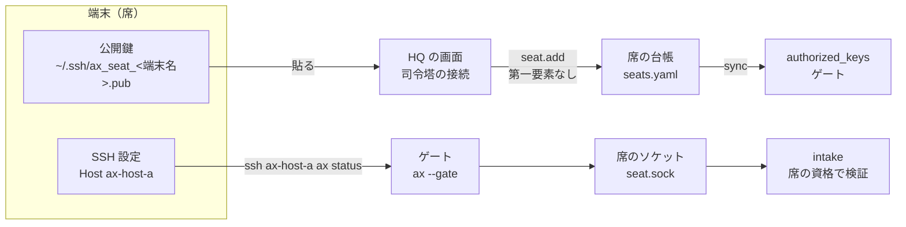

# 席の登録の手順（席を登録する人のための手引き）

この文書は別の端末（Mac や Windows や別の Linux）から `ax` で司令塔として AX を使うための席を作る手順です。席は「1 台の端末 + 1 つの資格（SSH 公開鍵か tailnet のトークン）」です（S-6.8）。登録は HQ（利用者本人が押す唯一の経路）で行います。HQ が使えないときの非常用も書きます。

> 概要（3行）
> 端末で鍵を作り、公開鍵を HQ の「司令塔の接続」画面に貼ります。段は最初は `read`（照会だけ）で、運用に必要な段は利用者が HQ で上げます。席の登録は HQ だけができ、司令塔は自分の席の段を上げられません。

- 対象: 別の端末を司令塔として使う人
- 必要なこと: HQ が使えること、端末から AX のホストへ SSH か tailnet で届くこと
- 索引: `ax` コマンドは [コマンドのリファレンス](../../docs/manual/cli-reference.md)、席と司令塔の安全は [セキュリティ](../../docs/manual/security.md)

## 目次

1. [全体像](#1-全体像)
2. [鍵を作る](#2-鍵を作る)
3. [席の登録](#3-席の登録)
4. [接続の確かめ](#4-接続の確かめ)
5. [段と承認](#5-段と承認)
6. [席を外す](#6-席を外す)
7. [tailnet の席](#7-tailnet-の席)
8. [非常用（HQ が使えないとき）](#8-非常用hq-が使えないとき)
9. [状態](#9-状態)

## 1. 全体像

席は司令塔の資格です。席の ID と身元の ID は同じ値です（`seat_id`。`^[a-z0-9][a-z0-9-]{2,31}$`）。席は自分の段を上げられません。段を上げる `seat.tier` は HQ の操作で、第二要素のコードが要ります（S-6.8、S-6.10）。



- 席の台帳は `${ax_state_dir}/seat/seats.yaml`（権限 0600、所有者 `<user>`、git に入れません）。変えられるのは `intake` だけです。
- 席が失効すると、開いている接続を閉じます。席の失効は `seat_cache_s`（既定 5 秒）以内に効きます（S-6.11）。
- `authorized_keys` への同期は `host/ax-seat.sh sync` が行い、数十秒で使えます。

## 2. 鍵を作る

端末で鍵を作ります（F-9.3）。秘密鍵は端末から出しません。

```bash
ssh-keygen -t ed25519 -f ~/.ssh/ax_seat_<端末名> -C ax-seat:<端末名>
```

Windows は PowerShell の同じコマンドです。端末名は tailnet の端末名（`tailscale status` の名前）に合わせます。

## 3. 席の登録

1. 公開鍵（`.pub`）を HQ の「司令塔の接続」画面に貼ります。端末名、ラベル、段（最初は `read`）を選び、第二要素のコードを入れます。画面に公開鍵の指紋が出るので、端末の指紋と照合します。
2. HQ が `seat.add` を出します。ホスト見張りが `sync` を動かし、台帳の端末名から tailnet アドレスを引いて `from=` を作ります（引けない席は入れません）。数十秒で使えます。
3. 段を上げるときは、HQ で `seat.tier` を出します（第二要素あり）。
4. 席を作るたびに発火する `seats.yaml` の変更は intake が行い、確認と通知を出すため、利用者は直接書きません。

端末名から tailnet アドレスが引けない席は `authorized_keys` に入りません。端末の名前（`device`）と `device_id` が一致しなければ入れません。

## 4. 接続の確かめ

端末側の SSH 設定（値は書かない。鍵のパスと名前だけ書きます。F-9.3）です。

```sshconfig
Host ax-host-a
    HostName host-a.example.invalid
    User ax-seat
    IdentityFile ~/.ssh/ax_seat_<端末名>
    IdentitiesOnly yes
    RequestTTY no
    ServerAliveInterval 30
    ServerAliveCountMax 4
```

使い方です。

```bash
ssh ax-host-a ax status     # 動作の確かめ
ssh ax-host-a 'ax work --project demo --title "調査を出す" --role summary'
ssh -t ax-host-a            # 対話。最初に ax brief --short（25 行以内）が出ます
```

標準入力を渡す操作は次のとおりです。

```bash
ssh ax-host-a ax core change --spec - < spec.yaml
```

日本語の出力のため、端末のロケールを UTF-8 にします（`LANG=C.UTF-8` など。sshd が `LANG` と `LC_*` を受けます）。`ax` の呼び出しで `--agent`、`--model`、`--session` を付けるか、環境変数 `AX_AGENT`、`AX_MODEL`、`AX_SESSION` を設定します。付けなくても動きます。

長い対話は端末側の `ServerAliveInterval` か tmux を使います。tmux と screen はありますが、mosh はありません（F-9.3 の調べた事実）。

無人で動かすハーネスは、承認ダイアログで止まらないよう、`ssh ax-host-a ax …` だけを許可リストに入れます（Claude Code は `--allowedTools "Bash(ssh ax-host-a ax:*)"`）。広い許可は使いません。席の段が危険な操作を止めますが、許可リストは外側の二重の網になります。

## 5. 段と承認

席の段は 3 つです。

| 段 | できます | 例 |
|---|---|---|
| `read` | 照会だけ | `ax status`、`ax todos`、`ax events` |
| `operate` | 取り消せる運用 | `ax work`、`ax control`、`ax answer` |
| `irreversible` | 戻しにくい操作の依頼 | `ax core change` |

`irreversible` の段でも、承認は HQ で利用者本人が出します。席は自分の段を上げられません。`operate` 以上を使うには、司令塔試験に合格し、`config/commander-models.yaml` の `exams` に有効な合格結果があることも要ります。`exams` に有効な合格の結果がない間は有効な段は `read` です。試験の合格と席の段を上げる承認は別の物です。

`ax whoami` で自分の席と段を確かめます（実体は未確認のため、§9 の状態を参照してください）。

## 6. 席を外す

席を失効させたら、その端末の秘密鍵は端末側で捨てます。台帳は日次で `${ax_state_dir}/archive/seat/` へ複製します（削除しません）。

- `seat.revoke`（失効）は、HQ が行う安全側の操作です。第二要素は要りません。自分の席だけ席からでも出せます（`ax seat revoke`。`ssh` と `tailnet` の席だけ）。
- 失効した席が依頼していた承認待ちは却下され（`requester_revoked`）、生きている `issued_by=commander` の命令と保持を外します。他の席と他の作業は止めません。
- `ssh` の席は `authorized_keys` からも外します。ホスト見張りは `sync` を動かし、その席のゲートのプロセスを止めます。目標は `seat_revoke_sync_s`（60 秒）以内です。

非常用（HQ が使えないとき。F-9.3）:

```bash
sudo -n host/ax-seat.sh revoke-all
```

`authorized_keys` を空にし、`ax-seat` のプロセスをすべて止めます（intake が止まっていても動きます）。

## 7. tailnet の席

tailnet の入口（`gate`）の席は登録コードでトークンを得ます（S-6.14）。

1. 利用者が HQ の「司令塔の接続」画面でラベルと段の上限を選び、第二要素を入れます。HQ が `seat.enroll_start` を出し、登録コードを 1 回だけ画面に出します。コードは時系列記録、ログ、通知に出しません。
2. 新しい端末で `ax gate enroll <コード>`（HTTP は `POST /v1/enroll`）を実行します。`gate` が送信元の端末を添えて intake へ渡します。intake がコードを確かめ（1 回限り、`gate_enroll_code_min` 分で切れる）、席を作り、端末に結び付け、トークンを作ります。トークンの値は 1 回だけ返し、保存はダイジェストだけです。
3. 同じ送信元が `gate_enroll_fail_max` 回失敗したら、`gate_enroll_lock_min` 分は登録を受けません。

席の登録と段の変更は `from=hq` の指示で、利用者本人が HQ で承認して行います（S-6.10）。

tailnet の席の接続は `gate`（`${bind_addr}:8909`）経由です。`ax` の接続先は `AX_GATE_URL` と `AX_GATE_TOKEN` です。端末ごとに設定します。

MCP の登録は各ハーネスで異なります。URL は `http://host-a.example.invalid:8909/mcp` の形で、ヘッダは `Authorization: Bearer ${AX_GATE_TOKEN}` です（F-9.4 の表）。導入時に各端末で `--help` か実物で確かめてください。

## 8. 非常用（HQ が使えないとき）

HQ が使えないときの非常用（F-9.3）:

```bash
host/ax-seat.sh add --pubkey-file F --device NAME --tier read
```

作れる席は段 `read` だけです。`--tier` に `read` 以外を渡すと拒否します。実行すると、`${ax_state_dir}/seat/host-ops.log`（JSON Lines。権限 0600。秘密を含まない）に 1 行追記し、ntfy に「ホストから席が登録された」と送ります。intake がこの行を読んで `seat.host_added` を書き、HQ に 24 時間の警告を出します。段を上げるのは HQ の `seat.tier`（第二要素あり）だけです。

`tailnet` の席の非常用（HQ が使えないとき。S-6.14）:

```bash
host/ax-gate-revoke.sh <seat_id>
```

`${ax_state_dir}/gate/revoked.d/<seat_id>` を置きます。`gate` は要求ごとにこのディレクトリを見て、置かれた席を拒否します（権限を減らす操作なので、この経路で足ります）。印は消しません。

席の自動停止（S-6.11）も席ごとにあります。席が `commander_rate_window_min`（10 分）の間に `commander_rate_max`（60）を超える指示を出す、または拒否が `commander_reject_suspend`（5）回続くと、その席は `suspended`（読むだけ許す）となり、カードで利用者に知らせます（`seat.suspended`）。再開は HQ だけです（`seat.resumed`）。

## 9. 状態

コードの現物で確かめました（未確認の部分は正直に書きます）。

### 確かめたこと

- `host/ax-seat.sh` が `host/lib/ax_gate.py` の `main()`（ゲート）と `host_main()`（ホスト操作）を呼ぶこと。ホスト操作は `install`、`sync`、`revoke-all`、`status`、`add` です。
- `authorized_keys` の 1 行の形（`restrict,pty,from="…",command="/usr/local/lib/ax-seat/ax --gate <seat_id>"`）は `host/lib/ax_gate.py` の `authorized_lines()` です。
- sshd の drop-in（`/etc/ssh/sshd_config.d/20-ax-seat.conf`。`Match User ax-seat`）は `host/sshd-dropin/20-ax-seat.conf` です。既存のユーザー（司令塔のユーザーと root）の実効値は変えません。
- 席の台帳は `${ax_state_dir}/seat/seats.yaml` です（F-9.3）。
- HQ の「司令塔の接続」画面は `core/hq/seats/render.py` の `seat_page()` です。操作は `seat.enroll_start`、`seat.tier`、`seat.revoke`、`seat.lock`、`seat.unlock` です。
- `/v1/read/*` の読み取りのうち、ローカルで使えるのは `status`、`todos`、`events` の 3 つだけです（`core/intake/dest/b12/read_relay.py` の `QUERY_KEYS`）。`brief`、`whoami` 等は未実装です。
- `ax seat revoke` の行き先（`seat.revoke`）は `ssh` と `tailnet` の席だけが出せます（`config/intake-destinations.d/b12b2.yaml` の `via`）。`local` は席を持たないため出せません。

### 未確認（B12b と B17 で確かめます。F-9.3 の未確認）

- `Match` が drop-in の末尾まで効くか。`ExposeAuthInfo` の指紋が `SSH_USER_AUTH` から取れるか。
- `tailnet` の端末のアドレスが変わると `from=` が合わなくなり、その席は閉じます。`sync` はホスト見張りの周期でも動かし、端末名から引き直したアドレスで `from=` を更新します。引けなければ閉じたままなので、HQ で登録し直します。
- `tailscale status --json` を `sudo -n` で動かして端末名とアドレスを突き合わせる処理は、設計だけで実測していません。
- Codex CLI、opencode、Cursor、Gemini CLI で `ssh … ax …` を許可リストに入れる記法は知識で書いたものです。導入時に各端末で `--help` を確かめます。
- `ax gate enroll` は `POST /v1/enroll` 経由です（S-6.14）。ローカルの `ax` では使えません。
